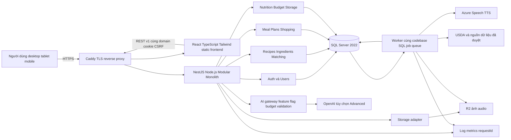
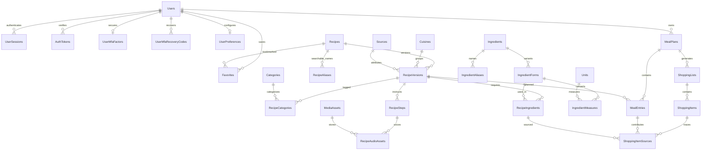
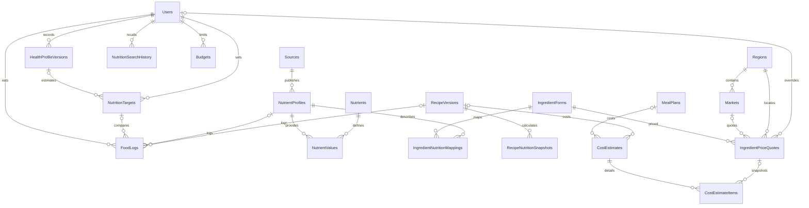
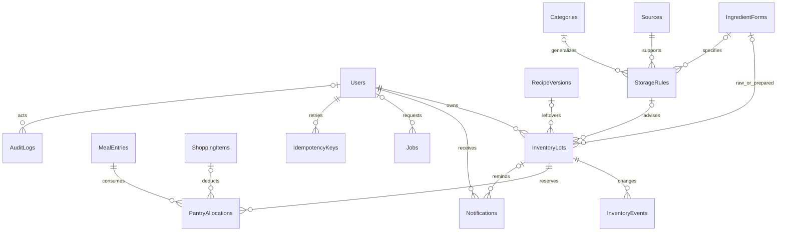
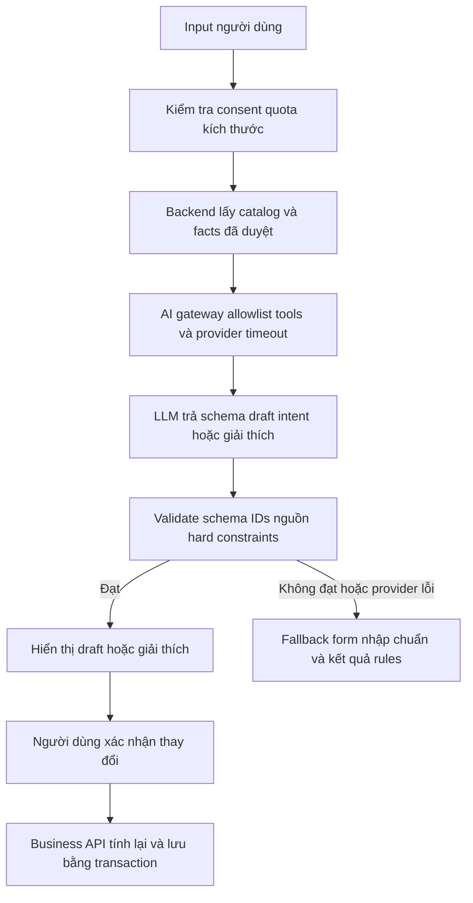

# Cookora Master Project Plan

**Kế hoạch sản phẩm, kiến trúc và triển khai Cookora – Bếp Nhà**  
Ngày lập: **31/10/2026** · Phiên bản: **1.4** · Ngôn ngữ sản phẩm ban đầu: tiếng Việt  
Đầu vào: toàn bộ nội dung `C:/Users/reiko/Downloads/web cookara.docx` và yêu cầu trong `Pasted text.txt`. Đây là tài liệu phân tích và đặc tả; chưa triển khai source code.

**Cập nhật v1.4:** Phạm vi [300 đề tài công thức](C:/Cookara/docs/Cookora-Recipe-Backlog-300.md) gồm **150 món Việt và 150 món nước ngoài**, mỗi nhóm Hàn/Nhật/Trung/Thái/Ý/Âu Mỹ khác 25 món. Giữ toàn bộ 100 mã ban đầu và 7 bản thảo; M0–M1 giữ nguyên, M2 được phân bổ lại; pilot/MVP 100 món là mốc kiểm chứng trước khi hoàn thiện 300 món.

**Bổ sung v1.1 theo yêu cầu:** vai trò Content Strategist/Culinary Researcher/Recipe Developer/Food Editor, chiến lược thư viện đa quốc gia, research, danh mục và bài mẫu. Xem mục 16, [Content Strategy and Research](C:/Cookara/docs/Cookora-Content-Strategy-and-Research.md) và [Content Starter Pack](C:/Cookara/docs/Cookora-Content-Starter-Pack.md). Quy trình nội dung này chạy song song với phát triển phần mềm.

## 0. Tóm tắt toàn bộ tài liệu Cookora

Cookora – Bếp Nhà giúp người dùng khám phá món ăn và tổ chức việc nấu ăn hằng ngày, hướng đến sinh viên, người sống một mình, người mới học nấu ăn và người thường không biết chọn món gì. Giá trị xuyên suốt là giảm công sức quyết định, chuẩn bị đúng khẩu phần, đi chợ có kế hoạch và sử dụng thực phẩm hợp lý.

Tài liệu Word mô tả đầy đủ **10 nhóm chức năng**:

| Mã | Chức năng gốc | Nội dung đã được mô tả |
|---|---|---|
| G01 | Khám phá công thức | Món Việt, Hàn, Nhật, Trung, Thái, Ý và phương Tây; tìm theo tên, nguyên liệu, thời gian, danh mục. |
| G02 | Hướng dẫn nấu ăn | Ảnh món, nguyên liệu, định lượng theo người ăn, thời gian chuẩn bị/nấu, các bước thực hiện; mong muốn thêm giọng AI đọc hướng dẫn. |
| G03 | Có gì nấu nấy | Nhập nguyên liệu đang có; gợi ý món, mức độ phù hợp và nguyên liệu còn thiếu. Đây là tính năng nổi bật được chỉ rõ. |
| G04 | Điều chỉnh khẩu phần | Thay đổi số người ăn và tính lại lượng nguyên liệu để giảm thừa/thiếu. |
| G05 | Thực đơn tuần | Chọn món cho tuần và số người; tổng hợp danh sách nguyên liệu, định lượng để mua một lần có kế hoạch. |
| G06 | Yêu thích | Lưu và tìm lại công thức. |
| G07 | Eat Fit | Nhập giới tính, chiều cao, cân nặng, vận động, mục tiêu giảm mỡ/tăng cơ/duy trì; ước tính nhu cầu và gợi ý thực đơn. |
| G08 | Chi phí và ngân sách | Chi phí từng nguyên liệu/món; tự cập nhật theo khẩu phần; ngân sách ngày/tuần; tổng tiền thực đơn; gợi ý món theo ngân sách còn lại; tự cập nhật giá theo nơi mua. Ví dụ 300.000 VNĐ/7 ngày là tình huống minh họa, không phải mức ngân sách mặc định. |
| G09 | Bảo quản và thức ăn thừa | Hướng dẫn ngăn mát/ngăn đông, thời gian khuyến nghị, đóng gói/chia phần/hâm nóng; ghi thức ăn dư; nhắc kiểm tra trước hạn; gợi ý tận dụng. Tài liệu yêu cầu nguồn an toàn đáng tin cậy, xét nhiệt độ/cách bảo quản và không kết luận an toàn chỉ bằng cảm quan. |
| G10 | Calories và dinh dưỡng | Tìm món/nguyên liệu; kcal/100g hoặc khẩu phần; protein, carbohydrate, fat, một số vi chất; nhập khối lượng; lưu lịch sử tra cứu; nhật ký món đã ăn và tổng kcal ngày; so với Eat Fit. |

Yêu cầu trong tệp văn bản bổ sung phạm vi lập kế hoạch: giữ **React, Node.js, Tailwind CSS, Microsoft SQL Server và Docker**, thiết kế REST API, database, UI/UX, AI, DevOps, roadmap, backlog, chi phí và rủi ro. **Không bắt đầu lập trình.**

**Khuyến nghị chính:** xây dựng Modular Monolith bằng React + TypeScript, NestJS trên Node.js, Prisma ORM 7 và SQL Server 2022; đưa luồng **tìm món → điều chỉnh khẩu phần → xếp thực đơn → tổng hợp đi chợ** thành MVP. Hướng dẫn bằng TTS có thể cung cấp ngay trong MVP bằng âm thanh tạo trước. Eat Fit, chi phí đầy đủ và quản lý thức ăn thừa được triển khai tiếp sau khi chuẩn hóa dữ liệu. AI/LLM chỉ hỗ trợ hiểu câu hỏi và giải thích gợi ý; mọi phép tính, hạn chế an toàn và lựa chọn dữ liệu đều do backend kiểm soát.

### 0.1. Cách đọc nguồn gốc yêu cầu

- **[G01…G10]**: yêu cầu có trong Word, được tóm tắt ở trên.
- **[R]**: yêu cầu trực tiếp trong tệp văn bản, ví dụ công nghệ bắt buộc, Admin Dashboard, REST, Docker, Mermaid.
- **[T]**: quyết định/giả định kỹ thuật đề xuất, chưa phải yêu cầu kinh doanh đã xác nhận.
- **[X]**: ý tưởng mở rộng tùy chọn, không đưa vào cam kết MVP nếu chưa chọn.
- **MVP / P2 / ADV**: độ ưu tiên sản phẩm; **F1…F4**: giai đoạn thực hiện ở mục 11. P2 không đồng nghĩa F2.

Mọi ngưỡng hiệu năng, quy mô, nhân lực, giá nội bộ, thời lượng và KPI trong tài liệu là **[T] dùng để lập kế hoạch**, phải đo hoặc xác nhận trước khi cam kết. Nguồn kỹ thuật và giá dịch vụ được kiểm tra ngày 31/10/2026; không xem giá là báo giá hợp đồng.

### 0.2. Giả định và giới hạn phạm vi

| Mã | Giả định [T] | Tác động nếu thay đổi |
|---|---|---|
| T01 | Nhóm 2 dev full time, 1 người thiên FE và 1 thiên BE; PM/UX 0,3 FTE; QA 0,5 FTE từ MVP; có người phụ trách nội dung | Thiếu QA/nội dung kéo dài roadmap; xem mục 11. |
| T02 | Bản đầu tiếng Việt, VNĐ, thị trường Việt Nam; dữ liệu có trường quốc gia/vùng | Đa ngôn ngữ, đa tiền tệ cần thêm dịch thuật và chính sách quy đổi. |
| T03 | Một tài khoản sở hữu kế hoạch và nhật ký riêng; chưa chia sẻ hộ gia đình | Chia sẻ cộng tác làm tăng phân quyền và xử lý xung đột. |
| T04 | Người dùng công khai không tự đăng công thức; biên tập viên quản lý thư viện | UGC cần moderation, báo cáo vi phạm, quyền sở hữu và chống spam. |
| T05 | Pilot 100–300 công thức được duyệt, 200–400 nguyên liệu/dạng; tối đa 10.000 công thức, 1.000 MAU và 50 phiên hoạt động đồng thời để lập cấu hình ban đầu | Đây là dữ liệu kiểm thử/mục tiêu, không phải capacity đã đo. |
| T06 | Eat Fit tự ước tính chỉ cho người trưởng thành đủ điều kiện; tuổi là thông tin bổ sung cần xác nhận | Chưa có tuổi không thể chạy công thức năng lượng được đề xuất. |
| T07 | Nhắc bảo quản trong ứng dụng là bản đầu; push/email cần opt-in ở P2/ADV | Không hứa nhắc khi app đóng nếu chưa có kênh ngoài ứng dụng. |
| T08 | Đọc giọng nói là TTS; điều khiển bằng lời và hội thoại hai chiều là [X] | Không đồng nhất yêu cầu “giọng AI” với trợ lý realtime. |

## 1. Product Vision và phân tích yêu cầu

### 1.1. Định vị và bài toán

**Vision:** giúp một người từ “hôm nay ăn gì” đến “đã có kế hoạch và đủ nguyên liệu để nấu” trong một luồng ngắn, dễ hiểu. Website công thức thông thường giải quyết tìm thông tin từng món; Cookora kết nối thông tin đó với những gì người dùng có, số người ăn, thời gian, mục tiêu và tiền dự kiến.

| Nhóm người dùng | Tình huống | Giá trị ưu tiên | Thiết kế cần đáp ứng |
|---|---|---|---|
| Sinh viên | Ít tiền, ít thiết bị, nguyên liệu còn lẻ | Có gì nấu nấy; xem thiếu gì; món đơn giản; ngân sách | Không bắt điền hồ sơ sức khỏe khi chỉ tìm món; hiển thị chi phí thiếu dữ liệu. |
| Sống một mình | Công thức thường cho nhiều người; nguyên liệu dễ thừa | Khẩu phần 1–2; thực đơn tận dụng nguyên liệu | Tách lượng dùng và quy cách mua; giữ số lẻ hợp lý. |
| Mới học nấu | Không hiểu thao tác; tay đang bận | Các bước ngắn, ảnh, giọng đọc, timer [X] | Nút lớn, có đọc lại, không tự chuyển bước. |
| Người bận rộn | Quyết định bữa ăn và đi chợ nhiều lần | Thực đơn tuần; danh sách mua sắm | Cho chọn mua theo đợt; cảnh báo khả năng bảo quản. |
| Quan tâm dinh dưỡng | Tra cứu và ghi lại bữa ăn | Dữ liệu có nguồn; mục tiêu Eat Fit; nhật ký | Nêu ước tính, dữ liệu thiếu, đơn vị và phần ăn thực tế. |
| Editor/Admin [R/T] | Cần kiểm soát công thức và dữ liệu | Quản lý dữ liệu, duyệt nội dung, audit | Validation trước xuất bản và phân quyền riêng. |

**USP đề xuất:** món phù hợp với nguyên liệu thực có; một tập dữ liệu định lượng dùng chung cho khẩu phần, đi chợ, dinh dưỡng và chi phí; giải thích kết quả bằng “đang có/thiếu/chưa rõ” thay vì một điểm AI khó kiểm chứng; nội dung món Việt được chuẩn hóa và kiểm duyệt.

Khác biệt này là định hướng sản phẩm, **chưa phải tuyên bố đã khảo sát toàn bộ đối thủ**. Nên phỏng vấn 8–12 người thuộc ba nhóm đầu và thử prototype với 5 người trước khi chốt UI.

### 1.2. Phạm vi MVP và những gì cần trì hoãn

**MVP có thể phát hành:** tài khoản, nội dung do editor quản lý, khám phá công thức, chi tiết/cooking mode, đọc TTS công thức đã duyệt, điều chỉnh khẩu phần, Có gì nấu nấy bằng thuật toán, yêu thích, thực đơn tuần và danh sách đi chợ. Hướng dẫn bảo quản tĩnh có nguồn được đưa sớm để hỗ trợ kế hoạch mua cả tuần.

**P2:** dữ liệu giá + ngân sách, tra cứu dinh dưỡng + nhật ký, Eat Fit cơ bản, ghi thực phẩm/thức ăn dư và nhắc trong ứng dụng. **ADV:** tối ưu đa mục tiêu, LLM diễn giải/ngôn ngữ tự nhiên, push/email bảo quản, điều khiển giọng nói nếu được chọn.

Không bỏ G07–G10: chúng có thiết kế trong bản kế hoạch và các mốc nghiệm thu riêng, nhưng không chặn kiểm chứng nhu cầu cốt lõi.

### 1.3. Chỉ số kiểm chứng [T]

| Chỉ số | Cách đo | Ngưỡng thử nghiệm ban đầu |
|---|---|---|
| Hoàn thành tác vụ chính | Người thử tự chọn 3 món và tạo danh sách đi chợ | ≥ 80% trong usability test; không suy rộng thành KPI thị trường. |
| Thời gian lập kế hoạch đầu tiên | Từ mở planner đến lưu ít nhất 3 bữa | Median ≤ 5 phút trong pilot. |
| Chất lượng gợi ý | Người thử đánh giá top 5 món với pantry của họ | ≥ 70% phiên có ít nhất 1 món phù hợp; bộ 50 ca kiểm duyệt. |
| Chất lượng dữ liệu MVP | Công thức xuất bản qua checklist | 100% có lượng/đơn vị hoặc cờ “tùy khẩu vị”, bước nấu, nguồn/quyền ảnh. |
| Độ chính xác phép tính | Bộ fixture khẩu phần/đơn vị/gộp shopping | 100% ca xác định; không chấp nhận “gần đúng do LLM”. |
| Sử dụng lặp lại | Tỷ lệ tài khoản có planner quay lại trong 7 ngày | Đo baseline 4 tuần trước khi đặt target tăng trưởng. |

### 1.4. Các mở rộng có giá trị với chi phí thấp

| Mã | Đề xuất [X] | Lý do | Ưu tiên và chi phí tương đối |
|---|---|---|---|
| X01 | Timer theo bước | Hữu ích lúc nấu; không cần AI | MVP nếu dư 1–2 ngày; timer theo timestamp, không dựa setInterval chính xác tuyệt đối. |
| X02 | In danh sách đi chợ/CSV | Dùng được trên giấy và gửi thủ công | Cuối MVP, 1–2 ngày; chưa có chia sẻ tài khoản. |
| X03 | Lọc theo dụng cụ | Sinh viên chỉ có nồi cơm/bếp điện | P2, 2–4 ngày và công gắn nhãn nội dung. |
| X04 | Khai báo tránh nguyên liệu/dị ứng | Bộ lọc cứng cho planner | P2 cùng Eat Fit; không tuyên bố bảo đảm không nhiễm chéo. |
| X05 | PWA/offline công thức đã chọn | Hữu ích khi mạng bếp yếu | ADV; cần version cache và xóa dữ liệu riêng khi logout. |

Các con số trên là dev-days cho phần bổ sung sau nền tảng, chưa gồm thời gian chuyên gia và QA toàn luồng.

## 2. Lựa chọn công nghệ

### 2.1. Quyết định cụ thể

| Thành phần | Chọn [T] | Mục đích và lý do | Ưu tiên | Chi phí dịch vụ dự kiến |
|---|---|---|---|---|
| Frontend | React + Vite + TypeScript strict | SPA dễ triển khai, typed data contract; không thay React | MVP | Không phí bản quyền dự kiến; tính chi phí nhân công/hosting riêng. |
| Styling | Tailwind CSS + CSS tokens | Responsive, design system nhất quán | MVP | Không phí dịch vụ. |
| Routing | React Router, declarative/data routing | Route public/private, lazy page, error boundary | MVP | Không phí dịch vụ. |
| Server state | TanStack Query | Cache dữ liệu server, invalidate, trạng thái pending/error | MVP | Không phí dịch vụ. |
| Client state | Zustand chỉ cho cooking mode/draft UI | Tránh store toàn bộ response; URL giữ bộ lọc | MVP | Không phí dịch vụ. |
| Form | React Hook Form + Zod | Validation sớm, thông báo theo trường; server vẫn kiểm tra độc lập | MVP | Không phí dịch vụ. |
| UI | shadcn/ui dựa Radix + Lucide | Component có thể chỉnh, keyboard/focus; không copy phong cách sản phẩm khác | MVP | Không phí dịch vụ; vẫn cần QA accessibility. |
| HTTP | native fetch wrapper, client types từ OpenAPI | Ít dependency; timeout, cookie, CSRF, lỗi thống nhất | MVP | Không phí dịch vụ. |
| Chart | Recharts | Kcal/macro, ngân sách ngày/tuần | P2 | Không phí dịch vụ. |
| Kéo thả | dnd-kit, chỉ thêm sau planner cơ bản | Desktop planner; mobile luôn có nút Chuyển bữa | P2 | Không phí dịch vụ. |
| Runtime | Node.js 24 LTS, pin patch đã vá khi khởi tạo | Nhánh trưởng thành; kiểm tra tương thích ORM/adapter trong Sprint 1 | MVP | Không phí dịch vụ. |
| Backend | NestJS dùng Express adapter + TypeScript | Module, DI, Guard, Pipe, Filter, OpenAPI, test | MVP | Không phí dịch vụ. |
| ORM | Prisma ORM **7**, `@prisma/adapter-mssql`, pin cả CLI/client/adapter | Type-safe query, migration; bổ sung T-SQL cho feature đặc thù | MVP | ORM dùng local không cần thuê nền tảng Prisma. |
| Database | SQL Server 2022, schema `dbo` | Decimal, transaction, FK/index, dữ liệu quan hệ | MVP | Developer cho dev/test; Express cho production nhỏ; Standard có phí khi cần nâng. |
| Auth | Session opaque lưu SQL Server, Argon2id hash mật khẩu | Thu hồi tức thì, phù hợp web cùng domain; chưa cần JWT refresh phức tạp | MVP | Không phí dịch vụ; email giao dịch dự trù ở mục 12. |
| API contract | Nest OpenAPI/Swagger | FE/BE thống nhất schema và error code | MVP | Không phí dịch vụ. |
| Giọng đọc | Azure Speech TTS `vi-VN-HoaiMyNeural`, tạo trước khi xuất bản | Phát lại nhanh, không cần LLM để đọc chữ | MVP | Theo ký tự tổng hợp; dự trù ở mục 12. |
| AI văn bản | OpenAI Responses API, `gpt-5.4-mini-2026-03-17` sau eval | Hiểu yêu cầu tự nhiên, giải thích lựa chọn đã được kiểm tra | ADV | Theo token, hard cap; xem mục 9/12. |
| Ảnh/audio | Cloudflare R2 Standard qua S3 API | Object storage riêng, metadata trong SQL; SDK AWS S3 có thể dùng | MVP | Theo storage/operations; ngân sách 0–5 USD pilot, xem mục 12. |
| Proxy/TLS | Caddy | HTTPS tự động, reverse proxy và static assets | MVP | Không phí dịch vụ; domain riêng. |
| Container | Docker Engine + Docker Compose | FE, API, SQL, migration job và worker cùng codebase | MVP | Hạ tầng; kiểm tra điều khoản Docker Desktop theo tổ chức. |
| CI/CD | GitHub Actions + GHCR | Kiểm tra, build image, staging, deploy version cố định | MVP | Dự trù 0–20 USD/tháng tùy runner/minutes. |
| Log/monitor | Pino JSON + metrics Prometheus; Grafana khi cần dashboard | RequestId, lỗi, thời gian SQL, resource, backup | MVP tối thiểu; dashboard P2 | Có thể tự host; phải tính tài nguyên. |

Các thư viện OSS không đồng nghĩa mọi gói thương mại/hosting của nhà cung cấp đều miễn phí. Kiểm tra license trong CI khi khóa dependency.

Nguồn kỹ thuật: [React Router](https://reactrouter.com/start/declarative/installation), [TanStack Query](https://tanstack.com/query/latest/docs/framework/react/overview), [Tailwind với Vite](https://tailwindcss.com/docs/installation/using-vite), [Node.js releases](https://nodejs.org/en/about/previous-releases), [NestJS](https://docs.nestjs.com/).

Tham chiếu form/UI: [React Hook Form](https://react-hook-form.com/), [Zod](https://zod.dev/), [shadcn/ui](https://ui.shadcn.com/docs). Chọn bộ component Radix khi khởi tạo; xác nhận phiên bản cùng React và Tailwind trong Sprint 1 thay vì trộn các adapter UI không tương thích.

**Lưu ý có ảnh hưởng trực tiếp:** tài liệu Prisma hiện nêu SQL Server chưa có library ORM 8 và khuyên dùng ORM 7 cho database này. Vì vậy không chạy nâng cấp major tự động sang 8. ORM 7 có SQL Server connector và adapter MSSQL; cần kiểm tra migration, Decimal, rowversion, native constraints trong spike. Xem [Prisma supported databases](https://www.prisma.io/docs/orm/supported-databases) và [SQL Server connector v7](https://docs.prisma.io/docs/orm/v7/core-concepts/supported-databases/sql-server).

### 2.2. TypeScript so với JavaScript

| Tiêu chí | JavaScript | TypeScript | Kết luận |
|---|---|---|---|
| Bắt đầu | Ít cấu hình | Có compiler/types | Chấp nhận thêm cấu hình. |
| Đơn vị, DTO, trạng thái tính toán | Lỗi thường lộ lúc runtime | Có thể biểu diễn union `known/partial/unavailable` | TS phù hợp domain nhiều phép tính. |
| Refactor nhiều module | Dựa test và quy ước | Compiler hỗ trợ đổi field/API | Chọn TS cả FE/BE. |
| Giới hạn | Không check compile | Types mất khi runtime; không tự kiểm chứng JSON | Vẫn cần Zod/DTO validation và DB constraints. |

Đề xuất typed quantity chứa `value`, `unitCode`, `basis`, không truyền một số trần cho mọi khối lượng. Không chia sẻ entity/database model trực tiếp ra frontend.

### 2.3. Express so với NestJS

| Tiêu chí | Express thuần | NestJS trên Express |
|---|---|---|
| Boilerplate | Nhẹ lúc đầu; tự xây module/auth/error convention | Nhiều cấu trúc ban đầu; sẵn convention |
| Quy mô 10 nhóm chức năng | Cần team tự duy trì kỷ luật dependency | Module và DI phù hợp nhiều miền nghiệp vụ |
| Validation/permission/docs | Tự ghép và chuẩn hóa | Guard/Pipe/Filter/OpenAPI tích hợp workflow |
| Nhân lực | Tốt với prototype nhỏ, người quen Express | Tốt với dự án dài hạn có FE/BE song song |
| Trade-off | Dễ lệch cấu trúc khi mở rộng | Có learning curve decorators/DI |

**Chọn NestJS**, dùng một application deploy. Không thêm CQRS/event sourcing/microservices trong MVP. Các sự kiện nội bộ chỉ dùng cho công việc phụ như tạo audio, không tách domain thành dịch vụ mạng.

### 2.4. ORM và database access

| Lựa chọn | Điểm mạnh | Hạn chế | Quyết định |
|---|---|---|---|
| Prisma 7 | Typed client, schema/migration tập trung | Phải quản lý tính năng SQL Server ngoài schema; major 8 chưa hỗ trợ SQL Server theo docs hiện tại | **Chọn**, khóa version và spike ngay F1. |
| TypeORM | Tích hợp Nest, hỗ trợ MSSQL, query builder | Entity decorators và migration cần kiểm soát; tránh schema sync production | Phương án thay trong F1 chỉ khi spike ORM thất bại, ghi ADR. |
| `mssql` trực tiếp | Toàn quyền T-SQL, phù hợp query đặc thù | Nhiều mapping/boilerplate hơn | Chỉ dùng qua adapter/repository đặc thù khi ORM không biểu diễn được. |

Filtered unique index, CHECK, `rowversion` và locking query có thể cần migration T-SQL được review. `nvarchar(max)` chứa JSON chỉ dành cho snapshot/audit có schema version; **không dùng thay quan hệ nguyên liệu–công thức**. Decimal không serialize thành IEEE float rồi tính tiền bằng JavaScript Number.

## 3. Phân rã chức năng và độ ưu tiên

### 3.1. Ma trận phạm vi

| Nhóm | MVP | P2 | Advanced | Độ phức tạp 1–5 |
|---|---|---|---|---|
| G01 Discovery | Tìm kiếm có dấu/không dấu, filter, phân trang | Dụng cụ [X03], xếp hạng theo lịch sử opt-in | Cá nhân hóa học từ dữ liệu | 3 |
| G02 Cooking | Chi tiết, từng bước, TTS tạo trước, khẩu phần | TTS động theo phần ăn nếu cần | Speech commands/hội thoại [X] | 3; hội thoại 5 |
| G03 Có gì nấu nấy | Chọn ingredient chuẩn, tùy chọn lượng, thiếu gì, điểm giải thích được | Pantry lưu lâu, ưu tiên gần hạn | Hiểu câu tự nhiên và gợi ý thay thế đã duyệt | 4 |
| G04 Serving | Quy đổi/scaling, rounding có hướng dẫn | Quy tắc thiết bị, mẻ lớn | Chia mẻ nâng cao | 3 |
| G05 Planner | CRUD tuần/bữa, số phần, gộp shopping, checklist | Copy tuần, kéo thả, mua nhiều đợt | Tối ưu tự động đa ràng buộc | 4 |
| G06 Favorites | Lưu/bỏ lưu, xem riêng | Collections nếu được chọn [X] | Chia sẻ nếu được chọn [X] | 1 |
| G07 Eat Fit | Chưa đưa vào MVP | Hồ sơ + target + menu theo rule đã duyệt | Tối ưu nhiều mục tiêu, LLM giải thích | 5 |
| G08 Budget | Chuẩn bị domain dữ liệu, không hứa tổng tiền đầy đủ | Giá cá nhân/vùng, món/ngày/tuần, còn lại, gợi ý | Quy cách gói, tối ưu chi phí | 4 |
| G09 Storage | Nội dung bảo quản tĩnh có nguồn | Lưu lot/thức ăn dư, nhắc trong app, gợi ý tận dụng | Push/email opt-in, sự kiện rã đông | 4–5 |
| G10 Nutrition | Chuẩn bị schema/provenance | Search, 100g/khẩu phần, vi chất, lịch sử, log ngày, liên kết target | Yield/retention chuyên sâu | 4–5 |

Chi phí công việc ước tính nằm trong backlog và roadmap; điểm phức tạp không phải số ngày. Những chức năng gốc bị dời vẫn được nghiệm thu ở milestone P2.

### 3.2. G01 Recipe Discovery

**Giá trị:** tìm món theo điều kiện thực tế, đọc được không cần tài khoản.

**User flow:** mở `/cong-thuc` → gõ tên/nguyên liệu → chọn món Việt/Hàn/Nhật/Trung/Thái/Ý/phương Tây, thời gian, danh mục → xem kết quả → mở món → giữ bộ lọc khi quay lại. Nếu không có kết quả, gợi ý bỏ một bộ lọc; không tự thay truy vấn người dùng.

**Màn hình/components:** recipe explorer, thanh tìm kiếm, ingredient chips, filter drawer, result count, recipe card, pagination, empty/error/loading skeleton. Trên mobile dùng drawer, hiển thị số filter đang bật.

**FE:** debounce ~300ms [T], URL search params, hủy request cũ, lazy images; kết quả cuối cùng theo request hiện tại. **BE:** chỉ trả revision đã publish; validate query, allowlist sort, query theo index, normalize tiếng Việt; ghép filter với ý nghĩa AND giữa nhóm, OR trong cùng danh mục nếu API ghi rõ. IngredientIds dùng `match=all|any`.

**API:** `GET /recipes`, `/recipes/{slug}`, `/categories`, `/cuisines`, `/ingredients`. **DB:** Recipes, RecipeVersions, RecipeIngredients, Categories, Cuisines, RecipeCategories, MediaAssets, Ingredients, IngredientAliases, IngredientForms. **Thuật toán:** search normalized name + alias, prefix/ranking đơn giản; full-text chỉ bổ sung sau đo. **Ngoại lệ:** ký tự `%/_` phải escape khi dùng LIKE; alias mơ hồ cần chọn; công thức bị thu hồi hiển thị trang unavailable; không để unpublished qua ID. **Mức:** 3/5, MVP. **Nghiệm thu:** tìm “thit kho” ra “Thịt kho”, filter thời gian dùng totalElapsedMinutes đã review, gồm thời gian chờ bắt buộc và ghi preconditions, pagination không lặp khi cùng sort; dữ liệu 10.000 công thức đạt budget hiệu năng mục 11.

### 3.3. G02 Cooking Guide và giọng đọc

**Giá trị:** người mới có thể làm theo từng bước, nghe khi tay bận.

**User flow:** chi tiết món → chọn khẩu phần → xem nguyên liệu đã tính → “Bắt đầu nấu” → bước hiện tại → đọc/tạm dừng/đọc lại/chuyển bước thủ công → hoàn thành. Quay lại phiên đang nấu khôi phục revision, khẩu phần, bước; không tự đánh dấu đã ăn.

**Màn hình/components:** recipe detail; `/cong-thuc/:slug/nau`; step card, ingredient list, serving control, progress, audio controls, optional timer X01. Giao diện cook mode ít phân tán, chữ tối thiểu 18px [T].

**FE:** local state lưu tiến độ theo recipeVersion; dừng audio cũ trước bước mới; chỉ phát sau tương tác; screen wake lock nếu trình duyệt hỗ trợ [X]. **BE:** trả bước có thứ tự; worker tạo TTS từ văn bản đã duyệt, cache theo content hash + locale + voice; upload audio R2; API cung cấp manifest. **Quan trọng:** audio tạo trước đọc nguyên liệu theo công thức gốc; UI thông báo khẩu phần gốc, không đọc lượng sai sau scaling. MVP viết bước ưu tiên thao tác và đọc lượng trong danh sách riêng; audio động theo khẩu phần là P2, có limit và hash tham số.

**API:** recipe detail, `GET /recipes/{id}/versions/{version}/audio`, `POST /ai/cooking-audio` chỉ P2 nếu âm thanh theo tham số; `GET /jobs/{id}`. **DB:** RecipeVersions, RecipeSteps, RecipeIngredients, RecipeAudioAssets, MediaAssets, Jobs. **Tech:** HTMLAudioElement, Azure TTS; đọc văn bản không dùng LLM. Azure có giọng tiếng Việt [nguồn voice support](https://learn.microsoft.com/en-us/azure/ai-services/speech-service/language-support?tabs=tts).

**Ngoại lệ:** autoplay bị chặn → nút phát; TTS/provider lỗi → còn chữ và retry worker; mất mạng → bước đang tải vẫn hiển thị, chưa hứa offline hoàn toàn; recipe update không thay revision đang nấu; đổi khẩu phần không tự nhân thời gian/nhiệt độ. **Mức:** 3/5, MVP; hội thoại 5/5, ADV [X]. **Nghiệm thu:** play/pause/replay, chuyển bước không chồng audio, nghe thử toàn bộ tập seed tiếng Việt, TTS downtime không chặn nấu.

### 3.4. G03 Có gì nấu nấy

**Giá trị:** biến nguyên liệu sẵn có thành lựa chọn có thể thực hiện, kèm phần cần mua thêm.

**User flow:** vào `/co-gi-nau-nay` → nhập/chọn ingredient chuẩn → chọn dạng sống/chín, tùy chọn lượng/đơn vị → chọn khẩu phần và filter → xem top món, điểm, đang đủ/thiếu/chưa rõ lượng → mở món → thêm vào planner hoặc thêm phần thiếu vào shopping. Có thể bỏ qua lượng, nhưng kết quả chỉ có mức khớp danh tính.

**Màn hình:** form pantry ad hoc, ingredient autocomplete có alias và xác nhận, quantity rows, mode “Có nguyên liệu”/“Đủ định lượng”, match cards và missing drawer. FE không tự suy đoán 1 bó = 100g. BE normalize ID/form/unit, tính score theo mục 4, hard filters trước ranking và trả breakdown từng nguyên liệu. Lưu pantry lâu dài chỉ ở P2; input ad hoc của khách không lưu phía server ngoài log kỹ thuật đã giảm thiểu.

**API:** `POST /recipes/match`, `GET /ingredients`, `GET /ingredients/{id}/forms`, `POST /shopping-lists/{id}/items` cho phần thiếu, P2 `/storage/items`. **DB:** Ingredients, IngredientAliases, IngredientForms, IngredientMeasures, RecipeIngredients, ShoppingItems; P2 InventoryLots. **Thuật toán:** exact ID + alias mapping + weighted coverage; không cần LLM. **Ngoại lệ:** chưa biết quantity, dạng sống/chín khác nhau, nguyên liệu tùy khẩu vị, allergy [X04], lot hết hạn, thiếu mapping đơn vị, nhiều dòng cùng nguyên liệu, không có công thức → trả trạng thái và đề nghị thêm nguyên liệu. Không để AI tự tạo món như công thức đã xác minh.

**Mức:** 4/5, MVP. **Nghiệm thu:** điểm và nguyên liệu thiếu khớp fixture; quantity unknown không thành “đủ”; ingredient không có không trở thành “có” do semantic similarity; khi nhiều món dùng cùng pantry, planner có reservation để không sử dụng cùng lượng hai lần.

### 3.5. G04 Serving Calculator

**Giá trị:** mua và nấu đúng số người. **Flow:** chọn 1–20 phần [T/MVP] → backend trả định lượng, đơn vị hiển thị, cảnh báo → frontend cập nhật danh sách, khi mở cost/nutrition sẽ dùng cùng scale.

**Màn hình:** serving stepper ở recipe, match và planner; tooltip quy tắc làm tròn, chú thích “nêm lại theo khẩu vị”. **FE:** preview scale chỉ phục vụ UI; cần kết quả server khi lưu planner/tính shopping. **BE:** `requestedServings/baseServings`; dùng decimal, không ghi đè công thức gốc; ingredient tùy khẩu vị không ép số; thời gian/nhiệt độ không scale. Muối/men/gia vị và món nhiều mẻ có thể cần giới hạn do editor đặt.

**API:** `POST /recipes/{id}/scale`, tạo/cập nhật meal entry. **DB:** RecipeVersions.baseServings, RecipeIngredients.scalingRule/quantityBasis, Units, IngredientMeasures, MealEntries. **Ngoại lệ:** phần 0/âm/quá max → 422; trứng 1,5 quả → giữ lượng nấu chính xác và hướng dẫn đánh trứng/chia phần, lượng mua có thể 2 quả; “một ít” giữ text, đánh dấu không tính đầy đủ. **Mức:** 3/5, MVP. **Nghiệm thu:** đổi 2→3→2 không tích lũy rounding, shopping cộng lượng chưa làm tròn rồi mới làm tròn mua.

### 3.6. G05 Weekly Meal Planner và shopping

**Giá trị:** một lần lập kế hoạch thay nhiều lần nhớ và mua lắt nhắt. **Flow:** mở tuần → chọn ngày/bữa → tìm món → số người ăn → lưu nhiều món cùng bữa → tạo preview danh sách → tùy chọn trừ pantry đủ điều kiện → xác nhận → tick đã mua/thêm ghi chú → khi đổi thực đơn, xem diff rồi cập nhật danh sách.

**Màn hình:** tuần 7 ngày, mobile danh sách từng ngày; add-recipe dialog; meal entry servings; shopping preview/active list; thay đổi từ phiên bản trước. **FE:** không bắt kéo thả, hỗ trợ chọn “Chuyển”; hiển thị save pending/conflict, có undo ngắn [X]. **BE:** ownership, snapshot recipeVersion; transaction update plan; generation theo plan revision, idempotency; normalize + tổng hợp + allocation theo thời gian; giữ dòng user thêm, ghi chú và số đã mua.

**API:** `/meal-plans`, `/meal-plans/{id}/entries`, `POST /meal-plans/{id}/shopping-preview`, `POST /meal-plans/{id}/shopping-lists`, `/shopping-lists/{id}`, `/shopping-lists/{id}/items/{itemId}`. **DB:** MealPlans, MealEntries, ShoppingLists, ShoppingItems, ShoppingItemSources, PantryAllocations (P2 khi dùng pantry lưu). **Tech:** SQL transaction, rowversion/ETag, Decimal normalization; thuật toán mục 4.

**Ngoại lệ:** hai bữa cùng ingredient, khác dạng/đơn vị chưa đổi được, stale revision, thiếu quantity, công thức thu hồi, đổi món sau khi đã mua, pantry không đủ cho mọi bữa, món dễ hỏng không thể để ngăn mát cả tuần. Cần nhóm mua theo ngày/đợt; danh sách một tuần không có nghĩa mua/lưu ngăn mát mọi thứ 7 ngày. **Mức:** 4/5, MVP; pantry reservation P2. **Nghiệm thu:** ba món dùng 200g+0,3kg+100g cùng dạng cho ra 600g; regenerate cùng input không nhân đôi; đánh dấu đã mua không biến thành đã ăn hoặc đã thêm vào kho.

### 3.7. G06 Favorite Recipes

**Giá trị:** mở lại món quen nhanh. **Flow:** khách bấm lưu → đăng nhập với return URL nội bộ → lưu → vào `/yeu-thich` → tìm trong danh sách/bỏ lưu.

**FE:** optimistic update có rollback; đối chiếu cache sau login/logout. **BE:** idempotent PUT/DELETE theo cặp user–recipe, không dùng favorite count để lộ dữ liệu cá nhân. **API:** `GET /users/me/favorites`, `PUT|DELETE /users/me/favorites/{recipeId}`. **DB:** Favorites, Users, Recipes. Favorite trỏ recipe identity để đọc revision đang xuất bản; planner/log trỏ revision cố định.

**Ngoại lệ:** bấm nhiều lần không duplicate; món archive giữ mục “không còn khả dụng” hoặc lọc với thông báo; ID user khác không truy cập được. **Mức:** 1/5, MVP. **Nghiệm thu:** unique key đảm bảo duy nhất, reload vẫn còn, cache tài khoản A không xuất hiện với B.

### 3.8. G07 Eat Fit

**Giá trị:** hỗ trợ lập thực đơn theo nhu cầu tham khảo, dùng chung với planner và nhật ký. **Flow:** chọn đồng ý lưu hồ sơ → khai tuổi (bổ sung cần xác nhận), chiều cao, cân nặng, tham số giới tính dùng cho phương trình, vận động, mục tiêu → xem giải thích ước tính → chấp nhận/chỉnh target hợp lệ → sinh draft menu từ công thức có dinh dưỡng → đổi món → xác nhận vào planner → so target với nhật ký.

**Màn hình:** onboarding sức khỏe tùy chọn, target review, dashboard kcal/macro, menu draft, liên kết diary. **FE:** form riêng tư, unit rõ ràng, loading và explainability; chưa có target vẫn tra cứu món được. **BE:** công thức/rules versioned, profile snapshot, boundary validation, lọc tránh ingredient nếu khai báo [X04], rule planner kiểm chứng toàn bộ menu. Không suy ra mục tiêu y tế và không tự nhập diary từ planner.

**API:** `GET|PUT /users/me/health-profile`, `POST /nutrition/targets/estimate`, `GET|PUT /users/me/nutrition-target`, `POST /meal-plans/suggestions`, `GET /nutrition/summary`. **DB:** HealthProfileVersions, NutritionTargets, UserIngredientExclusions [X04], RecipeNutritionSnapshots, MealPlans, MealEntries, FoodLogs. **Tech:** Mifflin–St Jeor và activity rules đã duyệt; greedy constrained selection + swap; không cần LLM để tính.

**Ngoại lệ:** không đủ tuổi/dữ liệu, không thuộc đối tượng phương trình, thai kỳ/cho con bú, bệnh lý/chế độ điều trị, kết quả ngoài miền chuyên gia duyệt → không sinh tự động, có thể nhập target từ chuyên gia. Không suy hệ số phương trình từ gender identity. Chưa đủ dữ liệu dinh dưỡng thì không gắn nhãn menu đạt mục tiêu. **Mức:** 5/5, P2, có gate nội dung/chuyên gia. **Nghiệm thu:** lưu phiên bản công thức tính, báo infeasible nếu không có menu đủ điều kiện; không âm thầm bỏ giới hạn ngân sách/dị ứng, không tuyên bố chính xác tuyệt đối.

### 3.9. G08 Meal Cost Calculator và Budget

**Giá trị:** thấy khoảng chi phí, biết đang dự kiến vượt hay còn ngân sách. **Flow:** chọn vùng/nơi mua → xem giá tham khảo và ngày cập nhật → thêm giá cá nhân nếu cần → chọn khẩu phần → xem cost từng line/món → đặt ngân sách ngày/tuần → xem planner projected vs budget → gợi ý món vừa phần còn lại → xác nhận đổi món.

**Màn hình:** breakdown món, price editor, budget dashboard, tuần/bữa, suitable-recipes drawer. **FE:** rõ “giá tham khảo”, “chưa có giá”, “chi phí lượng dùng” và “tiền đi chợ theo gói”; không thay số thiếu bằng 0. **BE:** chọn price quote theo user override → vùng → tham khảo toàn quốc cùng currency/unit/form; freshness rule [T 30 ngày, cấu hình được]; tính gross/net theo yield; lưu estimate với price IDs/as-of; ngân sách tuần không cộng dồn duplicate các ngày và tuần.

**API:** `/prices`, `PUT /users/me/ingredient-prices/{formId}`, `/budgets`, `POST /cost/recipe-estimates`, `POST /cost/meal-plan-estimates`, `GET /budgets/{id}/suggestions`. **DB:** IngredientPriceQuotes, Markets, Regions, Budgets, CostEstimates, CostEstimateItems; MealEntries. **Tech:** Decimal, conversion, snapshot, rule-based budget ranking.

**Ngoại lệ:** không có báo giá đúng basis, hết hạn, giá theo gói khuyến mãi có điều kiện, ingredient tùy khẩu vị, nhiều nơi mua, pantry đã trả tiền nhưng còn dùng, không tìm được món trong phần tiền còn lại. Chi phí tiêu thụ và cash cần chi là hai góc nhìn, không cộng hai lần. **Mức:** 4/5, P2; tối ưu gói ADV. **Nghiệm thu:** 300g ở 80.000 VNĐ/kg = 24.000 VNĐ khi cùng basis; thiếu giá có partial total + unknown lines; đổi phần cập nhật cả món/tuần, không báo “trong ngân sách” khi tổng chưa đầy đủ.

### 3.10. G09 Food Storage Guide và leftovers

**Giá trị:** quản lý thực phẩm dư có căn cứ và giảm lãng phí. **Flow:** đọc hướng dẫn theo ingredient/dạng → ghi thực phẩm/món dư, lượng, thời điểm nấu/mua, đưa vào bảo quản, ngăn/nhiệt độ khai báo → xem mốc khuyến nghị và nguồn → nhận nhắc kiểm tra → ghi dùng/bỏ/chuyển điều kiện bảo quản → gợi ý món dùng phần còn phù hợp.

**Màn hình:** knowledge library/detail (public MVP), inventory list/lot detail, leftover entry, notification center, gợi ý tận dụng (P2). **FE:** ngày giờ theo timezone user, form phân biệt raw/cooked/opened; không chỉ dùng badge xanh “an toàn”. **BE:** rule đã duyệt gắn source/version và điều kiện; mốc tham khảo từ event thích hợp, không tự reset khi hâm nóng/rã đông/chuyển ngăn; scheduler SQL job và dedupe; loại lot expired/unknown-unsafe khỏi matching.

**API:** `/storage/guides`, `/storage/items`, `/storage/items/{id}/events`, `/storage/items/{id}/suggestions`, `/notifications`. **DB:** StorageRules, InventoryLots, InventoryEvents, Notifications, Jobs, Sources. **Tech:** rule engine + scheduled jobs; chỉ dùng LLM để giải thích nội dung đã có nếu cần ADV.

**Ngoại lệ:** không biết thời gian để ngoài/nhiệt độ → không khẳng định còn an toàn; power outage → trạng thái cần kiểm tra, không kéo dài hạn; món có nhiều thành phần dùng điều kiện bảo thủ được chuyên gia duyệt; món dư không tự coi tương đương ingredient sống; push bị từ chối → notification trong app. Nguồn [FoodSafety.gov Cold Food Storage Chart](https://www.foodsafety.gov/food-safety-charts/cold-food-storage-charts) phân biệt điều kiện lạnh và ngăn đông; thời gian ngăn đông có thể nói về chất lượng, không được gắn chung là hạn an toàn.

Nhiệt độ do người dùng nhập là thông tin khai báo tại thời điểm đó, không chứng minh toàn bộ lịch sử bảo quản. Engine xét mốc trên nhãn nhà sản xuất khi áp dụng và guideline đã duyệt, không kéo dài mốc chỉ vì đổi ngăn/hâm nóng. UI nhắc không dựa riêng vào nhìn/ngửi/nếm để xác định an toàn; nếu điều kiện không rõ thì giữ UNKNOWN và không đưa lot vào gợi ý “đang dùng được”.

**Mức:** 4–5/5, public guide MVP, quản lý P2. **Nghiệm thu:** mỗi rule có source và reviewer; reminder unique theo lot+ruleVersion+scheduledAt; lot đã dùng không được nhắc lại; “còn N ngày” luôn có điều kiện và không thay thế kiểm tra lịch sử bảo quản.

### 3.11. G10 Calorie và Nutrition Finder

**Giá trị:** có một nơi tra cứu, ghi món thực tế đã ăn và so với mục tiêu cá nhân. **Flow:** tìm ingredient/món → chọn entry đúng dạng/nguồn → 100g hoặc lượng/khẩu phần → xem kcal/macros/vi chất có dữ liệu → tự chọn lưu lịch sử → ghi vào bữa đã ăn → xem tổng ngày và target Eat Fit.

**Màn hình:** search results, nutrition detail, portion entry dialog, history, daily diary, trend dashboard. **FE:** không hiển thị unknown micronutrient như 0; cho xem source/date/basis; không ghi âm thầm lịch sử khi user tắt. **BE:** mapping ingredient form tới nutrient profile đã duyệt; chuẩn hóa g phần ăn được, tính recipe yield theo mục 4; snapshot tại thời điểm log, version target theo ngày. Sửa nhật ký không sửa hồ sơ của nguồn dữ liệu.

**API:** `/nutrition/foods`, `/nutrition/foods/{profileId}`, `POST /nutrition/calculate`, `/nutrition/search-history`, `/nutrition/food-logs`, `/nutrition/summary`. **DB:** Nutrients, NutrientProfiles, NutrientValues, IngredientNutritionMappings, RecipeNutritionSnapshots, NutritionSearchHistory, FoodLogs, NutritionTargets. **Tech:** curated import USDA FDC và nguồn Việt được cấp phép; arithmetic; không LLM tạo số kcal.

**Ngoại lệ:** món Việt không có entry tương đương, thiếu cooked yield, gram có cả xương/vỏ, duplicate branded entry, nhiều giá trị energy khác nhau → áp quy tắc nguồn và nêu trạng thái; log món ngoài có thể nhập số theo nhãn với provenance user entered. **Mức:** 4–5/5, P2. **Nghiệm thu:** 150g từ profile 200kcal/100g = 300kcal; nguyên liệu không có protein không thành 0g protein; tổng ngày không tự đếm món dự kiến chưa ăn.

## 4. Đặc tả thuật toán và dữ liệu tính toán

### 4.1. Định danh nguyên liệu và đơn vị

Một **Ingredient** là nguyên liệu danh mục; **IngredientForm** là dạng có thể dùng để tính, ví dụ thịt gà sống không xương, thịt gà sống có xương, thịt gà luộc. Dạng ảnh hưởng conversion, giá, dinh dưỡng, bảo quản; không gộp chỉ vì cùng tên. Alias “ngò rí/rau mùi” có thể map cùng ingredient sau duyệt; “hành” cần người dùng chọn hành lá/hành tím/hành tây.

`Quantity` gồm: value decimal, unit, ingredientForm, basis (`EDIBLE` hoặc `AS_PURCHASED`), conversion version/source và trạng thái chính xác/ước tính. Không normalize “bó” bằng hệ số toàn cục. Đơn vị chuẩn trong một dimension là g, ml, piece; kg→g và lít→ml là exact; count/volume→mass cần mapping riêng theo form.

| Loại chuyển đổi | Cách làm | Khi thiếu dữ liệu |
|---|---|---|
| Cùng dimension | `q_base = q_input × unit.factorToBase` | Từ chối unit không thuộc dimension phù hợp. |
| ml → g | `mass_g = volume_ml × density_g_per_ml` theo form, nguồn | Giữ ml, đánh dấu không tính được kcal/giá theo g. |
| quả/cái/bó → g | Mapping form + measure, ví dụ gram/quả cỡ vừa | Đề nghị cân/nhập gram; không tự lấy trọng lượng loại khác. |
| Gross → edible | `q_edible = q_purchased × edibleYield` | Nếu không có yield, không tự tính net/gross. |
| Edible → gross | `q_purchased = q_edible / edibleYield`, `0 < yield ≤ 1` | Bắt nguồn hoặc xác nhận giả định người dùng. |
| Sống → chín | Chỉ qua cooking yield được duyệt; không đổi như đơn vị thông thường | Giữ riêng form; không suy `100g sống = 100g chín`. |

Mỗi phép tính trả `status = complete|partial|unavailable`, `warnings`, `assumptions`, `asOf`, `calculationVersion`. Với nutrition, completeness theo từng nutrient và coverage khối lượng; với giá theo từng line. Không gộp thành một phần trăm “độ chính xác” không có cơ sở.

### 4.2. Scale và làm tròn

Với công thức gốc `S0` phần, yêu cầu `S` phần, lượng số của line `i` là `q_i`:

`factor = S / S0`; `scaled_i = q_i × factor`.

Luôn tính từ công thức gốc; lưu số chưa làm tròn bằng Decimal. UI có thể hiện 0,333kg thành 333g, nhưng shopping/cost/nutrition dùng lượng đầy đủ. “Tùy khẩu vị” dùng `quantity = null` + text, không dùng 0. Với count chia lẻ, cooking display giữ cách xử lý; purchase display mới ceil theo quy cách.

Không tự nhân nhiệt độ, thời gian nấu, thể tích nồi hay lượng men theo số phần. Dùng `scalingRule = LINEAR|TO_TASTE|EDITOR_RULE`, rule ngoài LINEAR cần được review và giới hạn miền phục vụ. MVP hỗ trợ LINEAR/TO_TASTE, chỉ xuất bản món không cần editor formula phức tạp; ghi cảnh báo khi vượt recommendedMaxServings.

### 4.3. Có gì nấu nấy

**Bước 1 — Chuẩn hóa input:** tối đa 50 dòng [T]; xác nhận alias; gộp dòng cùng form/basis sau conversion; lượng không nhập là unknown. Nếu user nói “có gia vị cơ bản”, yêu cầu tick danh sách hoặc preset hiển thị rõ; không mặc định mọi nhà có dầu/muối/nước mắm.

**Bước 2 — Candidate retrieval:** lọc revision published và hard filters (thời gian, danh mục; exclusion/allergy nếu có), tìm công thức chia sẻ ít nhất một ingredient trong input. Một recipe có requirement quan trọng không có mapping không được báo là fully available.

**Bước 3 — Coverage:** trước hết gộp các required line cùng form/unit/basis trong một công thức thành một requirement, cộng lượng cần và lấy weight cao nhất của nhóm; không cấp cùng lượng pantry cho phần sốt và phần chính hai lần. Chỉ tính requirement bắt buộc, không phạt nguyên liệu optional. Weight theo role editor [T]: main 3, supporting 1, seasoning 0,25. Điểm trọng số giúp tránh món có 7 gia vị nhưng thiếu thịt vẫn được xếp “rất phù hợp”. Trong công thức bên dưới, i là requirement sau gộp.

- Identity mode: `c_i = 1` nếu có đúng form hoặc equivalence đã duyệt; `0` nếu không có. Có nguyên liệu nhưng không rõ lượng vẫn ghi `quantityStatus=unknown`.
- Quantity mode: `c_i = min(available_i / needed_i, 1)` sau cùng unit/basis; unknown **không** được tính thành đủ. Trả `knownCoverage` và danh sách unknown; không đưa một điểm toàn phần như kết quả đủ chắc chắn.
- `matchScore = 100 × Σ(w_i × c_i) / Σ(w_i)`, mẫu số gồm toàn bộ required weight; trong quantity mode, unknown có contribution 0 và được báo riêng, không bị loại khỏi mẫu số để làm tăng điểm. Response luôn nêu mode, evaluatedWeight, unknownWeight. UI chỉ hiện “đủ định lượng” khi tất cả required requirement đã đủ và không còn unknown.
- `missing_i = max(needed_i - allocated_i, 0)` cho lượng known; unknown trả `missingQuantity=null`, yêu cầu kiểm tra.

Để không gây điểm số khó hiểu, khi có unknown trong Quantity mode, UI hiển thị **“đã xác nhận X% mức đáp ứng; Y nguyên liệu chưa rõ lượng”**; mẫu số dùng toàn bộ required weight, unknown contribution 0. `knownCoverage` là lower bound đã xác nhận, không phải toàn bộ fit. Recipe có toàn bộ required line chỉ “tùy khẩu vị” không có mẫu số đáng tin: `score=null` và yêu cầu editor sửa/ghi thủ công.

**Bước 4 — Ranking:** eligibility trước, sau đó confirmed coverage giảm dần, số main ingredient thiếu tăng dần, số line thiếu tăng dần, thời gian, recipe ID để ổn định. Không cộng độ rẻ vào score có nghĩa “đủ nguyên liệu”; nếu thêm giá, hiển thị trục riêng. Suggestion thay thế chỉ đi qua danh sách được editor duyệt [ADV/X], không dùng fuzzy string match làm bằng chứng thay thế.

**Ví dụ kiểm thử:** món 2 phần cần gà 300g (weight 3), cà rốt 100g (1), hành 20g (1), muối 2g (0,25). Pantry có gà 150g, cà rốt 100g, không hành, có muối nhưng chưa nhập lượng. Identity score = `100×(3+1+0,25)/5,25 = 80,95%`, có ghi “chưa xác nhận lượng”. Quantity confirmed = `100×(3×0,5+1)/5,25 = 47,62%`; thiếu 150g gà, 20g hành, muối cần kiểm tra. Không ghi “nấu đủ” trong cả hai mode.

**Hiệu năng:** lấy candidate bằng index RecipeIngredients(formId, recipeVersionId), batch load required lines; O(số line của candidate) trong backend. Dùng cache công thức published theo revision, không cache chéo input pantry cá nhân. Chưa cần vector database.

### 4.4. Gộp shopping và trừ pantry

1. Lấy plan revision và recipeVersion cố định của từng meal entry; scale từ số phần gốc.
2. Tính nhu cầu theo `(ingredientFormId, basis, compatible base dimension)`; giữ dòng không định lượng ở nhóm “Cần kiểm tra”.
3. Chuyển edible need sang purchase need nếu đã có yield. Không biến một dòng chưa đổi được thành 0.
4. Tổng hợp số chính xác; lưu ShoppingItemSources để truy vết từng món/bữa, không chỉ lưu tổng.
5. Nếu trừ pantry: chỉ dùng lot thuộc user, đúng form/basis, còn lượng, có điều kiện bảo quản phù hợp **đến ngày nấu**. Allocate theo ngày bữa, FEFO (first expiry first out) trong các lot đủ điều kiện. Đây là allocation trong kế hoạch, chưa phải xác nhận đã tiêu thụ.
6. `toBuy = max(totalNeed - allocatedPantry, 0)`. Reservation không được cấp cùng lượng cho hai plan đang active; transaction/locking kiểm soát cạnh tranh. Bản MVP không có pantry lưu thì chỉ dùng input ad hoc được user xác nhận, không hứa quản lý reservation nhiều kế hoạch.
7. Chỉ sau cộng/trừ mới làm tròn theo gói/quy cách. Quantity needed và quantity suggested to purchase là hai field khác nhau.
8. Tạo preview cùng hash input/planRevision → user xác nhận → lưu active revision; generate lại cùng Idempotency-Key không tạo bản trùng.

**Ví dụ:** A cần 200g cà rốt, B 0,3kg, C 100g cùng form và basis → 600g; có pantry đủ điều kiện 150g → thiếu 450g; nếu chỉ bán túi 500g thì suggested buy 500g, dự kiến dư 50g. Nếu 150g pantry hết điều kiện trước bữa B/C thì không được trừ toàn bộ cho các bữa đó.

**Thay đổi sau đã mua:** dòng user thêm giữ nguyên; line hệ thống được cập nhật theo diff. Lưu `purchasedQuantity` thay vì chỉ boolean để xử lý mua một phần; phần đã mua không xóa tự động khi giảm nhu cầu. Nếu mua dư, chuyển thành “đã mua vượt nhu cầu” và cho user chọn thêm kho; không tự tạo pantry lot thiếu thông tin bảo quản.

### 4.5. Giá theo khối lượng và ngân sách

Một price quote chứa form, nơi/vùng, amount, currency, package quantity/unit, basis, observedAt, owner (nếu cá nhân), source. Sau conversion về cùng basis:

`unitPrice = packagePrice / packageQuantityBase`  
`consumptionCost = requiredQuantityBase × unitPrice`  
`cashToBuy = ceil(toBuyBase / packageQuantityBase) × packagePrice` nếu chỉ mua cả gói; với hàng cân lẻ dùng lượng mua thực và min increment nếu có.

**Ví dụ cùng basis:** 80.000 VNĐ/kg × 300g = 24.000 VNĐ. **Ví dụ khác basis:** 300g phần ăn được, yield 0,8, giá 80.000 VNĐ/kg dạng mua vào → cần 375g mua, cost 30.000 VNĐ. Không áp yield lần nữa nếu quote đã là giá phần ăn được.

Nếu hai món dùng chung gói thì cash tính sau gộp shopping; không ceil mỗi món rồi cộng. Giá VND lưu `decimal(19,4)`, phép tính nội bộ Decimal, làm tròn tiền hiển thị tới đồng ở cuối; chỉ hỗ trợ một currency trong một estimate. Không dùng SQL `float`/JS float cho số tiền.

**Budget:** period là khoảng ngày theo timezone của user; projected là tổng cost/cash theo metric đã chọn của plan; actual cash chỉ lấy ledger chi tiêu do user ghi [X nếu triển khai], không suy từ món đã ăn. P2 mặc định dùng **projected consumption cost**, nhãn rõ; cash estimate nằm tab đi chợ. `remaining = limit - knownProjected`; nếu có missing price, đây chỉ là mức còn lại tạm tính và không dùng để chứng nhận vừa ngân sách. Gợi ý rẻ trước, không relax hard dietary restrictions; nêu không khả thi nếu không có candidate.

### 4.6. Dinh dưỡng theo nguyên liệu, món và khẩu phần

**Nguồn:** ưu tiên bảng thành phần thực phẩm Việt Nam được phép sử dụng; FDC là fallback cần mapping thủ công. FAO liệt kê bảng Việt Nam 2017 dạng sách in, nên không giả định có API công khai hoặc quyền sao chép toàn bộ. [FAO Vietnamese Food Composition Table](https://www.fao.org/food-composition/tables-and-databases/detail/%28viet-nam--2017%29-vietnamese-food-composition-table/en). FDC có REST API và dữ liệu CC0; vẫn lưu FDC ID, data type, phiên bản, thời điểm lấy. [USDA FDC API Guide](https://fdc.nal.usda.gov/api-guide/).

Với nutrient `j` trong profile per 100g edible và lượng edible `g_i`:

`nutrientTotal_j = Σ(g_i / 100 × nutrientPer100g_ij × retention_ij × retainedFraction_i)`.

Retention chỉ áp khi có hệ số đã duyệt và đúng phương pháp nấu; mặc định recipe sum chưa có retention phải gắn “ước tính từ nguyên liệu”. Không lấy retention = 1 để khẳng định dinh dưỡng sau nấu chính xác. Dùng profile sống hoặc chín nhất quán; nếu dùng profile món chín có sẵn thì không cộng thêm các ingredient lần thứ hai.

RetainedFraction ở v1.1 là phần nguyên liệu thực được giữ trong phần ăn, khác retention của từng nutrient do phương pháp nấu. Chỉ dùng 1 khi lượng đó xác định là được tiêu thụ toàn bộ; cooking medium/nước ướp/dầu bỏ có phần giữ lại chưa biết phải báo partial cho nutrient bị ảnh hưởng. Cost vẫn tính lượng cần dùng/mua, kể cả phần bị bỏ; không nhân chi phí mua với fraction dinh dưỡng.

`perServing = totalRecipe / baseServings`; `per100gCooked = totalRecipe / measuredCookedYieldGrams × 100`. Chưa có cooked yield thì **không công bố kcal/100g món chín** từ tổng khối lượng nguyên liệu sống. Với nước luộc, muối trong nước luộc, dầu/nước ướp bị bỏ, không cộng toàn bộ lượng ban đầu vào phần ăn; v1.1 thêm UsageMode/RetainedFraction. Khi tỷ lệ giữ lại chưa biết, nutrient bị ảnh hưởng phải partial/unknown, không tự đặt tỷ lệ bằng 0 hoặc 1. Định lượng khẩu phần ăn thực tế có thể khác phần công thức.

Kcal ưu tiên energy field của nguồn đã chọn; công thức 4P+4C+9F chỉ là kiểm tra tham khảo và không thay mọi energy field (fiber/alcohol và phương pháp nguồn có thể khác). Ghi `null` khi thiếu nutrient. Recipe snapshot giữ per-nutrient completeness và covered edible mass. Để gợi ý Eat Fit, yêu cầu energy/macros đủ theo policy đã duyệt; với “muối tùy khẩu vị” không được khẳng định sodium đầy đủ.

Food log lưu snapshot, lượng thực ăn, meal/localDate/timezone, source và targetId áp dụng; đổi profile ngày mai không viết lại tổng ngày hôm qua. Lịch sử tra cứu tách nhật ký đã ăn.

### 4.7. Ước tính Eat Fit và gợi ý thực đơn

Đề xuất phương trình Mifflin–St Jeor cho REE tham khảo trong đối tượng phù hợp:

`REE = 10 × weightKg + 6,25 × heightCm - 5 × ageYears + s`  
`s = +5` hoặc `-161` theo nhóm tham số sinh học của phương trình gốc; không suy từ tên/tài khoản. `TDEE_estimate = REE × activityFactor`.

Nguồn phương trình: [Mifflin và cộng sự 1990](https://pubmed.ncbi.nlm.nih.gov/2305711/). Đây là phương trình ước tính từ mẫu nghiên cứu; activity factor và mục tiêu calorie/macro là lớp policy bổ sung cần chuyên gia duyệt. Tài liệu gốc Cookora thiếu tuổi nên phải bổ sung hoặc cho nhập target thủ công. Không đặt một ngưỡng calorie tối thiểu chung cho mọi người, không tự tạo deficit/surplus mang tính điều trị.

Rule planner nhận số ngày, số bữa, portions, target intervals, budget, exclusions, max prep time và allowed recipes. Trình tự: lọc hard constraints → chọn greedy theo độ lệch energy/macros + diversity penalty + cost → local swap cải thiện → validate lại toàn bộ. Không có nghiệm thì trả `INFEASIBLE_CONSTRAINTS` với ràng buộc gây kẹt và đề nghị user chỉnh; không tự bỏ ràng buộc. ADV mới xem xét solver MILP nếu dữ liệu đủ và heuristic thất bại trong eval.

**Phần nấu và phần cá nhân:** MealEntry.Servings là tổng số phần nấu cho bữa, còn UserPlannedServings (P2) là số phần cá nhân dự kiến ăn. Eat Fit tính từ nutrition mỗi phần × UserPlannedServings, không so cả nồi 4 người với target của một người. Cost/budget mặc định tính toàn bộ lượng nấu trong plan; UI ghi rõ phạm vi. Ví dụ nấu 4 phần, mỗi phần 500kcal, cá nhân dự kiến ăn 1 phần → planned personal 500kcal, cả món 2.000kcal. Cả hai vẫn chỉ là dự kiến; nhật ký actual đợi user ghi lượng thực ăn.

### 4.8. Các fixture bắt buộc trước phát hành tính toán

| Ca | Kết quả mong đợi |
|---|---|
| Gộp 200g + 0,3kg + 100g | 600g; trace về đủ 3 line. |
| Scale 2→3→2 | Trở lại đúng lượng gốc, không tích lũy rounding. |
| 1 quả không có gram/quả | Không tự tính kcal theo gram; yêu cầu thêm dữ liệu. |
| 100ml dầu thiếu density | Không đổi thành 100g. |
| Gà sống và gà chín | Hai form riêng, không tự gộp. |
| 300g net, yield 0,8, giá 80.000/kg gross | 375g gross, 30.000 VNĐ consumption. |
| Hai món mỗi món cần 250g, bán gói 500g | Gộp cash mua 1 gói, không 2. |
| Thiếu giá 1/5 line | Partial, ghi 4 line có giá + line unknown, không cam kết đủ ngân sách. |
| 150g với 200kcal/100g | 300kcal; cùng profile/basis. |
| Không có cooked yield | Không xuất nutrition/100g cooked như complete. |
| Pantry 300g, hai bữa cần 200g/bữa | Allocate tối đa 300g, còn phải mua 100g. |
| Pantry hết điều kiện trước ngày nấu | Không allocate cho ngày đó. |
| Regenerate shopping cùng key | Cùng kết quả, không duplicate; key đổi payload trả conflict. |
| Target thay đổi hôm nay | Nhật ký hôm qua giữ snapshot cũ. |
| Nấu 4 phần, cá nhân dự kiến ăn 1 phần 500kcal | Eat Fit planned personal là 500kcal, không 2.000kcal; cost giữ phạm vi toàn món. |
| 6g muối cho nước luộc, phần bám vào mì chưa biết | Không báo sodium của cả 6g là đã ăn hoặc tự thay bằng 0; nutrient partial, cost lượng dùng vẫn giữ. |

## 5. Kiến trúc hệ thống

### 5.1. Modular Monolith

Một backend NestJS với module có ranh giới rõ; một database SQL Server; worker chạy cùng source/image nhưng process riêng cho TTS/import/reminder. Worker không phải microservice độc lập về domain. Kiến trúc này giữ transaction dễ kiểm soát và vận hành vừa sức nhóm nhỏ; module có thể tách sau khi có nhu cầu thực tế.



SQL Server lưu dữ liệu nghiệp vụ và job state; **không gọi trực tiếp LLM từ SQL**. API/worker điều phối external calls và ghi kết quả đã validate. Trình duyệt không giữ secret AI/TTS/FDC/R2.

### 5.2. Frontend architecture

Feature folders `auth`, `recipes`, `pantry-match`, `meal-plans`, `shopping`, `nutrition`, `budget`, `storage`, `admin`; shared `components/ui`, `api`, `lib/units`, `styles`. Pages gọi hooks theo feature; hooks dùng generated DTO types. Route lazy-load cooking/admin/charts; Query keys gồm userId và params; clear cache khi logout. Filter nằm trong URL; form draft ở component/Zustand, dữ liệu durable ở server. Có route error boundary, empty/error/offline states, skeleton không gây layout shift.

React SPA đủ cho app flows. SEO public recipe là rủi ro được ghi nhận: MVP có sitemap, canonical, metadata, prerender trang giới thiệu và recipe public tại build/publish nếu chi phí cho phép. Nếu organic search trở thành kênh chính, thêm React SSR/prerender pipeline theo ADR, vẫn giữ React/Node/SQL Server; không tự thay stack bằng framework khác trong bản này.

### 5.3. Backend architecture

`Controller → DTO/Pipe → Application Service → Domain calculation/policy → Repository/Prisma`. Controller không tính cost/nutrition; domain functions nhận dữ liệu typed, trả kết quả deterministic; provider adapters nhận interface ổn định. Một module chỉ truy cập dữ liệu module khác qua service public hoặc read model đã thống nhất, tránh circular dependency.

| Module | Sở hữu | Dependency chính |
|---|---|---|
| Auth/Users | tài khoản, session, roles, preferences | Database, mail adapter |
| Catalog | ingredients/forms/units/categories/media metadata | Sources |
| Recipes | identity, revisions, ingredient lines, steps, publish | Catalog, Media |
| Matching | candidate + coverage | Recipes, Catalog; Storage P2 |
| MealPlans | ngày/bữa, portions, recipeVersion | Recipes |
| Shopping | aggregate, sources, revisions, pantry allocation | MealPlans, Catalog, Storage P2 |
| Nutrition | profiles, mapping, calculation, diary, target | Catalog, Recipes, Users |
| Budget | quotes, estimates, budget policy | Catalog, MealPlans |
| Storage | rules, lots/events, reminders | Catalog, Sources, Jobs |
| AI Gateway | quota, provider adapter, output validation | chỉ read services được cho phép |
| Admin | workflow kiểm duyệt và audit | các service có quyền editor/admin |

### 5.4. Authentication và Authorization

**Chọn session opaque** cho ứng dụng web cùng origin. Cookie production `__Host-cookora_session`, Secure, HttpOnly, Path=/, không Domain, SameSite=Lax. Token ngẫu nhiên đủ entropy, chỉ lưu hash trong UserSessions. Đề xuất idle TTL 7 ngày, absolute 30 ngày [T], rotate sau login/đổi quyền/đổi mật khẩu; logout thu hồi session. Không lưu token vào localStorage. Phần public không yêu cầu account; planner/favorites/diary/price riêng yêu cầu session.

Session cookie cần **CSRF token** cho mutation, kiểm tra Origin/Referer, CORS allowlist; SameSite là lớp bổ sung. Hash mật khẩu Argon2id theo cấu hình được benchmark; rate limit login/reset và chống credential stuffing. Email reset/verify lưu token hash một lần và hết hạn; response không xác nhận email có tồn tại. Role `USER`, `EDITOR`, `ADMIN`; kiểm tra ownership trên mọi object riêng. Editor không được đọc health profile; Admin quản trị người dùng không mặc nhiên được truy cập dữ liệu sức khỏe.

Audit thay đổi quyền và xuất bản; MFA cho admin là gate trước public production [T]. Chọn TOTP bằng thư viện đã kiểm chứng, không tự viết cryptography; lưu secret mã hóa với key tách DB, recovery codes chỉ lưu hash, xác nhận code trước activation. Login đúng password của admin chỉ tạo challenge 5 phút (tối đa 5 lần thử), chưa cấp session có quyền admin; MFA thành công mới rotate session và ghi MfaVerifiedAt. Admin mới chưa enroll chỉ có restricted session để setup MFA/logout, không truy cập các route admin. Không seed admin có mật khẩu mặc định. [OWASP Session Management](https://cheatsheetseries.owasp.org/cheatsheets/Session_Management_Cheat_Sheet.html) là nguồn nguyên tắc cookie/session; TTL và TOTP workflow trên là lựa chọn vận hành của dự án.

### 5.5. Files, dữ liệu ngoài và jobs

- Ảnh do Cookora tạo/chụp/cấp phép; không scrape toàn bộ website công thức khi chưa rõ quyền. MediaAssets lưu owner/source/license/checksum/mime/size; ảnh output WebP/AVIF nếu pipeline hỗ trợ, responsive sizes, alt text. Không lưu binary ảnh trong SQL.
- Upload chỉ editor/admin MVP, allowlist JPEG/PNG/WebP, max 5MB [T], kiểm tra magic bytes, decode/re-encode, bỏ EXIF; không nhận SVG/HTML upload công khai trong MVP. Pre-signed URL hết hạn ngắn, confirm upload kiểm tra object trước publish.
- Recipe text nguồn do editor biên soạn/cấp phép; mỗi revision có provenance. Dữ liệu dinh dưỡng import vào staging, mapping và duyệt trước khi public; API bên ngoài không nằm trên đường critical của mọi request.
- Jobs là queue SQL ban đầu: claim atomic với lock/lease, attempts, nextRunAt, lock expiry; retry exponential tối đa 3–5 lần [T], dedupeKey unique, dead-letter state. Reminder enqueue cùng transaction cập nhật lot; job hết hạn hoặc lot đã dùng trở thành no-op.
- External timeout ngắn, retries chỉ với request an toàn/idempotent; circuit breaker; redacted logs; không gửi danh tính/health profile cho LLM nếu không cần.

### 5.6. Mở rộng dựa trên số đo

| Khi quan sát | Hành động ưu tiên | Không làm sớm |
|---|---|---|
| Query recipe chậm | Query Store/execution plan, thêm index phù hợp, giảm N+1, pagination | Tách database chỉ vì số user đăng ký. |
| Nhiều request public lặp | CDN/cache theo recipeVersion, ETag, ảnh cache dài | Cache toàn bộ hồ sơ cá nhân chung. |
| TTS/import làm API tăng latency | Tách worker process, giới hạn concurrency | Tách cả nền tảng thành microservices. |
| Một API process hết CPU | Stateless API nhiều replica; session/job vẫn SQL; rate limit chung | Thêm Redis khi chưa có nhu cầu đo được. |
| SQL Express gần giới hạn | Alert dung lượng 70/85%, archive log/audit đúng policy; nâng Standard hợp lệ trước chạm trần | Xóa dữ liệu nghiệp vụ để tránh bản quyền. |
| Search prefix không còn đạt yêu cầu | Thử full-text với tiếng Việt/alias; xét search engine riêng qua ADR | Giả định mọi tokenizer hỗ trợ tiếng Việt tốt. |
| Lock/queue SQL gây contention | Đo wait stats, optimize claim/index; cân nhắc Redis/BullMQ hoặc queue managed | Thêm queue server từ ngày đầu. |

## 6. Database Design cho SQL Server

### 6.1. Quy ước schema

Thiết kế dưới đây bao phủ toàn bộ sản phẩm; chỉ migrate bảng cần cho milestone đang làm. Không tạo mọi bảng Advanced ở Sprint 1.

- Schema `dbo`. Entity chính có `Id uniqueidentifier` do server tạo; clustered strategy đánh giá trong spike, ưu tiên sequential GUID hoặc surrogate clustered key để giảm fragmentation. Bảng append-only dung lượng lớn có thể dùng `bigint IDENTITY` nội bộ khi đo được nhu cầu.
- Ký hiệu **PK/FK/UQ/IX** tương ứng primary key/foreign key/unique/index. `?` là nullable; các field khác NOT NULL. FK tham chiếu `Id` nếu không ghi khác.
- Mọi field `Id` và FK đến entity có Id mặc định là `uniqueidentifier`, gồm `UserId`, `ReviewedBy`, `FormId` và các field tương tự; bảng nối dùng cùng kiểu với PK đích. Ngoại lệ `AuditLogs.Id` có kiểu bigint được ghi riêng. FK shorthand trong bảng dưới bao hàm kiểu này, không phải field chưa xác định type.
- **C**: `CreatedAt datetime2(3)` UTC, default SYSUTCDATETIME. **M**: C + `UpdatedAt datetime2(3)` + `Version rowversion` cho entity mutable. M/C chỉ xuất hiện khi được ghi trong hàng.
- Chuỗi hiển thị tiếng Việt dùng `nvarchar`; code/status dùng `varchar` + CHECK allowlist. Search key được normalize có quy tắc version; alias chính thức vẫn giữ dấu.
- Lượng `decimal(18,6)`; hệ số `decimal(18,8)`; tiền `decimal(19,4)`; nutrient `decimal(18,6)`; tỷ lệ yield `decimal(7,6)`; không dùng float cho nghiệp vụ.
- `datetime2` không giữ timezone: UTC cho sự kiện; thêm `LocalDate date`, `TimeZoneId nvarchar(64)` cho ngày ăn/budget/plan. Ngày bắt đầu tuần được cấu hình, đề xuất thứ Hai [T].
- JSON snapshot dùng `nvarchar(max)` + CHECK ISJSON và `SchemaVersion smallint`; ORM đọc thành string rồi validate. Không map sang Prisma Json trên SQL Server vì connector hiện không hỗ trợ type đó.
- `rowversion` dùng optimistic concurrency, không phải ngày giờ. Mỗi update gửi If-Match; adapter kiểm tra giá trị trong UPDATE WHERE hoặc transaction, trả 412 khi stale. Mapping raw/native column phải được kiểm tra trong spike ORM.

### 6.2. Danh sách bảng và trường

#### A. Identity và hồ sơ

| Bảng / phase | Trường SQL Server và quan hệ | Constraints và indexes |
|---|---|---|
| Users / MVP | Id PK; Email nvarchar(254); EmailNormalized nvarchar(254); PasswordHash varchar(255); DisplayName nvarchar(100); Role varchar(12); Status varchar(16); EmailVerifiedAt datetime2(3)?; M | UQ EmailNormalized; CHECK Role USER/EDITOR/ADMIN, Status ACTIVE/DISABLED/DELETION_PENDING; không trả PasswordHash. |
| UserSessions / MVP | Id PK; UserId FK Users; TokenHash binary(32); CsrfSecretHash binary(32); LastSeenAt, ExpiresAt, AbsoluteExpiresAt datetime2(3); RevokedAt datetime2(3)?; MfaVerifiedAt datetime2(3)?; IsRestricted bit; C | UQ TokenHash; IX UserId/RevokedAt, ExpiresAt; FK NoAction; restricted session chỉ setup MFA/logout. |
| AuthTokens / MVP | Id PK; UserId FK Users; Purpose varchar(20); TokenHash binary(32); ExpiresAt datetime2(3); UsedAt datetime2(3)?; Attempts smallint; C | UQ TokenHash; CHECK VERIFY_EMAIL/RESET_PASSWORD/MFA_LOGIN/REAUTH; token dùng một lần theo transaction; giới hạn attempt cho challenge. |
| UserMfaFactors / MVP trước beta | UserId PK/FK Users; EncryptedSecret varbinary(512); EncryptionKeyVersion varchar(40); VerifiedAt datetime2(3)?; EnrollmentExpiresAt datetime2(3)?; LastAcceptedTimeStep bigint?; M | TOTP secret chỉ giải mã server; chưa verified không active; chặn replay timestep theo policy và clock window nhỏ đã QA. |
| UserMfaRecoveryCodes / MVP trước beta | Id PK; UserId FK Users; CodeHash binary(32); UsedAt datetime2(3)?; C | UQ CodeHash; dùng một lần transaction; plaintext chỉ hiển thị khi tạo, không log. |
| UserPreferences / MVP | UserId PK/FK Users; TimeZoneId nvarchar(64); Locale varchar(10); RegionId FK Regions?; SaveNutritionHistory bit; StorageReminderEnabled bit; MarketingConsentAt datetime2(3)?; M | Quan hệ Users 1–0..1; timezone allowlist ứng dụng; marketing mặc định false, không gộp với consent sức khỏe. |
| HealthProfileVersions / P2 | Id PK; UserId FK Users; Revision int; AgeYears smallint; EquationSex varchar(12)?; HeightCm decimal(6,2); WeightKg decimal(6,2); ActivityLevel varchar(20); Goal varchar(16); ObservedAt datetime2(3); ConsentAt datetime2(3); EligibilityStatus varchar(24); C | UQ UserId/Revision; CHECK age/height/weight >0 và miền hợp lệ của policy; IX UserId/ObservedAt; immutable. Không lưu chẩn đoán tự do nếu không cần. |
| NutritionTargets / P2 | Id PK; UserId FK Users; HealthProfileVersionId FK?; ValidFrom date; ValidTo date?; EnergyKcal decimal(10,2); ProteinG, CarbG, FatG decimal(10,2)?; Method varchar(24); FormulaVersion varchar(32); PolicyVersion varchar(32); InputsSnapshot nvarchar(max); SchemaVersion smallint; C | CHECK EnergyKcal>0, ValidTo≥ValidFrom; index UserId/ValidFrom; transaction ngăn target overlap; manual target cần provenance, không bắt phải có health profile. |
| UserIngredientExclusions / P2 X04 | UserId FK Users; IngredientId FK Ingredients; Reason varchar(16); C | PK UserId/IngredientId; Reason ALLERGY/AVOID; không xem đây là chứng nhận không nhiễm chéo. |

#### B. Danh mục, đơn vị và provenance

| Bảng / phase | Trường SQL Server và quan hệ | Constraints và indexes |
|---|---|---|
| Sources / MVP | Id PK; Name nvarchar(200); SourceType varchar(24); Url nvarchar(2048)?; LicenseCode nvarchar(100)?; AttributionText nvarchar(1000)?; Edition nvarchar(100)?; RetrievedAt datetime2(3)?; PermissionStatus varchar(24); M | CHECK APPROVED/PENDING/RESTRICTED; public data chỉ dùng APPROVED; URL không tự fetch tùy ý. |
| Units / MVP | Id PK; Code varchar(24); Name nvarchar(80); Dimension varchar(12); FactorToBase decimal(18,8); IsApproximate bit; M | UQ Code; Dimension MASS/VOLUME/COUNT; factor>0; “bó” không có factor đổi gram trong Units. |
| Categories / MVP | Id PK; Slug varchar(100); Name nvarchar(100); ParentId FK Categories?; M | UQ Slug; ứng dụng chặn cycle cây danh mục. |
| Cuisines / MVP | Id PK; Code varchar(20); Name nvarchar(100); M | UQ Code; seed VN/KR/JP/CN/TH/IT/WESTERN, không cố định thành hardcode FE. |
| Ingredients / MVP | Id PK; Code varchar(80); Name nvarchar(160); NormalizedName nvarchar(160); CategoryId FK Categories?; IsActive bit; M | UQ Code; IX NormalizedName; không UQ Name vì tên có thể mơ hồ. |
| IngredientAliases / MVP | Id PK; IngredientId FK Ingredients; Alias nvarchar(160); NormalizedAlias nvarchar(160); Locale varchar(10); RegionId FK Regions?; C | UQ theo ingredient/normalizedAlias/locale trong cùng scope; alias có thể trỏ nhiều ingredient, UI phải xác nhận. Filtered indexes xử lý RegionId null. |
| IngredientForms / MVP | Id PK; IngredientId FK Ingredients; Code varchar(80); DisplayName nvarchar(160); PreparationState varchar(24); CanonicalUnitId FK Units; QuantityBasis varchar(16); EdibleYield decimal(7,6)?; YieldSourceId FK Sources?; IsActive bit; M | UQ Code; CHECK 0<yield≤1; canonical unit là g/ml/piece tương ứng; yield không có source không tự coi đã xác minh. |
| IngredientMeasures / MVP | Id PK; IngredientFormId FK IngredientForms; FromUnitId FK Units; ToUnitId FK Units; Factor decimal(18,8); Basis varchar(16); Description nvarchar(200)?; IsApproximate bit; SourceId FK Sources?; ValidFrom datetime2(3); ValidTo datetime2(3)?; C | factor>0; From≠To; IX form/from/to/ValidFrom; transaction không cho hai mapping active cùng scope; không tạo cycle conversion tùy ý. |
| MediaAssets / MVP | Id PK; ObjectKey nvarchar(450); MimeType varchar(80); Bytes bigint; Width,Height int?; Checksum binary(32); AltText nvarchar(300)?; SourceId FK Sources?; OwnerUserId FK Users?; Status varchar(16); C | UQ ObjectKey; CHECK bytes>0; Status UPLOADING/VERIFIED/REJECTED; chỉ VERIFIED được xuất bản. |
| Regions / MVP seed tối thiểu | Id PK; Code varchar(30); Name nvarchar(100); CountryCode char(2); M | UQ Code; có vùng GLOBAL/VN để quote tham khảo rõ scope. |
| Markets / P2 | Id PK; Name nvarchar(160); RegionId FK Regions; MarketType varchar(20); M | IX RegionId; user nhập nơi mua tự do được chuẩn hóa trước gộp, không bắt thu thập vị trí chính xác. |

Conversion có thời hạn/phiên bản để phép tính cũ tái hiện được; kết quả snapshot lưu mapping IDs và factor được dùng. Không cho “bó rau” đổi được thành “bó thịt” chỉ vì UnitId giống nhau.

#### C. Công thức và xuất bản

| Bảng / phase | Trường SQL Server và quan hệ | Constraints và indexes |
|---|---|---|
| Recipes / MVP | Id PK; Slug varchar(180); OwnerEditorId FK Users; Status varchar(16); M | UQ Slug; CHECK ACTIVE/ARCHIVED/WITHDRAWN; identity ổn định. |
| RecipeAliases / MVP v1.1 | Id PK; RecipeId FK Recipes; Alias nvarchar(180); NormalizedAlias nvarchar(180); Locale varchar(10); C | UQ recipe/normalizedAlias/locale; IX normalizedAlias; tên bản địa, phiên âm và đồng nghĩa cần review, không tự gộp hai recipe khác nhau. |
| RecipeVersions / MVP | Id PK; RecipeId FK Recipes; Revision int; Title nvarchar(180); NormalizedTitle nvarchar(180); Summary nvarchar(1000); WaitMinutes int?; TotalElapsedMinutes int?; Preconditions nvarchar(1000)?; ContentTestStatus varchar(20); ContentTestLogRef nvarchar(450)?; BaseServings decimal(8,2); PrepMinutes,CookMinutes smallint; CuisineId FK Cuisines; HeroMediaId FK MediaAssets; SourceId FK Sources; PublicationStatus varchar(16); PublishedAt datetime2(3)?; ReviewedBy FK Users?; RecommendedMaxServings decimal(8,2)?; CookedYieldGrams decimal(18,6)?; M khi draft, nội dung immutable sau publish | UQ recipe/revision; filtered UQ RecipeId WHERE PublicationStatus=PUBLISHED; CHECK servings>0, times≥0, cookedYield>0 nếu có; IX status/cuisine/TotalElapsedMinutes; total elapsed do review/đo, không computed prep+cook khi có wait/overlap; IX normalizedTitle. |
| RecipeCategories / MVP | RecipeVersionId FK RecipeVersions; CategoryId FK Categories | PK hai FK; thêm IX CategoryId/RecipeVersionId. |
| RecipeIngredients / MVP | Id PK; RecipeVersionId FK; IngredientFormId FK; Quantity decimal(18,6)?; UnitId FK Units?; QuantityBasis varchar(16); QuantityText nvarchar(160)?; ScalingRule varchar(16); Role varchar(16); UsageMode varchar(20); RetainedFraction decimal(7,6)?; IsOptional bit; SortOrder smallint; Notes nvarchar(300)? | UQ revision/sortOrder; CHECK numeric quantity>0 và unit có khi quantity có, hoặc quantity null + text không rỗng + TO_TASTE; Role MAIN/SUPPORTING/SEASONING; UsageMode CONSUMED/COOKING_MEDIUM/DISCARDED; CHECK retainedFraction 0..1 nếu có; IX form/revision; không UQ revision/form vì cùng nguyên liệu có thể chia vào phần sốt và phần chính. |
| RecipeSteps / MVP | Id PK; RecipeVersionId FK; StepNo smallint; Title nvarchar(120)?; Instruction nvarchar(max); MediaId FK MediaAssets?; TimerSeconds int? | UQ revision/stepNo; stepNo>0, timer>0 nếu có; index revision/stepNo; thứ tự liên tục kiểm tra khi publish. |
| RecipeAudioAssets / MVP | Id PK; RecipeVersionId FK; RecipeStepId FK RecipeSteps; ContentHash binary(32); VoiceCode varchar(100); Locale varchar(10); MediaAssetId FK MediaAssets; ParametersHash binary(32); GeneratedAt datetime2(3) | UQ contentHash/voiceCode/locale/parametersHash; cùng revision/step được service kiểm tra; P2 parameter hash chứa portions khi audio động. |
| Favorites / MVP | UserId FK Users; RecipeId FK Recipes; C | PK user/recipe; IX user/CreatedAt; không cần surrogate Id. |

Publish là transaction: validate lines/units/steps/media/nguồn → đánh dấu revision published cũ thành retired → publish draft mới → tạo job audio dedupe. Không sửa nội dung version mà planner/diary đang tham chiếu; trạng thái withdrawn vẫn có audit và policy hiển thị lịch sử.

#### D. Meal plan và shopping

| Bảng / phase | Trường SQL Server và quan hệ | Constraints và indexes |
|---|---|---|
| MealPlans / MVP | Id PK; UserId FK Users; WeekStart date; TimeZoneId nvarchar(64); Name nvarchar(120); Status varchar(16); Revision int; M | IX user/weekStart; filtered UQ user/weekStart khi ACTIVE [T một active plan/tuần]; Revision tăng mỗi mutation entry. |
| MealEntries / MVP | Id PK; MealPlanId FK; LocalDate date; MealType varchar(16); RecipeVersionId FK; Servings decimal(8,2); UserPlannedServings decimal(8,2)? P2; SortOrder smallint; Note nvarchar(300)?; M | CHECK servings>0, 0<userPlannedServings≤servings nếu có; IX plan/date/meal; date trong tuần kiểm tra service; nhiều món mỗi bữa được phép, không UQ date/meal. |
| ShoppingLists / MVP | Id PK; UserId FK Users; MealPlanId FK MealPlans?; PlanRevision int?; Revision int; Status varchar(16); InputHash binary(32); GeneratedAt datetime2(3); M | IX user/status, plan/planRevision; filtered UQ active list/plan; list thủ công plan null được phép; hash dùng trace/dedupe. |
| ShoppingItems / MVP | Id PK; ShoppingListId FK; IngredientFormId FK?; Label nvarchar(160); BaseUnitId FK Units?; Basis varchar(16)?; RequiredQuantity, PantryAllocatedQuantity, ToBuyQuantity, SuggestedPurchaseQuantity, PurchasedQuantity decimal(18,6)?; MergeKey varchar(180); Origin varchar(16); NeedsReview bit; UserNote nvarchar(300)?; M | UQ list/mergeKey; CHECK lượng≥0 nếu có; manual item có thể không có form/quantity; origin GENERATED/MANUAL; unknown không ghi 0. |
| ShoppingItemSources / MVP | Id PK; ShoppingItemId FK; MealEntryId FK; RecipeIngredientId FK; NeededQuantity decimal(18,6)?; UnitId FK Units?; ConversionSnapshot nvarchar(max)?; SchemaVersion smallint | UQ item/mealEntry/recipeIngredient; source là lineage, không dùng FK cascade xóa lịch sử sau đã mua. |
| PantryAllocations / P2 | Id PK; InventoryLotId FK; MealEntryId FK; ShoppingItemId FK?; Quantity decimal(18,6); BaseUnitId FK Units; PlannedUseDate date; Status varchar(16); M | UQ lot/mealEntry; quantity>0; status RESERVED/CONSUMED/RELEASED; transaction kiểm tra owner/form/basis và tổng reservation≤remaining. |

#### E. Dinh dưỡng và lịch sử ăn uống

| Bảng / phase | Trường SQL Server và quan hệ | Constraints và indexes |
|---|---|---|
| Nutrients / P2 | Id PK; Code varchar(40); Name nvarchar(120); UnitCode varchar(12); DisplayOrder smallint | UQ Code; unit gồm kcal,g,mg,µg, không tự coi mg=µg. |
| NutrientProfiles / P2 | Id PK; SourceId FK Sources; ExternalFoodId varchar(100)?; SourceRelease varchar(100); DisplayName nvarchar(180); PreparationState varchar(24); BasisGrams decimal(10,3); Basis varchar(16); DataType varchar(40)?; RetrievedAt datetime2(3); ReviewStatus varchar(16); C | UQ source/externalFoodId/release khi externalId not null; BasisGrams>0, EDIBLE; immutable approved profile; data cập nhật tạo version mới. |
| NutrientValues / P2 | NutrientProfileId FK; NutrientId FK; Value decimal(18,6); Method varchar(32)? | PK profile/nutrient; Value≥0; thiếu nutrient là không có row, không mặc định 0. |
| IngredientNutritionMappings / P2 | Id PK; IngredientFormId FK; NutrientProfileId FK; ValidFrom datetime2(3); ValidTo datetime2(3)?; MappingConfidence varchar(16); ReviewedBy FK Users; C | IX form/ValidFrom; filtered UQ form khi ValidTo null; mapping EXACT/APPROXIMATE; không map sống/chín sai dạng. |
| RecipeNutritionSnapshots / P2 | Id PK; RecipeVersionId FK; CalculationVersion varchar(32); InputHash binary(32); TotalsSnapshot nvarchar(max); PerNutrientCompleteness nvarchar(max); CookedYieldGrams decimal(18,6)?; SchemaVersion smallint; C | UQ version/calculation/inputHash; ISJSON; snapshot bất biến chứa profile/mapping IDs, factors và known/unknown. |
| FoodLogs / P2 | Id PK; UserId FK Users; LocalDate date; OccurredAt datetime2(3); TimeZoneId nvarchar(64); MealType varchar(16); RecipeVersionId FK?; NutrientProfileId FK?; Label nvarchar(180); Quantity decimal(18,6); UnitId FK; NutritionTargetId FK?; NutritionSnapshot nvarchar(max); SourceType varchar(16); SchemaVersion smallint; M | IX user/localDate; CHECK quantity>0; recipe/profile/manual là các source mode được kiểm tra, không cho recipe+profile cùng lúc; private. |
| NutritionSearchHistory / P2 | Id PK; UserId FK Users; Query nvarchar(200); NutrientProfileId FK?; RecipeVersionId FK?; C | IX user/CreatedAt; retention riêng, xóa được; chỉ ghi khi SaveNutritionHistory=true. |

Snapshot là denormalization có chủ đích để bảo toàn kết quả lịch sử, không làm nguồn chính cho dữ liệu danh mục. Chỉ server tạo snapshot sau validation; client không gửi tùy ý một tổng kcal rồi gắn là dữ liệu chuẩn.

#### F. Giá và ngân sách

| Bảng / phase | Trường SQL Server và quan hệ | Constraints và indexes |
|---|---|---|
| IngredientPriceQuotes / P2 | Id PK; IngredientFormId FK; OwnerUserId FK Users?; MarketId FK Markets?; RegionId FK Regions; Price decimal(19,4); Currency char(3); PackageQuantity decimal(18,6); UnitId FK Units; Basis varchar(16); SourceId FK Sources?; ObservedAt datetime2(3); ValidUntil datetime2(3)?; RetiredAt datetime2(3)?; C | Price≥0, packageQty>0; IX form/region/ObservedAt; IX owner/form/ObservedAt; append-only history, user override là quote mới; MVP P2 chỉ VND. |
| Budgets / P2 | Id PK; UserId FK; PeriodType varchar(12); StartDate,EndDate date; LimitAmount decimal(19,4); Currency char(3); Metric varchar(24); M | UQ user/periodType/startDate/metric; CHECK end≥start, limit>0; daily 1 ngày/weekly 7 ngày được service kiểm tra; không cộng hai period overlap. |
| CostEstimates / P2 | Id PK; UserId FK?; RecipeVersionId FK?; MealPlanId FK?; PlanRevision int?; Metric varchar(24); Currency char(3); KnownTotal decimal(19,4); Status varchar(16); MissingCount int; InputHash binary(32); CalculationVersion varchar(32); AsOf datetime2(3); C | CHECK đúng một target recipe/plan; IX user/CreatedAt; public recipe estimate có user null, không trộn quote cá nhân vào cache chung. |
| CostEstimateItems / P2 | Id PK; CostEstimateId FK; IngredientFormId FK; PriceQuoteId FK?; RequiredQuantity decimal(18,6)?; PurchaseQuantity decimal(18,6)?; UnitId FK?; LineCost decimal(19,4)?; Status varchar(24); ConversionSnapshot nvarchar(max)?; SchemaVersion smallint | IX estimate; thiếu quote hoặc conversion → lineCost null và status nêu lý do; quote dùng trong snapshot không sửa/xóa vật lý. |

Không có SpendLedger trong scope gốc bắt buộc vì G08 mô tả ước tính. Nếu xác nhận cần ghi chi tiêu thực tế [X], bổ sung ledger riêng và không dùng CostEstimates làm hóa đơn.

#### G. Bảo quản, nhắc và vận hành

| Bảng / phase | Trường SQL Server và quan hệ | Constraints và indexes |
|---|---|---|
| StorageRules / MVP nội dung, P2 engine | Id PK; IngredientFormId FK?; CategoryId FK Categories?; Slug varchar(180); Title nvarchar(180); Revision int; FoodState varchar(24); StorageMethod varchar(20); MinTempC,MaxTempC decimal(5,2)?; DurationHoursMin,DurationHoursMax int?; GuidanceType varchar(16); StartEvent varchar(24); Packaging nvarchar(1000); ReheatGuidance nvarchar(2000)?; Conditions nvarchar(max); SourceId FK Sources; ReviewedBy FK Users?; ReviewedAt datetime2(3)?; Status varchar(16); M khi draft, immutable sau publish | CHECK min≤max, duration>0 nếu có; GuidanceType SAFETY/QUALITY; UQ slug/revision; filtered UQ published slug; UQ target/state/method/revision theo filtered scopes; rule chung chọn category, rule riêng chọn form, không mơ hồ. |
| InventoryLots / P2 | Id PK; UserId FK Users; IngredientFormId FK?; RecipeVersionId FK?; Label nvarchar(160); Note nvarchar(300)?; InitialQuantity,RemainingQuantity decimal(18,6); UnitId FK; Basis varchar(16); PreparedAt datetime2(3)?; PurchasedAt datetime2(3)?; StoredAt datetime2(3)?; StorageMethod varchar(20); TemperatureC decimal(5,2)?; ManufacturerUseByAt datetime2(3)?; ReferenceUntil datetime2(3)?; StorageRuleId FK?; SafetyStatus varchar(24); Status varchar(16); M | CHECK initial>0, 0≤remaining≤initial; ingredient/recipe/manual mode; IX user/status/referenceUntil; date không đủ → UNKNOWN; ReferenceUntil là tham chiếu có điều kiện, không chứng nhận. |
| InventoryEvents / P2 | Id PK; InventoryLotId FK; EventType varchar(20); OccurredAt datetime2(3); QuantityDelta decimal(18,6)?; Method varchar(20)?; TemperatureC decimal(5,2)?; Note nvarchar(300)?; C | IX lot/occurredAt; type STORE/OPEN/FREEZE/THAW/CONSUME/DISCARD/ADJUST; immutable, transaction cập nhật remaining; conversion state không tự reset timer. |
| Notifications / P2 | Id PK; UserId FK; InventoryLotId FK?; Channel varchar(16); Type varchar(24); DedupeKey varchar(180); ScheduledAt datetime2(3); SentAt,ReadAt datetime2(3)?; Payload nvarchar(max); SchemaVersion smallint; Status varchar(16); M | UQ DedupeKey; IX user/status/scheduledAt; status QUEUED/SENT/CANCELLED/FAILED/READ. |
| Jobs / MVP | Id PK; OwnerUserId FK?; Type varchar(40); DedupeKey varchar(180); Payload nvarchar(max); Result nvarchar(max)?; SchemaVersion smallint; Status varchar(16); Attempts smallint; RunAfter datetime2(3); LockedUntil datetime2(3)?; LockOwner varchar(80)?; ErrorCode varchar(60)?; M | UQ DedupeKey; IX status/runAfter include attempts/lockedUntil; payload/result có giới hạn size; private jobs kiểm tra owner, internal jobs editor/admin. |
| IdempotencyKeys / MVP | Id PK; UserId FK; RouteScope varchar(120); Key varchar(128); RequestHash binary(32); ResponseStatus smallint; ResponseSnapshot nvarchar(max); ExpiresAt datetime2(3); C | UQ user/route/key; IX expires; TTL 24h [T]; payload đổi cùng key trả 409; không snapshot secrets/cookie. |
| AuditLogs / MVP | Id bigint IDENTITY PK; ActorUserId FK?; Action varchar(60); EntityType varchar(50); EntityId uniqueidentifier?; RequestId varchar(64); ChangesSnapshot nvarchar(max)?; SchemaVersion smallint; C | IX entityType/entityId/createdAt, actor/createdAt; append-only, redact password/token/health values; retention policy. |

### 6.3. ERD và quan hệ

ERD chia theo miền để đọc được; những entity chung xuất hiện lại là **cùng một bảng**. Field details ở bảng dữ liệu trên. Quan hệ một–nhiều là mặc định FK; bảng nối thể hiện nhiều–nhiều.







Quan hệ 1–1: Users–UserPreferences. Quan hệ N–N: User–Recipe qua Favorites; RecipeVersion–Category qua RecipeCategories; RecipeVersion–IngredientForm qua RecipeIngredients có thuộc tính quantity; Profile–Nutrient qua NutrientValues. Health profile/price/conversion/rule/version là lịch sử 1–N, không phải một cột ghi đè.

### 6.4. Integrity, index và migration

1. **Chuẩn hóa 3NF** cho danh mục, recipe lines, step, nutrition và relation. Không lưu danh sách nguyên liệu bằng comma string. Snapshot bất biến là ngoại lệ có mục đích, gồm schema version và input hash.
2. **Constraints:** CHECK lượng/yield/status/cặp quantity+unit; FK dùng NoAction tại đường có nguy cơ multiple cascade paths; xóa có kiểm soát trong transaction. Tránh cascade xóa recipe version đang tham chiếu. Soft archive recipe, không soft-delete mọi table theo thói quen.
3. **Filtered unique:** published revision/recipe, mapping nutrition active/form, active plan/user/week, active shopping list/plan; migration T-SQL được review. Không dựa unique nullable thông thường để biểu diễn nhiều scope null trong SQL Server.
4. **Indexes theo workload:** RecipeIngredients(formId, recipeVersionId); MealEntries(planId,date,meal); FoodLogs(userId,localDate) include snapshot summary nếu tách read columns; quotes(form,region,observedAt DESC); lots(user,status,referenceUntil); jobs(status,runAfter). FK thường join cần index; không index mọi field.
5. **Search:** explicit collation hỗ trợ Unicode/case/accent policy hoặc normalized column thống nhất; thử tên Việt có dấu/không dấu. Leading wildcard trên toàn bộ title không được mặc định là scalable. Benchmark prefix và candidate alias trước full-text.
6. **Migrations:** Prisma schema + reviewed migration SQL là một timeline duy nhất; create-only khi cần native constraint/index. Dev dùng migrate dev; staging/prod dùng migrate deploy từ job độc quyền. Cấm db push/synchronize production. Seed danh mục idempotent, seed demo không chạy production.
7. **Versioning:** recipe published content, source release, nutrition mapping, price quote, storage rule, profile, target và calculationVersion lưu lịch sử. Khi đổi conversion/price không viết lại cost/food log cũ; người dùng có thể yêu cầu tính lại thành estimate mới.
8. **Concurrent writes:** ETag cho entity; plan Revision bao gồm mọi entry mutation; pantry allocation và update remaining trong transaction có locking; deadlock retry giới hạn với idempotency. Không dựa SUM check ngoài transaction.
9. **Privacy/deletion:** retention dự kiến logs kỹ thuật 14–30 ngày, audit 180 ngày, search history 90 ngày [T]; cho xóa history và yêu cầu xóa tài khoản. Khi xóa tài khoản, purge/anonymize dữ liệu riêng theo policy; nội dung editor có attribution được xử lý riêng, không phá FK. Backup retention và thời hạn xóa phải được công bố và xác nhận pháp lý.
10. **Testing database:** chạy integration trên SQL Server cùng major, smoke test trên edition production. Không thay bằng SQLite cho test constraint, collation, Decimal, transaction hoặc SQL dialect.

## 7. Sitemap và UI UX

### 7.1. Cấu trúc trang

```text
/                                Trang chủ
/cong-thuc                        Khám phá và bộ lọc
/cong-thuc/:slug                  Chi tiết món
/cong-thuc/:slug/nau              Cooking mode
/co-gi-nau-nay                    Ghép nguyên liệu ad hoc
/dinh-duong                       Tra cứu dinh dưỡng (P2)
/dinh-duong/:id                   Chi tiết nguồn và định lượng (P2)
/bao-quan                         Hướng dẫn bảo quản
/bao-quan/:slug                   Bài hướng dẫn có nguồn
/dang-nhap /dang-ky               Authentication
/xac-minh-email /quen-mat-khau /dat-lai-mat-khau
/gioi-thieu /quyen-rieng-tu /dieu-khoan /nguon-du-lieu

Yêu cầu đăng nhập
/thuc-don?week=YYYY-MM-DD         Thực đơn tuần
/di-cho/:listId                   Danh sách mua sắm
/yeu-thich                        Công thức đã lưu
/eat-fit                          Hồ sơ và dashboard mục tiêu (P2)
/nhat-ky                          Nhật ký ăn và lịch sử tra cứu (P2)
/ngan-sach                        Ngày tuần và giá tham khảo (P2)
/tu-lanh                          Thực phẩm và thức ăn dư (P2)
/thong-bao                        Nhắc trong ứng dụng (P2)
/tai-khoan                        Profile preferences privacy sessions

Editor hoặc Admin
/admin                           Tổng quan nội dung và data quality
/admin/cong-thuc                  Danh sách bản nháp publish archive
/admin/cong-thuc/:id              Biên tập revisions và audio
/admin/nguyen-lieu                Alias forms units conversion
/admin/dinh-duong                 Import mapping review (P2)
/admin/gia                       Giá nguồn vùng và ngày cập nhật (P2)
/admin/bao-quan                   Review rules và nguồn
/admin/nguon                      Attribution license media
/admin/jobs                       TTS import failed jobs
/admin/nguoi-dung                 Chỉ Admin quyền và khóa tài khoản
/admin/audit                      Chỉ Admin lịch sử quản trị
```

URL là đề xuất [T]; business module vẫn dùng API tiếng Anh. Public không thấy menu chức năng chưa phát hành. Private route guard phía FE chỉ hỗ trợ trải nghiệm; authorization luôn thực thi phía BE.

### 7.2. Navigation và layout

Desktop header: logo **Cookora – Bếp Nhà**, Khám phá, Có gì nấu nấy, Thực đơn, menu “Công cụ” cho dinh dưỡng/ngân sách/bảo quản; avatar và thông báo khi login. Mobile bottom navigation tối đa 4 mục: Khám phá, Có gì nấu nấy, Thực đơn, Cá nhân; các công cụ trong Cá nhân. Cooking mode có navigation riêng tối giản. Admin dùng sidebar riêng, không trộn nút quản trị trong màn nấu.

Guest có thể thử match và xem món trước khi đăng ký. Khi lưu planner/favorite, mở đăng nhập và trở lại đúng tác vụ; không làm mất input ad hoc. Không yêu cầu người chỉ tìm công thức phải đi qua Eat Fit onboarding.

### 7.3. Page specifications

| Trang | Components và dữ liệu | Tương tác | Trạng thái/điểm UX |
|---|---|---|---|
| Homepage | Hero ảnh bữa cơm Việt, search, CTA “Bạn đang có nguyên liệu gì?”, món nhanh, danh mục quốc gia, 3 bước lên kế hoạch, guide bảo quản | Tìm ngay; mở match; thêm món vào tuần sau login | Không giả dữ liệu “10.000 người dùng”; không hiển thị cost/kcal khi chưa có dữ liệu. |
| Discovery | Query, chips ingredient, filter thời gian/cuisine/category, recipe grid, servings hint, pagination | Filter cập nhật URL, clear từng chip, lưu favorite | Empty state có đề nghị nới filter; skeleton và ảnh giữ aspect ratio. |
| Recipe detail | Ảnh, title, nguồn, thời gian, phần, ingredient list, bước nấu, lưu, thêm planner; cost/nutrition P2 | Scale, chọn ngày/bữa, bắt đầu nấu | Phân biệt prep/cook; warning scaling; dữ liệu partial có thông tin thiếu. |
| Cooking mode | Step, progress, nút trước/sau, audio, ingredient drawer, timer X01 | Play/pause/repeat; chuyển bước, resume | Nút ≥44px; không chặn màn vì audio lỗi; dùng được landscape. |
| Có gì nấu nấy | Ingredient autocomplete, form/amount/unit, pantry chips, filter, match breakdown | Chọn identity/quantity mode, xem thiếu, thêm shopping | MatchScore giải thích; form mơ hồ yêu cầu chọn; có nhãn unknown lượng. |
| Weekly planner | 7 ngày/bữa, meal card, servings, add/search dialog, shopping CTA | Add/move/delete; review khi recipe thay đổi; generate list | Mobile ngày theo accordion; kéo thả có cách keyboard/nút thay thế. |
| Shopping | Groups theo category/đợt mua, required/toBuy/purchase/purchased, notes, source meals | Tick/mua một phần, manual items, regenerate diff, print X02 | Lượng chưa quy đổi tách “Cần kiểm tra”; không xóa đã mua. |
| Eat Fit | Opt-in form, target kcal/macro, phương pháp, draft menu, actual-vs-target | Estimate, accept target, swap món, confirm vào planner | Không có target vẫn xem diary; số là ước tính có ngày và nguồn. |
| Nutrition finder/diary | Search, source picker, 100g/portion, macros, vi chất, logs ngày, history | Nhập gram, ghi/sửa/xóa bữa ăn, xóa lịch sử, đổi ngày | Không log từ search tự động; unknown không vẽ chart như 0. |
| Meal Cost | Budget period, projected chart, breakdown, price as-of, coverage, quote form | Set limit, cập nhật giá nơi mua, xem món phù hợp còn lại | Hai tab consumption/cash; thiếu giá không hiển thị xanh “đạt”. |
| Food Storage | Search guide/source, inventory lot cards, thời điểm/điều kiện, rule version | Thêm dư, dùng/bỏ, chỉnh điều kiện, xem gợi ý tận dụng | Reminder là nhắc kiểm tra; không badge an toàn chắc chắn. |
| Profile | Tên/email, timezone/region, sessions, consent/history, health data control | Đổi password, revoke sessions, export/delete request | Re-auth với tác vụ nhạy cảm; không hiển thị health data trên trang công khai. |
| Admin | Content pipeline, validation errors, sources/license, imports/mappings, jobs, audit | Draft/review/publish; rollback bằng revision mới; retry job | Editor không quản lý role; preview trước publish; không metric giả. |

### 7.4. Design System đề xuất

| Nhóm token | Quyết định |
|---|---|
| Brand | Terracotta `#B6472B` cho primary, dark brown `#2D241E` cho text, cream `#FFF9F2` cho nền, sage `#496B4A` cho phụ; trắng `#FFFFFF` cho cards. |
| Semantic | Success `#276749`, warning text `#805500` trên nền `#FFF4CE`, error `#B42318`; luôn kèm icon/text, không chỉ dùng màu. |
| Typography | Be Vietnam Pro self-host subset nếu license cho phép; fallback system sans; body 16px/1,5; heading 32/40 desktop, 26/34 mobile; tabular numerals cho tiền/lượng. |
| Spacing | Thang 4,8,12,16,24,32,48,64px; content max 1200px; page gutter 16 mobile/24 tablet/32 desktop. |
| Cards | Radius 12px, border dịu, shadow nhẹ; ảnh món 4:3 nhất quán; giữ trọng tâm là món ăn. |
| Buttons | Primary/secondary/ghost/destructive; height ≥44px; có loading, disabled reason và focus ring rõ. |
| Forms | Label luôn hiển thị, helper unit gần input, error theo field, error summary khi form dài; chọn đơn vị từ list hợp lệ. |
| Navigation | Header sticky vừa phải, breadcrumbs trang sâu; bottom nav chừa safe-area trên mobile; không che CTA. |
| Motion | 150–200ms cho feedback; tôn trọng prefers-reduced-motion; không autoplay carousel/audio. |
| Responsive | Mobile mặc định; 640px small, 768px tablet, 1024px desktop, 1280px wide; kiểm tra 360/390/768/1024/1440px. |
| Accessibility | Mục tiêu WCAG 2.2 AA [T]: đo contrast, keyboard/focus, screen-reader labels, error announcements, zoom 200%; chart có bảng/text tương đương. |

Các màu là palette đề xuất, không khẳng định đạt AA cho mọi cặp; cần đo cặp foreground/background thực dùng theo [W3C WCAG](https://www.w3.org/WAI/standards-guidelines/wcag/). Ảnh tông ấm, đồ ăn thật và dụng cụ gần gũi; không sao chép layout/thương hiệu website khác. Chưa cần dark mode ở MVP.

## 8. REST API Specification

### 8.1. Contract chung áp dụng cho từng endpoint

Base path **`/api/v1`**; các bảng dưới lược base path để dễ đọc. JSON camelCase, UTF-8. UUID cho `id`, số nguyên cho `revision`; decimal trong request/response dùng **string thập phân**, ví dụ `"300.000000"`, để không mất precision. Số đếm, phút và năm tuổi dùng integer. Server parse Decimal và kiểm tra miền, không chấp nhận NaN/Infinity/exponent tùy ý. Timestamp ISO 8601 UTC; local date `YYYY-MM-DD` kèm timezone đã lưu.

**Authentication:** `P` public; `U` session hợp lệ và chỉ dữ liệu của mình; `E` editor hoặc admin, theo quyền nội dung; `A` admin. `P/U` public trả dữ liệu công khai, chỉ dùng dữ liệu riêng khi session và yêu cầu explicit. Mọi mutation U/E/A cần CSRF; login/register/reset cũng kiểm tra origin và chống login CSRF. Không nhận userId từ body để chọn chủ sở hữu.

**Response thành công:**

```json
{
  "data": {},
  "meta": { "requestId": "req-...", "asOf": "2026-10-31T10:00:00Z" }
}
```

List: `data` là array, `meta.pagination = {page,pageSize,total,totalPages}`. Mặc định page=1, pageSize=20, tối đa 50. Sort allowlist từng endpoint, có `id` tie-breaker; filters là AND trừ khi có tham số match. Không cho client truyền tên cột SQL bất kỳ. History/jobs có thể dùng cursor khi cần nhưng phải có schema riêng và không đồng thời trả hai loại pagination trong một endpoint.

201 kèm Location; 202 trả Job và Location polling; 204 không body. GET mutable entity trả ETag; PATCH/PUT/DELETE mutable entity yêu cầu If-Match (trừ endpoint idempotent như favorite/notification read/logout). 412 khi stale, 428 khi thiếu precondition. Mutation MealEntry trả ETag mới của plan và entry; server tăng plan revision trong cùng transaction. Trình duyệt retry mutation theo policy, không blind retry POST.

**Lỗi chung B**, có điều kiện phù hợp với từng route:

| HTTP / code | Áp dụng và xử lý |
|---|---|
| 400 MALFORMED_REQUEST | JSON/query/date không parse được; trả field errors nếu có. |
| 401 AUTH_REQUIRED / SESSION_EXPIRED | Route U/E/A chưa login; frontend giữ draft và chuyển login. |
| 403 FORBIDDEN / CSRF_FAILED | Role không đủ, token/origin CSRF sai; không tiết lộ thông tin nội bộ. |
| 404 NOT_FOUND | Entity không tồn tại hoặc thuộc user khác; cùng response để tránh enumeration. |
| 409 CONFLICT | Uniqueness hoặc trạng thái nghiệp vụ xung đột; có code cụ thể trong bảng route. |
| 412 STALE_VERSION / 428 PRECONDITION_REQUIRED | Có thay đổi đồng thời; reload và review diff. |
| 413 PAYLOAD_TOO_LARGE / 415 UNSUPPORTED_MEDIA_TYPE | Quá giới hạn body/file hoặc sai định dạng. |
| 422 VALIDATION_FAILED | Đúng cú pháp nhưng sai miền/scope/unit; không tự sửa input quan trọng. |
| 429 RATE_LIMITED | Có Retry-After; login/match/AI/upload có quota riêng. |
| 500 INTERNAL_ERROR | Message an toàn + requestId; stack chỉ ở log đã redact. |
| 503 DEPENDENCY_UNAVAILABLE | Thành phần bắt buộc lỗi; external AI lỗi thì dùng fallback ở route tương ứng, không làm mất data. |

```json
{
  "error": {
    "code": "UNIT_CONVERSION_UNAVAILABLE",
    "message": "Chưa có quy đổi từ bó sang gram cho nguyên liệu này.",
    "details": [{ "field": "items[0].unitId", "reason": "MAPPING_REQUIRED" }]
  },
  "meta": { "requestId": "req-..." }
}
```

Request size chung ≤256KB [T], collection limits trong từng DTO; không chấp nhận field không khai báo. Errors `B` áp dụng cho mọi route theo ngữ cảnh; cột lỗi dưới ghi **bổ sung nghiệp vụ**. Thiếu giá/dinh dưỡng là **kết quả 200 partial**, không mặc định 500. Endpoint tính toán mà input không thể chuyển đổi trả 422 nếu không có bất kỳ kết quả dùng được; từng line chưa đủ dữ liệu có thể trả partial nếu contract cho phép.

### 8.2. Response DTO dùng lại

| DTO | Fields bắt buộc và ý nghĩa |
|---|---|
| User | id, email, displayName, role, status, emailVerified; không hash/session token. |
| RecipeSummary | id, slug, revision, title, heroUrl, prepMinutes, cookMinutes, waitMinutes, totalElapsedMinutes, preconditions, baseServings, cuisine, categories; optional cost/nutrition summary kèm status. |
| RecipeDetail | RecipeSummary + recipeVersionId, summary, ingredients[{id,formId,name,quantity,unit,basis,quantityText,optional,scalingRule,usageMode,retainedFraction}], steps[{id,stepNo,instruction,media,timer}], source attribution, warnings. |
| ScaledRecipe | recipeVersionId, servings, factor, ingredients[{lineId,exactQuantity,displayQuantity,unit,basis,warnings}], calculationVersion. |
| MatchResult | mode, requestedServings, recipes[{recipeId,revision,matchScore,confirmedCoverage,unknownWeight,canCookConfirmed,available,missing,unknown,warnings}], calculationVersion. |
| Ingredient | id, name, aliases, category, active; form list là IngredientForm. |
| IngredientForm | id, ingredientId, name, state, canonicalUnit, basis, supportedMeasures[{unit,factor,approximate,source}], warnings. |
| MealPlan | id, weekStart, timezone, name, revision, status, entries[{id,date,mealType,recipeVersionId,title,servings,userPlannedServings?,note,etag}]. |
| ShoppingPreview | planId, planRevision, inputHash, items[{mergeKey,formId,label,required,allocated,toBuy,suggestedPurchase,unit,basis,needsReview,sources}], warnings, expiresAt. |
| ShoppingList | id, planId, planRevision, revision, items thêm itemId/purchasedQuantity/origin/userNote, generatedAt, stale. |
| NutritionResult | targetRef, quantity, unit, basis, nutrients[{code,value,unit,status,sourceIds}], status, coveredMass, missing, assumptions, calculationVersion. |
| NutritionTarget | id, validFrom, validTo, energyKcal, proteinG, carbG, fatG, method, formulaVersion, policyVersion, eligibility, warnings. |
| FoodLog | id, date, occurredAt, timezone, mealType, label, sourceRef, quantity, unit, nutritionSnapshot, targetId. |
| PriceQuote | id, formId, market, region, amount, currency, packageQuantity, unit, basis, observedAt, source, scope PUBLIC/PERSONAL, stale. |
| CostEstimate | id, targetRef, metric, currency, knownTotal, status, missingCount, items[{formId,quoteId,quantity,unit,cost,status}], asOf, calculationVersion. |
| Budget | id, periodType, startDate, endDate, metric, limitAmount, currency; summary thêm knownProjected, remaining, completeness. |
| StorageGuide | id, slug, title, form/category, state, method, conditionTemperatures, duration, guidanceType, packaging, reheatGuidance, source, reviewedAt, ruleRevision. |
| InventoryLot | id, label, formId/recipeVersionId, remainingQuantity, unit, basis, preparedAt,purchasedAt,storedAt,storageMethod,temperatureC, referenceUntil,safetyStatus,ruleRef,warnings,status. |
| Notification | id, type, channel, title, message, targetRef, scheduledAt, sentAt, readAt, status. |
| Job | id, type, status, progress?, resultRef?, errorCode?, createdAt; polling không lộ provider payload/secrets. |

Nullable quantity và missing fields được biểu diễn explicit; không xóa key để frontend tự đoán. Response chứa snapshot có thể triển khai thêm schema chuẩn chi tiết trong OpenAPI, nhưng giữ semantics của DTO ở đây. DTO public không trả nội dung audit/internal/review draft.

### 8.3. Authentication và Users

| Method Endpoint | Quyền / phase | Request và validation | Response thành công | Lỗi bổ sung B |
|---|---|---|---|---|
| GET /auth/csrf | P / MVP | Không body; same-origin; token ngắn hạn | 200 {csrfToken,expiresAt}; cache no-store | CSRF_UNAVAILABLE nếu session store lỗi |
| POST /auth/register | P / MVP | {email, password, displayName}; email≤254, tên 1–100; password 12–128 ký tự [T], không trim password | 202 {message}; email verify nếu có; chưa trả session trước verify theo policy | Generic response cho email đã tồn tại; 422 password policy |
| POST /auth/login | P / MVP | {email,password}; origin/CSRF, rate limit; không nhận role | 200 {state:AUTHENTICATED,user} + session cho user; admin trả MFA_REQUIRED + challengeToken hoặc MFA_ENROLLMENT_REQUIRED + restricted session | 401 INVALID_CREDENTIALS; 403 EMAIL_VERIFICATION_REQUIRED chỉ sau đúng password |
| POST /auth/logout | U / MVP | Không body; CSRF; idempotent khi session đã revoke | 204 và clear cookie | Không lộ trạng thái token cũ |
| POST /auth/password/forgot | P / MVP | {email}; email hợp lệ; rate limit | 202 {message} luôn generic | Không trả EMAIL_NOT_FOUND |
| POST /auth/password/reset | P / MVP | {token,newPassword}; token một lần, TTL [T] 30 phút; password policy | 204; revoke mọi session, không tự login | 422 TOKEN_INVALID_OR_EXPIRED |
| POST /auth/email/verify | P / MVP | {token}; một lần, TTL [T] 24h | 204 | 422 TOKEN_INVALID_OR_EXPIRED |
| POST /auth/email/resend | P / MVP | {email}; generic + quota | 202 {message} | 429 RESEND_LIMIT |
| POST /auth/mfa/enroll | U restricted / MVP trước beta | {currentPassword}; account admin, re-auth, CSRF; chỉ tạo factor pending khi chưa active | 201 {enrollmentUri,expiresAt}; no-store; secret chỉ hiển thị lần setup | 401 REAUTH_FAILED; 409 MFA_ALREADY_ENROLLED |
| POST /auth/mfa/confirm | U restricted / MVP trước beta | {code}; 6 chữ số, factor pending còn hạn, rate limit | 200 {recoveryCodes,user}; activate, rotate session có MFA, no-store | 422 INVALID_MFA_CODE/ENROLLMENT_EXPIRED |
| POST /auth/mfa/verify | P challenge / MVP trước beta | {challengeToken,code?,recoveryCode?}; đúng một proof; challenge 5 phút, attempt≤5, origin/CSRF protection | 200 {state:AUTHENTICATED,user} + rotated session; code/challenge one-time | 401 MFA_PROOF_INVALID; 422 CHALLENGE_EXPIRED; 429 MFA_ATTEMPT_LIMIT |
| POST /auth/mfa/recovery-codes | U MFA / MVP trước beta | {currentPassword,code}; fresh password+TOTP, CSRF; revoke codes cũ | 200 {recoveryCodes}; plaintext một lần, no-store | 401 REAUTH_FAILED; 422 INVALID_MFA_CODE |
| GET /users/me | U / MVP | Không body | 200 User + preferences | B |
| PATCH /users/me | U / MVP | {displayName}; If-Match; đổi email là flow verify riêng chưa scope MVP | 200 User + ETag | 422 INVALID_DISPLAY_NAME |
| PUT /users/me/preferences | U / MVP | {timezone,locale,regionId?,saveNutritionHistory,storageReminderEnabled}; timezone hợp lệ; no undeclared field | 200 Preferences + ETag | 422 INVALID_TIMEZONE/REGION |
| PUT /users/me/password | U / MVP | {currentPassword,newPassword}; CSRF, re-auth, password policy | 204; revoke session khác, rotate session hiện tại | 401 REAUTH_FAILED |
| GET /users/me/sessions | U / MVP | page/pageSize | 200 [{id,lastSeenAt,expiresAt,isCurrent}]+pagination | B |
| DELETE /users/me/sessions/{id} | U / MVP | id là session của mình | 204; clear cookie nếu current | B |
| GET /users/me/favorites | U / MVP | page/pageSize,q?, sort=savedAtDesc | 200 RecipeSummary[] + pagination | B |
| PUT /users/me/favorites/{recipeId} | U / MVP | Không body; recipe published/active | 204 idempotent | 409 RECIPE_UNAVAILABLE |
| DELETE /users/me/favorites/{recipeId} | U / MVP | Không body | 204 idempotent | B |
| POST /users/me/export | U / P2 | {scope:profile hoặc all}; re-auth; Idempotency-Key | 202 Job; kết quả signed download TTL ngắn | 409 EXPORT_ALREADY_RUNNING |
| DELETE /users/me | U / MVP tối thiểu workflow | {currentPassword,confirm:true}; re-auth; Idempotency-Key | 202 Job; revoke session, deletion workflow có retention disclosure | 401 REAUTH_FAILED; 409 LEGAL_RETENTION_HOLD nếu policy hợp lệ yêu cầu |

Admin MFA phải hoàn thành trước beta public. Key mã hóa secret không ở chung bản backup database; factor chưa confirm hết hạn và xóa pending secret. Mất cả factor và recovery codes dùng quy trình khôi phục định danh admin riêng có audit, không mở endpoint bỏ MFA chỉ bằng email. Session có quyền admin phải có MFA proof còn hợp lệ theo policy; đổi role/password thu hồi session liên quan.

### 8.4. Recipes, Ingredients và matching

| Method Endpoint | Quyền / phase | Request và validation | Response thành công | Lỗi bổ sung B |
|---|---|---|---|---|
| GET /recipes | P / MVP | q≤100; cuisineIds/categoryIds; ingredientIds≤20; match=all/any; maxTotalMinutes 1–1440; page/pageSize; sort=relevance/totalTime/title/newest | 200 RecipeSummary[] + pagination | 422 INVALID_FILTER/SORT |
| GET /recipes/{slug} | P / MVP | slug 1–180, đúng format | 200 RecipeDetail + ETag revision | 404 nếu draft/archived không public |
| POST /recipes/{id}/scale | P / MVP | {revision?,servings}; servings decimal >0≤20; revision nếu có phải published hoặc public retired được policy cho phép | 200 ScaledRecipe | 409 RECIPE_VERSION_UNAVAILABLE; 422 SERVINGS_OUT_OF_RANGE |
| POST /recipes/match | P / MVP | {mode,servings,items[{formId,quantity?,unitId?,basis?}],filters?};≤50 rows; quantity>0 nếu có, unit đi kèm; guest quota | 200 MatchResult; unknown conversions trong từng line | 422 EMPTY_PANTRY/INVALID_UNIT; 429 MATCH_LIMIT |
| GET /recipes/{id}/versions/{revision}/audio | P / MVP | revision integer>0; locale=vi-VN; chỉ revision có quyền xem | 200 {steps[{stepId,audioUrl,status}],voice,baseServings,warnings} | Không có audio trả status pending/unavailable, không gọi TTS trả phí từ GET |
| GET /categories | P / MVP | parentId?; tree=true/false; size bounded | 200 [{id,slug,name,parentId}] | B |
| GET /cuisines | P / MVP | Không body | 200 [{id,code,name}] | B |
| GET /ingredients | P / MVP | q 1–100 khi search; categoryId?; page/pageSize; sort=name | 200 Ingredient[] + pagination | 422 INVALID_CATEGORY |
| GET /ingredients/{id}/forms | P / MVP | ingredient active | 200 IngredientForm[] | B |
| GET /units | P / MVP | dimension? allowlist | 200 [{id,code,name,dimension,factorToBase}] | 422 INVALID_DIMENSION |
| GET /regions | P / MVP | countryCode=VN mặc định | 200 [{id,code,name,countryCode}] | B |
| GET /markets | P / P2 | regionId; q?; page/pageSize | 200 Market[] + pagination | B |

### 8.5. Meal Plans và Shopping

| Method Endpoint | Quyền / phase | Request và validation | Response thành công | Lỗi bổ sung B |
|---|---|---|---|---|
| GET /meal-plans | U / MVP | from,to date, phạm vi≤90 ngày [T]; page/pageSize | 200 MealPlan summary[] | 422 DATE_RANGE_TOO_LARGE |
| POST /meal-plans | U / MVP | {weekStart,timezone,name?}; tuần hợp lệ; Idempotency-Key | 201 MealPlan + ETag | 409 ACTIVE_PLAN_EXISTS |
| GET /meal-plans/{id} | U / MVP | UUID | 200 MealPlan + ETag | B |
| PATCH /meal-plans/{id} | U / MVP | {name?,status?}; If-Match; chỉ ACTIVE/ARCHIVED | 200 MealPlan + ETag | 409 INVALID_PLAN_TRANSITION |
| DELETE /meal-plans/{id} | U / MVP | If-Match; plan chưa có lịch sử mua thì xóa, nếu có thì archive theo policy trả detail | 204 | 409 PLAN_HAS_PURCHASE_HISTORY, đề nghị archive |
| POST /meal-plans/{id}/entries | U / MVP | {date,mealType,recipeVersionId,servings,userPlannedServings?,note?}; date trong tuần; portions>0≤20; If-Match plan; Idempotency-Key | 201 entry + planRevision/planETag | 409 RECIPE_WITHDRAWN; 422 DATE_OUTSIDE_PLAN |
| PATCH /meal-plans/{id}/entries/{entryId} | U / MVP | {date?,mealType?,servings?,userPlannedServings?,recipeVersionId?,note?}; If-Match entry, service tăng planRevision | 200 entry + planRevision/ETags | 409 RECIPE_WITHDRAWN; 422 DATE_OUTSIDE_PLAN |
| DELETE /meal-plans/{id}/entries/{entryId} | U / MVP | If-Match entry; release pantry reservations transaction | 204 + header X-Plan-ETag | 409 SHOPPING_REVIEW_REQUIRED nếu cần xử lý lịch sử mua, không xóa lineage âm thầm |
| POST /meal-plans/{id}/shopping-preview | U / MVP | {planRevision,usePantry:boolean,purchaseDates?}; MVP usePantry chỉ ad hoc theo contract, saved lots P2 | 200 ShoppingPreview, no durable mutation | 409 PLAN_CHANGED; 422 PANTRY_NOT_ENABLED |
| POST /meal-plans/{id}/shopping-lists | U / MVP | {planRevision,inputHash,options}; hash/server recompute khớp; Idempotency-Key; xác nhận review nếu list cũ đã mua | 201 ShoppingList hoặc 200 existing khi retry | 409 PLAN_CHANGED/PREVIEW_EXPIRED/PURCHASE_REVIEW_REQUIRED |
| GET /shopping-lists/{id} | U / MVP | UUID | 200 ShoppingList + ETag | B |
| POST /shopping-lists/{id}/items | U / MVP | {formId?,label,quantity?,unitId?,basis?,note?}; label 1–160; manual mode; If-Match list; Idempotency-Key | 201 ShoppingItem + listETag | 422 UNIT_REQUIRED/INVALID_FORM |
| PATCH /shopping-lists/{id}/items/{itemId} | U / MVP | {purchasedQuantity?,userNote?,checked?}; If-Match item; checked là shortcut chỉ khi quantity known; không sửa generated requirement trực tiếp | 200 ShoppingItem + listETag | 422 UNKNOWN_PURCHASE_QUANTITY; 409 GENERATED_AMOUNT_READ_ONLY |
| DELETE /shopping-lists/{id}/items/{itemId} | U / MVP | If-Match; chỉ manual item hoặc explicit exclude policy; không xóa source requirement | 204 + listETag | 409 GENERATED_ITEM_REQUIRES_PLAN_CHANGE |
| POST /meal-plans/suggestions | U / P2 | {weekStart,days≤7,mealTypes,servings,userPlannedServings,targetId,budgetId?,exclusions?,maxTotalMinutes?}; target của user; constraints validated | 200 {draft:MealPlan,comparison,warnings,feasible}; chưa lưu planner | 422 INELIGIBLE_TARGET/INFEASIBLE_CONSTRAINTS; partial dữ liệu không đạt policy |

InputHash không phải bằng chứng authorization và không cho client tự viết ShoppingPreview bất kỳ để server tin. Response regenerate có change summary trước khi thay active list.

### 8.6. Nutrition và Eat Fit

| Method Endpoint | Quyền / phase | Request và validation | Response thành công | Lỗi bổ sung B |
|---|---|---|---|---|
| GET /nutrition/foods | P / P2 | q 1–100, state?, sourceId?, page/pageSize; chỉ profile approved | 200 [{profileId,name,basis,state,nutrientSummary,source}] + pagination | B |
| GET /nutrition/foods/{profileId} | P / P2 | approved profile | 200 NutrientProfile + nutrient values/source/release | B |
| POST /nutrition/calculate | P / P2 | {sourceType:ingredient hoặc profile hoặc recipe,sourceId,quantity,unitId,basis,revision?}; quantity>0≤policy | 200 NutritionResult | 422 UNIT_CONVERSION_UNAVAILABLE/INVALID_BASIS |
| GET /users/me/health-profile | U / P2 | Không body; latest version | 200 profile hoặc data=null; không lộ profile user khác | B |
| PUT /users/me/health-profile | U / P2 | {ageYears,equationSex?,heightCm,weightKg,activityLevel,goal,consent:true}; If-Match khi đã tồn tại; policy eligibility | 201 bản đầu/200 bản tiếp + profile revision | 422 PROFILE_OUTSIDE_SUPPORTED_SCOPE; không tự sinh target |
| DELETE /users/me/health-profile | U / P2 | Re-auth; xác nhận rút consent; job purge profiles và target inputs liên quan theo policy, detach diary target FK | 202 Job | 409 PURGE_ALREADY_RUNNING |
| POST /nutrition/targets/estimate | U / P2 | {healthProfileVersionId,goal}; profile own, đủ tuổi/eligibility, specialist policy active | 200 {estimate:NutritionTarget,explanation,warnings}; chưa lưu target | 422 AGE_REQUIRED/OUTSIDE_SUPPORTED_SCOPE/POLICY_NOT_APPROVED |
| GET /users/me/nutrition-target | U / P2 | date? mặc định local today | 200 NutritionTarget hoặc null | B |
| PUT /users/me/nutrition-target | U / P2 | {validFrom,method:ESTIMATE hoặc MANUAL,estimateRef?,energyKcal?,proteinG?,carbG?,fatG?}; server recompute estimate; manual theo policy; If-Match nếu current | 200 NutritionTarget, đóng target cũ transaction | 409 TARGET_PERIOD_CONFLICT; 422 TARGET_OUTSIDE_POLICY |
| GET /nutrition/food-logs | U / P2 | date hoặc from/to≤31 ngày; page/pageSize | 200 FoodLog[] + pagination | 422 DATE_RANGE_TOO_LARGE |
| POST /nutrition/food-logs | U / P2 | {date,occurredAt,mealType,sourceType,sourceId?,quantity,unitId,basis,manualNutrition?}; sourceType MANUAL cần label/source note, không gắn verified; Idempotency-Key | 201 FoodLog + ETag | 422 UNIT_CONVERSION_UNAVAILABLE/INVALID_MANUAL_NUTRIENTS |
| PATCH /nutrition/food-logs/{id} | U / P2 | quantity/unit/date/mealType; If-Match; recalculate snapshot nếu input đổi | 200 FoodLog + ETag | 422 INVALID_PORTION |
| DELETE /nutrition/food-logs/{id} | U / P2 | If-Match | 204 | B |
| GET /nutrition/summary | U / P2 | from,to≤31 ngày; timezone từ preferences | 200 {days[{date,nutrients,target,comparison,completeness}],totals} | 422 INVALID_DATE_RANGE |
| GET /nutrition/search-history | U / P2 | page/pageSize, sort=recent | 200 history[] + pagination | B |
| POST /nutrition/search-history | U / P2 | {query,profileId?,recipeVersionId?}; chỉ khi opt-in; query≤200 | 201 history item, dedupe lần bấm cùng client key | 409 HISTORY_DISABLED |
| DELETE /nutrition/search-history | U / P2 | Không body; scope=all mặc định explicit | 204 | B |

Manual nutrition phân biệt thiếu và 0, energy/macros không âm, giới hạn chống payload vô lý theo policy; đây là dữ liệu người dùng nhập, không được quay ngược trở thành nguồn công khai.

### 8.7. Budget và Prices

| Method Endpoint | Quyền / phase | Request và validation | Response thành công | Lỗi bổ sung B |
|---|---|---|---|---|
| GET /prices | P/U / P2 | formId,regionId,marketId?,asOf?; usePersonal=true chỉ U; currency VND | 200 {selected:PriceQuote?,alternatives,selectionReason,warnings} | Không có quote trả selected=null, không phải giá 0 |
| PUT /users/me/ingredient-prices/{formId} | U / P2 | {amount,currency,packageQuantity,unitId,basis,marketId?,regionId,observedAt}; amount≥0, qty>0; không ngày tương lai quá tolerance; tạo quote history | 201 PriceQuote; thay đổi là append snapshot mới | 422 PRICE_BASIS_MISMATCH/INVALID_PACKAGE |
| GET /users/me/ingredient-prices | U / P2 | formId?,page/pageSize,sort=observedAtDesc | 200 PriceQuote[] + pagination | B |
| DELETE /users/me/ingredient-prices/{quoteId} | U / P2 | Disable quote dùng về sau; không xóa estimate lịch sử | 204 | 409 QUOTE_ALREADY_RETIRED có thể trả idempotent 204 |
| POST /cost/recipe-estimates | P/U / P2 | {recipeVersionId,servings,regionId,usePersonalPrices:boolean,metric}; personal yêu cầu U; metric CONSUMPTION/PURCHASE | 200 CostEstimate; estimate public có TTL, cá nhân private | 422 INVALID_METRIC; 200 partial nếu thiếu quote/conversion |
| POST /cost/meal-plan-estimates | U / P2 | {planId,planRevision,regionId,metric,usePersonalPrices}; plan own | 200 CostEstimate, breakdown theo ngày và line | 409 PLAN_CHANGED |
| GET /budgets | U / P2 | from,to≤90 ngày; periodType? | 200 Budget[] + summary, không cộng period trùng | 422 INVALID_RANGE |
| POST /budgets | U / P2 | {periodType,startDate,endDate,limitAmount,currency,metric}; DAILY/WEEKLY, VND; limit>0; Idempotency-Key | 201 Budget + ETag | 409 BUDGET_PERIOD_EXISTS |
| PATCH /budgets/{id} | U / P2 | {limitAmount}; If-Match; đổi period/metric cần tạo mới | 200 Budget + ETag | 422 INVALID_LIMIT |
| DELETE /budgets/{id} | U / P2 | If-Match | 204 | B |
| GET /budgets/{id}/suggestions | U / P2 | planId?,mealDate,servings,limit≤20; exclusions giữ nguyên | 200 {recipes:RecipeSummary[],knownRemaining,complete,reason} | Không đủ giá/không feasible trả reason; không gọi LLM để tạo giá |

### 8.8. Food Storage và Notifications

| Method Endpoint | Quyền / phase | Request và validation | Response thành công | Lỗi bổ sung B |
|---|---|---|---|---|
| GET /storage/guides | P / MVP | q?,formId?,state?,method?,page/pageSize | 200 StorageGuide summary[] + pagination | 422 INVALID_STORAGE_METHOD |
| GET /storage/guides/{slug} | P / MVP | published guide slug | 200 StorageGuide | B |
| GET /storage/items | U / P2 | status?,method?,expiringBefore?,page/pageSize; sort=referenceUntil/createdAt | 200 InventoryLot[] + pagination | B |
| POST /storage/items | U / P2 | {label,formId?,recipeVersionId?,quantity,unitId,basis,preparedAt?,purchasedAt?,storedAt?,method,temperatureC?,manufacturerUseByAt?}; qty>0; mode valid; Idempotency-Key | 201 InventoryLot, matched rule, warnings, ETag | 422 INVALID_CHRONOLOGY; thiếu điều kiện hợp lệ vẫn có thể lưu UNKNOWN |
| GET /storage/items/{id} | U / P2 | own lot | 200 InventoryLot + events + ETag | B |
| PATCH /storage/items/{id} | U / P2 | {label?,note?}; If-Match; lượng/method/time đổi qua event | 200 InventoryLot + ETag | 409 EVENT_REQUIRED cho field protected |
| POST /storage/items/{id}/events | U / P2 | {type,occurredAt,quantityDelta?,method?,temperatureC?,note?}; If-Match lot; Idempotency-Key; consumption không âm kho | 201 event + updatedLot + ETag | 409 INSUFFICIENT_LOT_QUANTITY/RESERVATION_CONFLICT; 422 INVALID_TRANSITION |
| DELETE /storage/items/{id} | U / P2 | If-Match; archive, release reservation/cancel reminder; không mất event history cần thiết | 204 | 409 ACTIVE_PLAN_RESERVATION_REVIEW nếu cần user chọn |
| GET /storage/items/{id}/suggestions | U / P2 | servings?,maxMinutes?; lot eligible đến thời điểm dùng | 200 {recipes,reason,warnings}; món dư chỉ theo transformation đã duyệt | 200 empty nếu unknown/expired, không đề nghị tận dụng thực phẩm nghi không an toàn |
| GET /notifications | U / P2 | unreadOnly?,page/pageSize; sort=recent | 200 Notification[] + pagination | B |
| PATCH /notifications/{id} | U / P2 | {read:true}; idempotent; không cho sửa body message | 200 Notification | B |

### 8.9. AI và Jobs

| Method Endpoint | Quyền / phase | Request và validation | Response thành công | Lỗi bổ sung B |
|---|---|---|---|---|
| POST /ai/recipe-interpretations | U / ADV | {text≤1000,locale:vi-VN}; quota; chỉ parse thành draft ingredient/filter, user xác nhận | 200 {draftItems,filters,unresolved,providerUsed}; không tự thay planner | 422 NO_SUPPORTED_INTENT; 503 AI_UNAVAILABLE kèm fallback nhập chuẩn |
| POST /ai/meal-plan-explanations | U / ADV | {planId,planRevision}; server lấy verified facts; không nhận health profile tùy ý qua prompt | 200 {explanation,sourceRefs,disclaimer,providerUsed} | 409 PLAN_CHANGED; 503 AI_UNAVAILABLE, UI vẫn có breakdown rule |
| POST /ai/cooking-audio | U / P2 tùy chọn | {recipeId,revision,stepId,servings,voice:allowlist}; sanitize text server, quota, Idempotency-Key | 202 Job hoặc 200 cached audioRef | 422 INVALID_STEP/VOICE; 429 AUDIO_BUDGET_LIMIT |
| GET /jobs/{id} | U/E / MVP | own job hoặc editor permitted internal job | 200 Job | 404 nếu job không có quyền; không lộ payload admin qua UUID |

LLM recommendation core dùng `/recipes/match` và `/meal-plans/suggestions` deterministic; AI routes không được cấp endpoint ghi dữ liệu thay user. TTS static là worker publish, không bắt guest gọi endpoint trả phí.

### 8.10. Admin và content contracts

Admin DTO sau dùng lại trong bảng endpoint:

- **RecipeDraftInput:** `{title,summary,searchAliases?:[{alias,locale}],baseServings,prepMinutes,cookMinutes,waitMinutes?,totalElapsedMinutes?,preconditions?,contentTestStatus,testLogRef?,cuisineId,categoryIds,heroMediaId,sourceId,ingredients:[{formId,quantity?,unitId?,basis,quantityText?,scalingRule,role,usageMode,retainedFraction?,optional,sortOrder}],steps:[{stepNo,instruction,mediaId?,timerSeconds?}],recommendedMaxServings?,cookedYieldGrams?}`. Title 1–180, summary≤1000; 1–100 ingredients, 1–50 steps [T], lượng/unit theo mục 6; source/media tồn tại và scope hợp lệ.
- **IngredientInput:** `{code,name,categoryId?,aliases:[{alias,locale,regionId?}]}`; code unique, tên 1–160, aliases≤30.
- **FormInput:** `{code,displayName,state,canonicalUnitId,basis,edibleYield?,yieldSourceId?}`; yield hợp lệ có nguồn; không sửa semantics form đã được dùng, thay bằng form mới.
- **MeasureInput:** `{fromUnitId,toUnitId,factor,basis,description?,sourceId,isApproximate,validFrom}`; factor>0; match form; đóng mapping cũ transaction.
- **SourceInput:** `{name,type,url?,licenseCode?,attributionText?,edition?,permissionStatus}`; published dùng APPROVED; URL allowlist khi import, không cho SSRF.
- **StorageRuleInput:** `{slug,title,targetFormId?,categoryId?,foodState,method,temperatures?,duration?,guidanceType,startEvent,packaging,reheatGuidance?,conditions,sourceId}`; đúng một target; chuyên gia/reviewer và nguồn trước publish.
- **PriceInput:** giống user quote nhưng owner null và SourceId required; region/market/unit đúng scope.

| Method Endpoint | Quyền / phase | Request và validation | Response thành công | Lỗi bổ sung B |
|---|---|---|---|---|
| GET /admin/overview | E / MVP | date range≤90 ngày | 200 {contentCounts,dataQuality,audioJobs}; không health data | B |
| GET /admin/recipes | E / MVP | q?,status?,page/pageSize,sort=updatedAt | 200 recipe revisions summary[] | B |
| POST /admin/recipes | E / MVP | RecipeDraftInput + slug; Idempotency-Key | 201 {recipeId,revision,draft,etag} | 409 SLUG_EXISTS; 422 INVALID_DRAFT |
| POST /admin/recipes/{id}/versions | E / MVP | {fromRevision?}; clone nội dung thành draft mới; Idempotency-Key | 201 draft + ETag | 409 DRAFT_ALREADY_EXISTS |
| PUT /admin/recipes/{id}/versions/{revision} | E / MVP | RecipeDraftInput; If-Match; chỉ draft | 200 draft + ETag | 409 PUBLISHED_VERSION_IMMUTABLE |
| POST /admin/recipes/{id}/versions/{revision}/publish | E / MVP | {reviewNote?}; If-Match; validation toàn bộ; nguồn approved/ảnh verified | 200 RecipeDetail + audio Job refs; audit | 422 PUBLISH_VALIDATION_FAILED, details theo line |
| POST /admin/recipes/{id}/archive | E / MVP | {reason}; If-Match; existing plans không mất revision | 200 {id,status} | 409 INVALID_STATE |
| GET /admin/ingredients | E / MVP | q?,includeInactive?,page/pageSize | 200 ingredient[] + pagination | B |
| POST /admin/ingredients | E / MVP | IngredientInput | 201 Ingredient + ETag | 409 INGREDIENT_CODE_EXISTS |
| PATCH /admin/ingredients/{id} | E / MVP | name/category/active/aliases; If-Match | 200 Ingredient + ETag | 422 AMBIGUOUS_ALIAS_REVIEW_REQUIRED chỉ khi policy cần duyệt, không auto merge |
| POST /admin/ingredients/{id}/forms | E / MVP | FormInput | 201 IngredientForm + ETag | 409 FORM_CODE_EXISTS |
| POST /admin/forms/{id}/measures | E / MVP | MeasureInput | 201 Measure, đóng mapping active cũ khi xác nhận replacement | 409 ACTIVE_MAPPING_EXISTS; 422 CONVERSION_CYCLE |
| GET /admin/sources | E / MVP | q?,permissionStatus?,page/pageSize | 200 Source[] | B |
| POST /admin/sources | E / MVP | SourceInput | 201 Source + ETag | 422 INVALID_SOURCE |
| PATCH /admin/sources/{id} | E / MVP | SourceInput partial; If-Match; thu hồi nguồn kích hoạt review content | 200 Source + affectedContentSummary | 409 SOURCE_REVIEW_REQUIRED nếu đang dùng public |
| POST /admin/media/uploads | E / MVP | {filename,mime,bytes,checksum}; 5MB limit, allowlist | 201 {assetId,uploadUrl,expiresAt,requiredHeaders}; signed PUT | 422 INVALID_FILE_TYPE; 429 UPLOAD_LIMIT |
| POST /admin/media/{id}/complete | E / MVP | Không nhận public URL arbitrary; kiểm tra object đã upload, decode/reencode | 200 {assetId,status,urls} hoặc 202 Job nếu xử lý async | 422 INVALID_MEDIA_CONTENT; 409 UPLOAD_INCOMPLETE |
| GET /admin/storage-rules | E / MVP | status?,target?,page/pageSize | 200 StorageGuide/rule summary[] | B |
| POST /admin/storage-rules | E / MVP | StorageRuleInput, tạo draft revision | 201 rule + ETag | 422 INVALID_RULE_CONDITIONS |
| PUT /admin/storage-rules/{id} | E / MVP | StorageRuleInput; If-Match; chỉ draft | 200 rule + ETag | 409 RULE_VERSION_IMMUTABLE |
| POST /admin/storage-rules/{id}/publish | E / MVP | {reviewNote}; If-Match; reviewer được phân công và source approved | 200 published guide; các lot cũ đánh dấu review nếu thay chính sách | 422 SOURCE_OR_REVIEW_REQUIRED |
| POST /admin/nutrition/imports | E / P2 | {sourceId,release,externalIds≤100}; source allowlist; Idempotency-Key | 202 Job; staging import | 422 UNAPPROVED_SOURCE; 429 IMPORT_LIMIT |
| GET /admin/nutrition/mappings | E / P2 | formId?,reviewStatus?,page/pageSize | 200 mapping candidates + provenance | B |
| PUT /admin/nutrition/mappings/{formId} | E / P2 | {profileId,confidence,reviewNote}; source approved, state/basis match | 201 mapping version, closes old active; audit | 422 STATE_MISMATCH/UNAPPROVED_PROFILE |
| POST /admin/prices | E / P2 | PriceInput | 201 PriceQuote | 422 PRICE_CONVERSION_UNAVAILABLE |
| GET /admin/jobs | E / MVP | type?,status?,page/pageSize; không raw sensitive payload | 200 Job[] | B |
| POST /admin/jobs/{id}/retry | E / MVP | {reason}; chỉ failed/retryable; dedupe and max attempts | 202 Job | 409 JOB_NOT_RETRYABLE |
| GET /admin/users | A / MVP | q?,status?,page/pageSize | 200 User admin summaries, không health profile | B |
| PATCH /admin/users/{id}/access | A / MVP | {role?,status?,reason}; If-Match; re-auth/MFA; không tự nâng quyền user thường | 200 User + audit, revoke/rotate sessions cần thiết | 409 LAST_ADMIN_CANNOT_BE_DISABLED |
| GET /admin/audit | A / MVP | entityType?,entityId?,actorId?,from,to≤90 ngày,page/pageSize | 200 redacted audit events | 422 INVALID_RANGE |

### 8.11. API operation policies

- **Versioning:** breaking change tạo `/api/v2`; field additive phải có backward compatibility. OpenAPI là contract release, generated client version cùng frontend. Không triển khai tất cả route P2 trong MVP.
- **Rate limit [T]:** guest search 60 request/phút/IP, match 10/phút/IP; login 5 lần/phút theo account+IP với adaptive throttle; AI 10 call/ngày/user và global spend cap; tinh chỉnh qua pilot, xử lý proxy IP đáng tin cậy. Không khóa vĩnh viễn account chỉ vì request từ bên ngoài.
- **Cache:** public recipe/catalog ETag và short cache; private `Cache-Control: private,no-store` cho hồ sơ/session/nhật ký; cache TTS theo nội dung. GET search không ghi history mặc định.
- **Idempotency:** bắt buộc cho tạo shopping, food log, lot event, job tính phí, account deletion; request hash cùng scope+key, lock để hai retry không chạy song song. Favorite PUT/DELETE idempotent tự nhiên.
- **Business errors ổn định:** frontend dựa code/field, không parse message tiếng Việt. Validation DTO có exact decimal, unit allowlist, owner scope, record existence và workflow transition.
- **Observability:** requestId xuyên proxy/API/job; SQL timeout/slow query, job retry/dead letter và external cost có metric; không log password/token/health body.
- **Health:** `GET /health/live` (process), `GET /health/ready` (DB/schema version), `GET /metrics` chỉ mạng nội bộ. TTS/LLM lỗi không làm readiness core fail. Health responses không lộ credential/connection string.

## 9. AI Integration Plan và nguồn dữ liệu

### 9.1. Khi nào dùng AI

| Tính năng | Giải pháp chính | AI/LLM có cần không | Dữ liệu ngoài | Quyết định |
|---|---|---|---|---|
| Khớp nguyên liệu G03 | ID/alias + coverage và hard filter | Không cho core; chỉ parse câu tự nhiên ADV | Không bắt buộc | MVP deterministic. |
| Scaling, quy đổi, shopping | Arithmetic/Decimal + mapping | Không | Nguồn measure nếu cần | Server tính; LLM không được viết số vào kết quả. |
| Calories/macros G10 | Profile chuẩn + phép cộng | Không | FDC/nguồn Việt được phép | Không dùng LLM ước kcal. |
| Chi phí G08 | Quote + unit/basis + Decimal | Không | Giá tham khảo được duyệt/cá nhân | Không dùng AI tự đoán “giá hôm nay”. |
| TTS G02 | Azure Speech đọc text đã duyệt | Có mô hình speech; không cần LLM | TTS API | MVP audio tạo trước/cache. |
| Smart recipe recommendations | Rules theo filter/favorite/context opt-in | Tùy chọn diễn giải, không bắt buộc | Catalog nội bộ | P2 rules; ADV LLM. |
| Personalized meal planning | Constraint selection, nutrition policy | Không cần để sinh menu cơ bản | Nutrition/price | Chỉ giải thích menu đã validate. |
| Budget meal suggestions | Filter remaining budget + rank | Không | Quote có nguồn | Không gọi LLM để “tối ưu” số tiền. |
| Leftover recommendations | Lot đủ điều kiện + curated transformation | Không cho kiểm tra an toàn; LLM chỉ diễn giải nội dung | Storage rules đáng tin | Không coi hâm nóng làm reset an toàn. |
| Voice commands [X] | Speech-to-text + intent allowlist | Có thể hữu ích nhưng chưa cần | Speech API | ADV, xác nhận thao tác ghi/xóa. |

### 9.2. Phương án AI cụ thể

**Speech MVP:** chọn Azure TTS tiếng Việt `vi-VN-HoaiMyNeural`, thử `vi-VN-NamMinhNeural` trong QA phát âm. Text lấy từ revision đã duyệt, escape SSML, chỉ dùng SSML server tạo; không nhận markup tùy ý từ người dùng. Tổng hợp theo bước khi publish để giới hạn ký tự và phát lại; object key gồm content hash + voice + locale. Dùng audio đã tạo hợp lệ khi provider downtime. Khi đổi số phần, không phát đoạn có lượng gốc mà UI không nêu rõ. Nguồn giọng: [Microsoft voice support](https://learn.microsoft.com/en-us/azure/ai-services/speech-service/language-support?tabs=tts).

**LLM ADV:** chọn thử nghiệm **`gpt-5.4-mini-2026-03-17` qua OpenAI Responses API**, pin snapshot, dùng Structured Outputs cho draft intent/IDs. Chọn vì có snapshot cụ thể và schema output; đây không phải tuyên bố là model mới nhất hay rẻ nhất. Chỉ giữ lựa chọn sau eval tiếng Việt, latency và cost thực tế; adapter cho phép thay provider theo ADR. Theo [OpenAI Docs model page](https://developers.openai.com/api/docs/models/gpt-5.4-mini), model hỗ trợ Structured Outputs; giá hiển thị là 0,75 USD/1M input và 4,50 USD/1M output, cần đối chiếu billing mode trước sử dụng.

Không thêm fine-tuning, embeddings/vector database, chatbot RAG tổng quát hoặc realtime voice vào MVP. Nếu dùng retrieval, bắt đầu từ truy vấn SQL lấy vài recipe/rule IDs đã duyệt. Schema đúng vẫn không chứng minh nội dung đúng.

### 9.3. Luồng AI và kiểm soát kết quả



Gợi ý phải chứa ID recipe trong candidate, không tự tạo URL/ID; factual outputs phải gắn sourceRef từ backend. Công thức, ghi chú và dữ liệu ngoài đều được xem là nội dung, không phải chỉ thị có quyền thay chính sách hệ thống. Không cấp SQL tự do, shell, URL fetch arbitrary hoặc tool xóa/ghi trực tiếp cho model. Nếu explanation có số sai, UI hiển thị số từ backend và bỏ đoạn giải thích lỗi, không sửa số backend theo model.

Hồ sơ cá nhân không mặc định gửi provider; chỉ gửi derived constraints tối thiểu khi người dùng chọn AI và đồng ý. Không log prompt chứa thông tin sức khỏe toàn văn; retention/provider data policy cần chốt trước bật feature.

### 9.4. Cost control và đánh giá AI

- Feature flag mặc định tắt LLM trong MVP; fallback deterministic luôn hoạt động.
- Quota ví dụ 10 call/ngày/user, 1.000 call/tháng pilot, global cap 10 USD cho thử nghiệm và alert 50/80/100% [T]. Hết cap từ chối AI nhưng các chức năng cốt lõi vẫn chạy.
- Giới hạn prompt ~2.000 input tokens/call, output tối đa khoảng 600 billed tokens cho loại diễn giải trong ví dụ cost; giới hạn kỹ thuật thực tế cần tính cả reasoning tokens và khả năng model cấu hình. Tránh gửi cả catalog vào prompt.
- Cache explanations của facts công khai theo input hash khi phù hợp; không cache chéo dữ liệu riêng. Timeout, tối đa 1 retry có backoff trong budget, không tạo vòng agent tự gọi nhiều lần.
- Eval ít nhất 100 câu tiếng Việt: alias mơ hồ, thiếu lượng, đầu vào không liên quan, prompt injection, ingredient không tồn tại, quote thiếu, constraint infeasible. Gate: 100% ID tham chiếu tồn tại và 100% hard constraints vẫn được server kiểm tra; ≥90% intent đúng trên tập eval [T]. Ca mơ hồ phải unresolved, không đoán tự tin.
- TTS QA: người Việt nghe 20 món đại diện tên món, chữ số, đơn vị, đọc dấu; dùng đúng script đã duyệt. Không hứa chat voice có thể hướng dẫn an toàn mọi tình huống.

### 9.5. Kế hoạch tạo dữ liệu

| Dataset | Nguồn và cách làm | Gate trước public | Không giả định |
|---|---|---|---|
| Recipes/ảnh | Editor tự biên soạn/chụp hoặc license rõ; ghi attribution | Đủ steps/portion/unit, quyền sử dụng, test nấu mẫu | Không mặc định dữ liệu web public được sao chép. |
| Ingredients/forms/aliases | Bộ từ điển nội bộ, nguồn nguyên liệu và editor review | Alias không mơ hồ, trạng thái, canonical unit | Tên gần giống không tự tương đương. |
| Measures/yield | Nguồn đáng tin hoặc cân thử có ghi phương pháp | Form-specific, source, approximate flag, review | Không có “1 bó” cố định cho mọi nơi. |
| Nutrition | Bảng Việt Nam được cấp phép; FDC approved mapping | Dạng/basis/source/release; missing được giữ | Không hứa món Việt tự có profile từ tên dịch. |
| Prices | Seed từ khảo sát nhỏ hợp lệ + giá user nhập | Vùng/nơi/đơn vị/date/currency, scope personal | Chưa xác minh nguồn API giá nguyên liệu Việt Nam đủ phủ; không dựa scraping trái điều khoản. |
| Storage | FoodSafety.gov/USDA và nguồn chuyên môn được chọn | Source, điều kiện, reviewer, ngày review, phân biệt quality/safety | Không suy hạn an toàn chỉ từ tên món/ngày nấu. |

Nguồn ngoài được đồng bộ qua job, staging và review; sửa mapping sai cần invalidate estimate mới nhưng giữ snapshot lịch sử. Có dashboard unknown conversions, thiếu giá, profile mismatch và rule hết kỳ review.

## 10. Project Structure và Docker Strategy

### 10.1. Cấu trúc dự án đề xuất

Đây là cấu trúc để triển khai sau khi chốt kế hoạch; **chưa tạo source hay cấu hình chạy ứng dụng**.

```text
Cookora/
  frontend/
    src/app/                       router providers layouts
    src/features/                  recipes matching planner shopping ...
    src/components/ui/             design system
    src/lib/                       fetch formatting decimal display
    src/styles/                    Tailwind tokens
    public/                        brand và static assets
  backend/
    src/modules/                   domain modules ở mục 5
    src/common/                    guards pipes filters request context
    src/integrations/              speech ai storage nutrition mail adapters
    src/jobs/                      worker bootstrap claim retry handlers
    prisma/schema.prisma           model và native annotations
    prisma/migrations/             timeline duy nhất schema + T-SQL
    test/                          unit integration contract fixtures
  database/
    seeds/                         reference data approved seed definitions
    fixtures/                      dataset dev/test không chứa dữ liệu thật
    operations/                    backup restore integrity runbooks
    reference/                     data dictionary ERD export
  packages/
    api-contracts/                 generated types từ OpenAPI
  docker/
    frontend.Dockerfile            Vite build rồi static image
    backend.Dockerfile             multi-stage non-root API/worker
    proxy/                         Caddy config
    compose.yaml                   base local services
    compose.dev.yaml               bind mount hot reload
    compose.test.yaml              isolated DB volumes và fixtures
    compose.prod.yaml              image digests no source mounts
  docs/
    Cookora-Master-Project-Plan.md   tài liệu hiện tại
    adr/                           decisions và trade-offs
    api/                           generated OpenAPI release
    product/                       wireframes user stories acceptance
    runbooks/                      deploy rollback restore incident
  .github/workflows/               CI test image deploy
  .env.example                    tên biến và giá trị minh họa không secret
  package.json                    private pnpm workspace scripts
  pnpm-lock.yaml                  pin dependencies
```

Migration chỉ ở backend/prisma/migrations, không thêm timeline SQL mâu thuẫn trong database/. `packages/api-contracts` chứa DTO generated, không nhập repository/entity backend vào FE. Build frontend/backend tách image để deploy/cache độc lập.

### 10.2. Docker Compose local

| Service | Trách nhiệm | Mount/network/health |
|---|---|---|
| frontend | Dev Vite HMR hoặc production static server | Dev bind source; build production chỉ dist; HTTP internal; /health static. |
| api | Nest HTTP REST | Dev source mount; prod non-root readonly filesystem khi phù hợp, writable tmp; /health/live và /ready. |
| worker | Cùng backend image, command worker | DB+R2+provider qua network egress; health là heartbeat/job lease, không giả endpoint process luôn healthy. |
| sqlserver | SQL Server 2022 image pin CU/digest | Named volume tại /var/opt/mssql, network data private; sqlcmd SELECT 1 healthcheck. |
| db-init/migrate | One-shot tạo DB/login/app role và apply migration | Chờ sql healthy, dùng credential migration riêng; lock chống chạy đồng thời; exit 0 mới cho API ready. |
| proxy | Caddy; cùng origin /api và frontend | Chỉ public 80/443 production; TLS state persistent, config read-only. |
| mailpit hoặc mail adapter giả [T] | Inbox dev/test, không gửi email thật | Chỉ dev profile; production dùng SMTP transactional đã chọn. |

Startup dependency: **SQL healthy → init/migration completed successfully → API ready → frontend/proxy phục vụ ứng dụng**. API/worker vẫn có reconnect/backoff khi DB restart; Compose dependency không tự giải quyết runtime outage. Docker Docs phân biệt service_started, service_healthy và service_completed_successfully: [startup order](https://docs.docker.com/compose/how-tos/startup-order/).

SQL Server không mặc nhiên chạy script trong `/docker-entrypoint-initdb.d` như một số database khác; phải có init job chủ động, idempotent và migration job riêng. Kiểm tra đường dẫn `sqlcmd` của **image pin** (thường mssql-tools18 với image tương ứng), TLS và healthcheck trong Sprint 1; không copy command cũ mà bỏ qua encryption/certificate. Không expose SA password trong healthcheck output/CI log. SA chỉ dùng bootstrap, app dùng login quyền tối thiểu; credential migration không đưa vào runtime API.

**Persistence:** DB named volume tách dev/test/prod; xóa container không xóa volume; `down -v` không có trong runbook production. TTS/media dùng R2; dev có thể dùng adapter local trong mounted folder, không ghi ảnh lên filesystem container tạm thời như storage durable.

**Environment:** NODE_ENV, APP_ORIGIN, APP_BASE_URL, DB host/name/port/TLS config, session settings, R2 endpoint/bucket, TTS region/voice, nutrition source IDs, feature flags; secrets qua secret files/runtime secret manager. Compose local `.env` được gitignore, `.env.example` không có secret. Compose secrets trên máy local không tự đồng nghĩa secret đã mã hóa trên đĩa; bảo vệ file host. `VITE_*` là public build-time, không đặt API key/password trong đó.

TLS tự động vẫn cần domain trỏ đúng, cổng challenge truy cập được hoặc DNS challenge được cấu hình; xem [Caddy automatic HTTPS](https://caddyserver.com/docs/automatic-https). Máy dev Windows cần kiểm tra [điều khoản Docker Desktop](https://docs.docker.com/subscription/desktop-license/) theo tổ chức; không mặc định mọi trường hợp đều miễn phí.

**Networking:** public proxy network và private data network; SQL không public 1433 production. Dev nếu cần DB client thì bind 127.0.0.1:1433; không dùng localhost từ API container để gọi SQL container, dùng service name. FDC/AI/TTS outbound qua adapter có timeout/allowlist. Production TLS tới SQL với certificate validate được; trustServerCertificate chỉ cho môi trường dev rõ ràng, không copy sang prod.

### 10.3. Tài nguyên và bản quyền SQL Server

Giữ baseline **SQL Server 2022** để có edition/giới hạn được đối chiếu cụ thể; không gọi 10GB là giới hạn mọi phiên bản SQL Server. Dev/test dùng Developer; **production nhỏ dùng Express** hoặc Standard có license hợp lệ. Developer không được dùng phục vụ production. Xem [Microsoft SQL Server editions](https://learn.microsoft.com/en-us/sql/sql-server/editions-and-components-of-sql-server-2022?view=sql-server-ver16) và [container deployment/license](https://learn.microsoft.com/en-us/sql/linux/containers/deploy?view=sql-server-ver16).

Express 2022 giới hạn database 10GB, tối đa lesser of 1 socket/4 cores và buffer pool khoảng 1.410MB; tăng RAM VPS không loại bỏ giới hạn edition. SQL Agent không sẵn trong Express, nên lịch backup dùng host scheduler/job runner được kiểm soát. Các giới hạn này phải được smoke test để không vô tình phụ thuộc tính năng Developer. [SQL Server 2022 Linux editions](https://learn.microsoft.com/en-us/sql/linux/sql-server-linux-editions-and-components-2022).

Microsoft nêu container hỗ trợ Linux host x86-64, không bảo đảm emulator/ARM. Máy Windows local nên dùng Docker Desktop Linux containers/WSL2 trên x86-64, RAM hệ thống khuyến nghị 16GB và cấp Docker khoảng 6–8GB [T]. Minimum khởi động SQL Linux 2GB không phải sizing cho toàn stack. [Container platform support](https://learn.microsoft.com/en-us/sql/linux/containers/deploy?view=sql-server-ver16), [SQL Linux requirements](https://learn.microsoft.com/sql/linux/sql-server-linux-setup?preserve-view=true&view=sql-server-linux-ver15).

Production pilot dự trù VPS x86-64 **4 vCPU, 8GB RAM, 80–120GB SSD** [T], SQL process/container budget khoảng 3–4GB, API ~1GB, worker ~0,5GB, phần còn lại cho OS/proxy/cache. Giới hạn memory SQL và cgroup có headroom; xác nhận bằng load test với Express chứ không suy từ RAM. Không chạy Grafana/log stack nặng trên cùng host nếu thiếu RAM. Một máy có single point of failure; đây là trade-off pilot, không phải HA.

### 10.4. Dev Test Staging Production

| Môi trường | Dữ liệu và secrets | Kiểm soát |
|---|---|---|
| Development | Seed giả; provider giả mặc định, TTS test quota nhỏ | Hot reload, DB private, không dùng health data thật. |
| Testing CI | SQL Server instance isolated cùng major; fixtures deterministic | Migration từ trắng, boundary/ownership/concurrency tests; cleanup chỉ tài nguyên test đúng scope. |
| Staging | Dataset đã scrub, không dump user production tùy ý | Image cùng digest production candidate; smoke trên Express nếu prod Express; provider sandbox. |
| Production | Secrets riêng, chỉ data thật có consent | Migration job độc quyền, backup ngoài host, access least privilege, TLS, alerts. |

### 10.5. CI CD và production deploy

1. PR chạy TypeScript check, meaningful unit tests domain, integration SQL, OpenAPI compatibility, dependency/secret scan. Lint theo convention repository được chọn khi khởi tạo.
2. Build multi-stage images, scan vulnerabilities, lưu SBOM; tag commit SHA và digest, không deploy mutable `latest`.
3. Deploy candidate staging → apply migration copy test → smoke auth/recipe/planner/shopping/worker. Image provider adapter disabled khi không có key.
4. Trước production: backup mới và verify đã upload; review schema backward compatibility; chạy migration duy nhất bằng deploy credential, abort khi lỗi.
5. Deploy image digest; readiness; smoke không tạo dữ liệu thật trái phép; theo dõi error/latency/DB. Giữ release cũ để rollback application.
6. Rollback code chỉ khi schema compatible. Schema dùng expand–migrate–contract; không mặc định down migration xóa cột dữ liệu. Nếu migration phá hỏng, xử lý theo runbook và restore dưới incident decision, không tự ghi đè database.

Automation deploy staging mỗi merge; production theo release có người chịu trách nhiệm [T]. Đây là chính sách dự án đề xuất, không phải yêu cầu xin phép để hoàn thành tài liệu hiện tại.

### 10.6. Logging, monitoring và backup

Pino JSON: UTC timestamp, requestId, route template, status, latency, actorId pseudonymous; không log body nhạy cảm. Metrics: API latency/error, SQL query time/pool/wait, DB size, disk/memory, worker queue age/retry, TTS/AI spend, quote freshness và missing mappings. Alerts thiết yếu: core error rate >2%/5 phút, ready fail >2 phút, disk >80%, DB Express >70/85% dung lượng, backup quá hạn, job reminder bị trễ [T, hiệu chỉnh sau baseline]. Metrics endpoint chỉ nội bộ.

**Backup pilot:** SQL SIMPLE recovery [T] với full backup hằng ngày và differential mỗi 4 giờ, upload ra storage khác host; mục tiêu **RPO≤6 giờ, RTO≤4 giờ** sau drill. Giữ 7 full daily và 4 full weekly, giữ diff cùng full gốc tương ứng; retention/thời hạn xóa cần policy. Không chỉ copy file MDF đang chạy hoặc coi Docker volume là backup. Express không có mọi tính năng mã hóa/compression như edition cao hơn: mã hóa archive ngoài SQL trước upload, quản lý khóa tách host/data, không hứa TDE Express.

Mỗi tháng restore thử lên SQL Server tách biệt, verify integrity và smoke tài khoản/công thức/planner; ghi thời gian thực tế. Backup sau deploy phải được giám sát bằng file/hash/đọc thử, không chỉ dựa exit code cron. Backup R2 metadata/content policy riêng cho ảnh/audio; audio có thể tái tạo nhưng ảnh nguồn phải giữ. Key khôi phục phải có owner và cách lấy khi host mất.

## 11. Development Roadmap và Sprint Backlog

### 11.1. Giả định năng lực và ước tính

Sprint **2 tuần**. Hai dev ×10 ngày ×70% thời gian hữu ích = khoảng **14 dev-days/sprint tổng cộng**; 30% dành review, họp, sửa lỗi nhỏ, hỗ trợ. Không xem đây là 14 ngày cho mỗi dev. UX/PM/QA/content là năng lực riêng theo T01; task database/devops vẫn tiêu thụ công dev, không phải miễn phí. Nếu team đều mới SQL Server/Nest, thêm 1 sprint học/spike.

**Baseline:** 28 tuần cho 4 giai đoạn; thêm buffer 4–6 tuần → **32–34 tuần** cho toàn bộ P2 có QA/nội dung sẵn. MVP phát hành beta sau khoảng 12 tuần; production hardening tối thiểu phải chạy trước beta, không để mọi bảo mật/backup chờ F4. ADV chỉ thực hiện theo nhu cầu, không mặc định nằm trong cam kết 28 tuần.

### 11.2. Bốn giai đoạn và acceptance criteria

| Giai đoạn | Thời gian baseline / ưu tiên | Mục tiêu và công việc | Dependencies | Deliverables và acceptance criteria |
|---|---|---|---|---|
| F1 Foundation | Tuần 1–4, S1–S2, 28 dev-days / P0 | Chốt scope, dictionary, ADR; spike SQL/Prisma; Compose; auth/session/CSRF; layout/tokens; schema/catalog/revision; CI; nguồn dữ liệu seed | Product owner xác nhận giả định quan trọng, x86-64 dev, nội dung mẫu có quyền | Local boot từ volume mới, migration chạy một lần/khởi động lại không duplicate; TypeScript compile; cookie/ownership/CSRF test; 5 recipe seed hoàn chỉnh; stack không có production secrets. |
| F2 Core MVP | Tuần 5–12, S3–S6, 56 dev-days / P0 | Discovery/detail/cooking/TTS; scale; match; favorites; planner; shopping; editor publish; guides public; beta deployment | F1 pass; ít nhất 100 recipe được duyệt theo mốc; voice/storage access hoặc fallback | G01–G06 và G09 guide public hoàn thành; 100% fixture xác định pass; 80% usability users hoàn thành tác vụ; migration/restore smoke pass; core không lệ thuộc AI; budget perf bên dưới. |
| F3 Smart Features | Tuần 13–24, S7–S12, 84 dev-days / P1 | G08 giá/ngân sách; G10 nutrient mapping/search/diary/history; G07 target/rule menu; G09 lots/events/reminder; pantry allocation; staged rollout từng module | Catalog ổn định, nguồn/giấy phép, reviewer dinh dưỡng/an toàn; không cần LLM | Missing/partial UI đúng; energy/price fixtures pass; data versions/history giữ nguyên; feasibility output minh bạch; reminder dedupe và timezone tests; profile consent/deletion hoạt động; acceptance toàn G07–G10. |
| F4 Optimization Deployment | Tuần 25–28, S13–S14, 28 dev-days / P0 launch gate | QA toàn luồng, security review, accessibility, load tests, SQL tuning, cost caps, backup restore drill, release/runbooks; sửa vấn đề pilot | Core và P2 stable; owner trực incident; môi trường prod license đúng | Không còn P0/P1, auth/IDOR/upload/CSRF checks pass; SLA nội bộ đo được; restore đạt RPO/RTO mục tiêu; go-live checklist và rollback drill hoàn tất. |

Nếu nguồn dinh dưỡng/an toàn chưa được duyệt, chỉ phát hành module đã đủ dữ liệu; không dùng LLM lấp chỗ thiếu để giữ timeline. Giai đoạn không đồng nghĩa cấm làm QA sớm: integration, security và backup bắt đầu F1 và tăng dần.

### 11.3. Sprint backlog bốn sprint đầu

Ước tính dưới tính theo dev-days hữu ích và tổng **14 ngày/sprint**, không dùng story points làm ngày công. Mỗi ticket có owner chính; các bên cùng review contract. QA chạy test case trong capacity QA riêng, còn fixing đáng kể phải đưa vào sprint hoặc giảm scope.

| Sprint / ticket | Mảng và owner | Công việc cụ thể | Ước tính | Dependency / nghiệm thu |
|---|---|---|---|---|
| S1-01 | DB + BE | Spike Prisma7/Node24/SQL2022: Decimal, migration, FK, filtered index, rowversion, parameterized query | 3d | Gate stack; ghi ADR và fixture integration; nếu fail chọn TypeORM trước module lớn. |
| S1-02 | DevOps + BE | Workspace/Compose SQL/init/API skeleton; health/order, secret placeholders, named volumes | 3d | S1-01 cho DB; boot mới và restart không duplicate. |
| S1-03 | FE | Vite React TS/Tailwind, tokens, public/private layouts, mobile nav, error/loading primitives | 3d | Wireframe PM/UX; keyboard/focus và responsive bản đầu. |
| S1-04 | BE | Auth/session contract, response/error/requestId, CSRF/origin design, repository boundary | 3d | DB/session spike; contract và tests basic, chưa hứa toàn auth xong. |
| S1-05 | DevOps + FE | CI typecheck/test scaffolding, lockfile, generated contract pipeline, README onboarding | 2d | Repo initialized; không secret, build skeleton thành công. |
| **S1 tổng** | | | **14d** | Mốc F1 giữa kỳ. |
| S2-01 | DB + BE | Catalog/recipe revision schema + constraints; seed units/cuisines/forms và 5 recipe | 3d | S1-01/02; seed idempotent, không mất provenance. |
| S2-02 | BE | Register/login/logout/verify/reset/session revoke, ownership Guards, rate limit | 4d | Auth design và mail dev; security flow tests. |
| S2-03 | FE | Login/register/reset/verify/profile tối thiểu + return URL + form validation | 3d | Auth contract; login không làm mất match draft. |
| S2-04 | BE + FE | Minimal editor draft/publish API + form vertical slice | 2d | Recipe schema; chỉ 1 published revision, field errors rõ. |
| S2-05 | DevOps + DB | Migration CI SQL; backup/restore smoke; account ownership/CSRF integration | 2d | Compose stable; F1 acceptance pass. |
| **S2 tổng** | | | **14d** | Foundation ready; admin UI hoàn thiện dần S3–S6. |
| S3-01 | BE | Recipe list/detail, filter/sort/pagination, ingredient alias search | 3d | Published seed; chỉ public approved data. |
| S3-02 | FE | Homepage/discovery/detail, URL filters, skeleton/empty/error, image responsive | 4d | API contract; back navigation giữ filter. |
| S3-03 | DB + BE | Scaling/conversion domain + provenance + fixture boundaries | 3d | IngredientForms/Measures; exact/unknown semantics đúng. |
| S3-04 | FE + BE | Favorite UI/API và cache isolation; scale input trên detail | 2d | Auth; không duplicate favorite. |
| S3-05 | DevOps + BE | R2 upload validated, TTS adapter/job/caching proof với 2 recipe | 2d | Storage/provider keys hoặc test adapter; không provider calls từ public GET. |
| **S3 tổng** | | | **14d** | Discovery vertical slice và tính lượng có kiểm chứng. |
| S4-01 | BE | Match candidate/score/breakdown/missing, quota và fixtures | 4d | Scale/conversion; unknown quantity không thành đủ. |
| S4-02 | FE | Có gì nấu nấy form/chips/mode/result drawer | 3d | Match contract; alias mơ hồ phải xác nhận. |
| S4-03 | FE | Cooking mode/step navigation/audio fallback/resume | 3d | Recipe steps/audio manifest; không chồng tiếng, không autoplay. |
| S4-04 | BE + DevOps | Publish → audio job pipeline, retry/dedupe, source/media review guard | 2d | TTS proof; worker crash không mất job. |
| S4-05 | DB + FE/BE | Integration các luồng recipe→scale→match→cook; accessibility fixes và review editor forms | 2d | 20 recipe seed; fixture/UI cases pass. |
| **S4 tổng** | | | **14d** | G01–G04/G06 usable; planner bắt đầu S5. |

Nội dung ngoài dev capacity: S1 5 recipe mẫu và dictionary; S2 10; S3 20; S4 40; S5 70; S6 100 recipe approved [T]. Nếu 100 chưa đạt quality gate, beta có ít món hơn nhưng phải ghi đúng độ phủ, không bù bằng import chưa duyệt.

### 11.4. Các sprint tiếp theo

| Sprint | Trọng tâm | Đầu ra kiểm chứng |
|---|---|---|
| S5 | MealPlans/Entries FE/BE/DB; shopping aggregation và preview | Chọn bữa/servings, gộp deterministic, ETag và idempotency. |
| S6 | Shopping checklist/diff, editor hoàn thiện, admin TOTP/recovery, guide public, staging/beta, QA | MVP release; backup/restore tối thiểu, MFA admin và không P0/P1. |
| S7 | Quote/region/market, cost engine và price editor | Cost per line, partial/stale, gross/net fixtures. |
| S8 | Budget ngày/tuần/dashboard/suggestions; đo pilot | 300.000 VNĐ/tuần chỉ là user input; không đếm period hai lần. |
| S9 | Nutrient import/mapping/profile/calculate/search | Approved source/provenance, cooked yield constraints, 50 form ưu tiên có mapping. |
| S10 | Food diary/history/summary và Eat Fit profile/target | Nhật ký không đổi theo nguồn cập nhật; privacy/age/eligibility gates. |
| S11 | Rule meal suggestions, hard constraint validation | Draft cần xác nhận, infeasible rõ, không tự giảm hạn chế an toàn. |
| S12 | Storage lot/event/reminder, pantry reservation/FEFO | Không allocate trùng, loại lot không đủ điều kiện, notification dedupe. |
| S13 | Security/accessibility/perf, SQL indexes, RPO/RTO drill | Số đo trên môi trường/edition production, fix lỗi đã tìm. |
| S14 | UAT, runbook, incident ownership, rollout | Release toàn P2 có data gate, support và rollback sẵn. |

LLM ADV/X01–X05 chỉ chọn sau đó hoặc hoán đổi một scope được product owner chấp nhận; không âm thầm thêm vào sprint đã đầy. Dự trù riêng ADV 2–4 sprint tùy tính năng và mức bảo đảm.

### 11.5. Definition of Done và quality gates

**Từng feature:** user story có acceptance cases, loading/empty/error/permission/responsive; DTO/OpenAPI cập nhật; DB migration tương thích; deterministic fixtures khi tính toán; source/provenance nếu có; log không lộ dữ liệu; critical ownership/security checks. Tests tập trung vào hành vi có rủi ro, không ép test từng component trình bày.

**Mục tiêu hiệu năng [T]:** seed 10.000 recipes và dữ liệu liên quan, 50 concurrent active sessions với think-time, 15 phút steady load, read/write mix được ghi rõ (ví dụ 80/20); đo riêng search/detail, match và planner. API core p95≤500ms cho list/detail; match p95≤1,5s với≤50 pantry rows; shopping≤2s cho 7 ngày×3 bữa×3 món; error<1% ngoài lỗi validation cố ý. Không tính provider TTS/LLM vào budget core; job có SLO riêng. Kết quả phụ thuộc edition/CPU/DB volume, không phải lời hứa trước đo.

**Frontend:** mục tiêu LCP≤2,5s, INP≤200ms, CLS≤0,1 trên page public trong điều kiện mobile/mạng kiểm thử đã ghi; theo dõi field data sau pilot. Bundle chart/admin lazy, image sizes ổn định. UX QA ở 360/390/768/1024/1440px, keyboard và zoom200%.

**Security/critical integration:** IDOR user A/B cho planner, diary, quotes, lots, jobs; editor/admin privileges; session revoke/CSRF; safe upload; SQL injection parameterization; XSS text rendering; SSRF import allowlist; concurrency pantry; idempotency duplicate POST; recipe revision publish. Chạy dependency scan và test restore, không chỉ UI happy path.

**Food/nutrition gate:** người phụ trách nội dung/chuyên môn ký checklist nguồn, dạng, đơn vị, điều kiện và giới hạn hiển thị. Không chấp nhận LLM answer như bằng chứng. Nếu chưa có reviewer, Eat Fit tự tính và storage deadline engine chưa bật production; public guide có nguồn vẫn có thể phát hành sau kiểm duyệt biên tập.

## 12. Technical Risks Cost và Feasibility

### 12.1. Risk register

Khả năng/tác động đánh giá H=high, M=medium, L=low trước kiểm soát; đây là nhận định lập kế hoạch, không phải kết quả audit.

| Rủi ro | Khả năng / tác động | Giảm thiểu và phương án fallback | Owner / dấu hiệu kích hoạt |
|---|---|---|---|
| Công thức không đồng nhất | H/H | Import staging, schema chuẩn ingredient/form/quantity, review trước publish; giới hạn seed có chất lượng | Content+BE; >5% draft không normalize được. |
| Quyền dùng công thức/ảnh | M/H | Source/license/attribution inventory, nội dung tự tạo/được phép, workflow thu hồi | PM+Content; source Pending/Restricted không public. |
| Nutrition thiếu hoặc map sai dạng | H/H | Nguồn Việt được cấp phép + FDC mapping có review; null khi thiếu; chặn target/menu khi không đủ | Nutrition reviewer; mapping sống/chín bất nhất hoặc coverage thấp. |
| Giá thay đổi theo nơi/thời điểm | H/M | Quote as-of/vùng/nơi, giá cá nhân, cảnh báo stale; partial không chứng nhận trong ngân sách | PM+BE; quote vượt freshness policy. |
| Đơn vị “bó/quả/thìa” mơ hồ | H/H | Form-specific mapping/source/approximate; không đoán; yêu cầu gram khi cần | Content+BE; fixture conversion fail hoặc nhiều unknown. |
| Gộp/trừ pantry hai lần | M/H | Lineage, Decimal, transaction reservations, same-input idempotency, review khi đã mua | BE+QA; allocations vượt remaining hoặc duplicate key. |
| Sai kcal món chín | H/H | Không dùng mass nguyên liệu sống làm mass thành phẩm; cooked yield và retention rõ | Nutrition reviewer; recipe thiếu yield nhưng UI có kcal/100g cooked. |
| Eat Fit ngoài đối tượng áp dụng | M/H | Age/eligibility/consent; chuyên gia duyệt policy; manual target được ghi provenance | PM+Nutrition reviewer; người ngoài scope hoặc target thiếu tham số. |
| Hướng dẫn bảo quản sai điều kiện | M/H | Rule version/source, nhiệt độ/event cần thiết, UNKNOWN khi thiếu; không guarantee an toàn | Food-safety reviewer; source/rule lỗi hoặc thay guidance. |
| Người dùng hiểu mua cả tuần là bảo quản lạnh 7 ngày | H/H | Chia đợt mua/ngày dùng, hướng dẫn đông lạnh đúng rule; cảnh báo trước generate | UX+Content; usability test hiểu sai. |
| AI hallucination/prompt injection | M/H | Schema, allowlist IDs/tools, server validate facts, no write tools; deterministic fallback | BE+QA; eval sai hard constraint hoặc ID không tồn tại. |
| Bảo mật tài khoản/IDOR | M/H | Ownership mọi route, CSRF/cookie/rate limit, re-auth sensitive actions, tests A/B | BE+QA; access test fail là release blocker. |
| Lộ health data/prompt/log | M/H | Data minimization, private cache, consent, redaction, deletion flow, least privilege | Tech lead; log sampling thấy body nhạy cảm. |
| SQL Server performance | M/M-H | Index theo query, pool limits, slow query metrics; Express load test; upgrade edition khi cần | BE+DevOps; p95 vượt budget/lock waits cao. |
| Prisma major thay đổi hỗ trợ | M/H | Pin7, compatibility matrix, spike F1; upgrade qua ADR; TypeORM fallback chỉ khi spike không đạt | Tech lead; unsupported connector/security lifecycle. |
| SQL Express chạm giới hạn | M/H | Data size alerts, audit retention, giữ media ngoài SQL, budget Standard trước trần | DevOps+PM; 70/85% DB cap. |
| Chi phí AI/TTS tăng | M/M | Pre-generate/cache TTS, global/user quotas, monthly spend cap, no guest paid calls | PM+DevOps; 50/80/100% spend. |
| Backup có nhưng restore thất bại | M/H | Off-host encrypted backups + monthly drill, full/diff chain retention, owner khóa giải mã | DevOps; backup trễ hoặc drill vượt RPO/RTO. |
| Một VPS lỗi | M/H | Runbook rebuild, external backup, image digests; chấp nhận pilot downtime, tách DB/HA khi SLA yêu cầu | PM+DevOps; user/SLA vượt khả năng single host. |
| Reminder không đến khi app đóng | H/M | Nhãn in-app rõ; push/email chỉ khi opt-in và triển khai thật; không coi như cảnh báo bảo đảm | UX+BE; người thử tưởng có push nhưng chưa bật. |
| SPA SEO yếu | M/M | Public metadata/sitemap/prerender; quyết định React SSR nếu organic search là mục tiêu chính | PM+FE; indexing/traffic không đạt kỳ vọng. |
| Nhóm nhỏ nhưng scope rộng | H/H | Milestone MVP/P2/ADV, limit WIP, buffer, bỏ mở rộng trước khi giảm QA/data quality | PM; sprint spillover>20% liên tiếp 2 sprint. |
| Dữ liệu seed chậm | H/H | Content owner riêng, lịch 5→100 recipe; có thể beta ít món với nhãn coverage thực | PM+Content; seed không đạt mốc S3/S4. |
| LLM hoặc external API downtime/rate limit | M/M | Batch import, cache approved, retry/backoff, core offline from provider; circuit breaker | BE+DevOps; latency/rate-limit tăng. |
| Data snapshot cũ sau thay nguồn | M/M | Snapshot giữ lịch sử và as-of; tính lại thành bản mới theo yêu cầu, không rewrite food log | BE; user đối chiếu số khác phiên bản. |

### 12.2. Chi phí vận hành pilot

**Giả định:** một VPS x86-64 8GB, SQL Express 2022, 1.000 MAU, khoảng 50.000 page/API sessions tương tác/tháng để dự toán (cần đo request thực), 100–300 recipe, media nhỏ, không HA, chưa có LLM mặc định. Bảng là **khoản dự trù của dự án**, không phải bảng giá đã xác nhận của nhà cung cấp hosting; chưa VAT/thuế, nhân công trực, data licensing và license SQL Standard.

| Khoản | USD/tháng dự trù [T] | Điều kiện |
|---|---:|---|
| VPS production 4 vCPU/8GB/SSD | 25–60 | Chọn nhà cung cấp/vùng sau benchmark và quyền sử dụng SQL. |
| Backup ngoài host | 5–15 | Theo dung lượng/retention/restore traffic; encryption keys riêng. |
| R2 ảnh/audio | 0–5 | Pilot nhỏ có thể trong free allowance; charge thực theo storage/requests. |
| Email giao dịch | 0–15 | Verify/reset; tránh coi free tier là cam kết lâu dài. |
| Metrics/logs | 0–10 | Self-host có resource cost; SaaS tùy chọn. |
| CI/CD registry/runners | 0–20 | Phụ thuộc loại repo và minutes/storage của tài khoản. |
| Domain phân bổ tháng | 1–3 | Renewal/TLD tùy nhà đăng ký. |
| TTS allowance/burst | 0–10 | Tạo trước, cache; giá paid phải chốt theo region/SKU. |
| SQL Server Express license | 0 | Chỉ cho edition/điều kiện Express; không phải mọi SQL Server đều miễn phí. |
| **Tổng vận hành MVP** | **31–138** | Tổng các khoản trên; chưa staging và LLM. |
| **Tổng có dự phòng 20%** | **Khoảng 37–166** | Không gộp contingency vào license/chuyên gia. |
| Staging riêng, nếu chạy thường xuyên | +15–40 | Có thể bật theo đợt nhưng không đặt test data cùng DB production. |
| LLM ADV pilot | +5–25 | 1.000–5.000 call ví dụ, cộng buffer; hard cap trước launch. |

Không quy đổi sang VNĐ theo “tỷ giá hiện tại” khi chưa có báo giá/tỷ giá thanh toán; dùng USD làm đơn vị dự toán. SQL Standard/managed SQL cần báo giá hợp lệ riêng khi Express không đạt giới hạn/SLA; không giả định doanh nghiệp được dùng Developer vì website nhỏ hoặc miễn phí.

**R2 tham chiếu:** Standard storage niêm yết 0,015 USD/GB-month, Class A 4,50 USD/1M requests, Class B 0,36 USD/1M requests và internet egress không tính phí theo bảng R2; có allowance/rounding/điều kiện. Ví dụ 20GB ảnh/audio chưa trừ allowance có storage component 0,30 USD/tháng; operations/backup khác tính riêng. [Cloudflare R2 pricing](https://developers.cloudflare.com/r2/pricing/).

**TTS tham chiếu:** Azure pricing hiển thị F0 có 0,5 triệu ký tự/tháng cho Neural TTS; availability/quota phụ thuộc account và tier, không mặc định tự trừ allowance F0 cho tài nguyên paid S0. Giá S0 phụ thuộc region/SKU và trang trả giá động, nên **chưa xác minh được một mức USD/1M ký tự cụ thể** từ trang đọc được. Dự trù 0–10 USD là reserve, phải xác nhận calculator trước bật paid. 100 recipe×6 bước×250 ký tự ≈150.000 ký tự cho một voice lần đầu; 300 recipe≈450.000, chưa tính regenerate/markup/provider counting. [Azure Speech pricing](https://azure.microsoft.com/en-us/pricing/details/speech/).

**LLM ví dụ:** model đã chọn, giả sử mỗi call dùng 2.000 input tokens và 600 **billed output tokens** (gồm phần tính phí reasoning nếu có): `2.000/1.000.000×0,75 + 600/1.000.000×4,50 = 0,0042 USD/call`; 1.000 call≈4,20 USD; 5.000≈21 USD. Chưa gồm retry, prompt dài, tools và phí bổ sung; ví dụ không phải mức bảo đảm. Không bật web search tool cho luồng này. [OpenAI model pricing](https://developers.openai.com/api/docs/models/gpt-5.4-mini).

### 12.3. Nhân công và nội dung

Baseline 28 tuần tương ứng khoảng 7 tháng kế hoạch (4 tuần/tháng để tính đơn giản), 14 developer-months, 2,1 PM/UX-months (0,3 FTE) và khoảng 2,5–3 QA-months tùy ngày bắt đầu. Buffer chưa nằm trong số tháng baseline. Hệ số 70% ở mục 11 dùng để tính capacity hữu ích, **không giảm lương phải trả**.

Ví dụ ngân sách nội bộ, **không phải khảo sát lương thị trường**: dev 25–40 triệu VNĐ/người/tháng → 350–560 triệu cho 14 dev-months; PM/UX 25–40 triệu/FTE-tháng → 52,5–84 triệu; QA 18–30 triệu/FTE-tháng×3 → 54–90 triệu. Tổng ví dụ nhân lực 456,5–734 triệu, trước content/chuyên gia, thiết bị, vận hành, thuế và buffer. Thay bằng mức team thực tế để ra budget; không coi con số này là báo giá.

Nội dung MVP 100 recipe nếu 1,5–3 giờ/recipe (biên soạn, nhập, đơn vị, ảnh có quyền và review cơ bản) → **150–300 giờ editor**; 300 recipe →450–900 giờ, chưa gồm mọi lần nấu thử/chụp chuyên nghiệp. Mapping dinh dưỡng, đo lượng “quả/bó”, nguồn giá và review bảo quản tính riêng, có thể là bottleneck lớn hơn API. Cần có người phụ trách dinh dưỡng/an toàn theo hợp đồng hoặc cộng tác viên với phạm vi review rõ; chưa có đơn giá thì để dòng ngân sách chờ báo giá.

**Khả thi:** MVP là dự án vừa sức 2 dev có kinh nghiệm trong khoảng 12 tuần nếu nội dung được chuẩn bị song song. Toàn bộ 10 nhóm chức năng có thể triển khai theo kiến trúc đề xuất, nhưng scope đầy đủ cần nửa năm trở lên và data governance. Một người làm part-time không nên giữ timeline này: phải tính lại từ dev-days và capacity thật; không chỉ chia thời gian theo số màn hình.

### 12.4. Các quyết định go no go

| Mốc | Điều kiện tiếp tục | Nếu chưa đạt |
|---|---|---|
| Kết thúc S1 | ORM/SQL spike pass, Docker chạy đúng platform, owner dữ liệu được chỉ định | Sửa stack access layer trong F1 hoặc bổ sung sprint; không đổi SQL Server. |
| Trước MVP beta | G01–G06 đúng, nội dung/ảnh đủ quyền, auth/ownership pass, backup restore tối thiểu | Beta phạm vi nhỏ hoặc trì hoãn; không bù bằng dữ liệu chưa duyệt. |
| Trước nutrition/Eat Fit | Nguồn/mapping/policy review, consent/age/eligibility, partial UI | Giữ tra cứu đã đủ nguồn; tắt auto target/menu. |
| Trước storage reminders | Rule/condition reviewed, dedupe/timezone test, nhãn giới hạn | Giữ guide public; không sinh hạn tự động. |
| Trước LLM | Eval đạt, quota/cap/fallback hoạt động, privacy policy đúng | Không bật LLM; core không bị ảnh hưởng. |
| Trước public release | License production đúng, incident owner, restore/perf/security gates đạt | Giải quyết blocker hoặc giới hạn pilot có thông báo thực tế. |

## 13. Recommended Implementation Order

1. **Xác nhận phạm vi và dữ liệu trước:** thống nhất tên thương hiệu Cookora, 10 nhóm yêu cầu, MVP, nguồn nội dung/ảnh, nhân lực và cơ chế review.
2. **Chốt định danh và đơn vị:** Ingredient → Form → Unit → Measure → basis/yield/provenance. Nếu bỏ nền này, shopping/cost/nutrition đều phải sửa sau.
3. **Spike SQL Server và ORM:** prove Decimal/migration/native constraints/concurrency/edition. Khóa version tương thích và ghi ADR.
4. **Foundation chạy được:** Compose, migration job, auth/session/CSRF, contracts, design tokens, seed và CI.
5. **Vertical slice recipe:** editor draft/publish → public discovery/detail → scale → favorite → cooking/TTS.
6. **Có gì nấu nấy:** exact identity, quantities optional, score/breakdown, fixture unknown và form mismatch.
7. **Planner → shopping:** version recipe, phần ăn, normalize/gộp/lineage, preview/idempotency/ETag và purchased state; phát hành MVP cùng guide bảo quản tĩnh.
8. **Giá và ngân sách:** quote history, per-line cost, daily/weekly projected, stale/partial, gợi ý theo tiền còn lại.
9. **Nutrition → nhật ký → Eat Fit:** nguồn/mapping trước, arithmetic, snapshot diary, age/target/policy, rule suggestions cuối cùng.
10. **Storage inventory/reminders:** reviewed rules, lot events, conditions, pantry reservation/FEFO theo ngày sử dụng; không nhắc nếu thiếu dữ liệu xác định.
11. **Tối ưu từ số đo:** query/perf/privacy/accessibility/restore/monitoring. Các kiểm soát nền đã phải có từ những bước đầu.
12. **ADV có bằng chứng:** LLM giải thích/ngôn ngữ tự nhiên, solver, voice commands/PWA/sharing nếu pilot chứng minh nhu cầu và có budget.

**Đường găng:** chuẩn hóa nguyên liệu → recipe revision + scaling → planner/shopping → cost/nutrition → target/constraints/storage automation. TTS tạo trước có thể triển khai độc lập sau recipe steps; không để LLM thành dependency của MVP.

### 13.1. Đối chiếu deliverables

| Deliverable yêu cầu | Mục đáp ứng |
|---|---|
| Product Vision & Requirements Analysis | 0–1, provenance/assumptions và questions 14 |
| Technology Stack Recommendation | 2 |
| Feature Breakdown & Prioritization | 3; thuật toán/edge cases 4 |
| System Architecture Diagram | 5.1 và 9.3 |
| Database Design & ERD | 6 |
| Sitemap & UI/UX Plan | 7 |
| REST API Specification | 8, contract chung + DTO + endpoint tables |
| AI Integration Plan | 9 |
| Project Structure & Docker Strategy | 10 |
| Development Roadmap & Sprint Backlog | 11 |
| Technical Risks Cost & Feasibility | 12 |
| Recommended Implementation Order | 13 |

## 14. Câu hỏi cần xác nhận trước khi triển khai

Những câu hỏi này **không ngăn hoàn thành kế hoạch**; giả định tương ứng đã được ghi rõ. Các câu quan trọng cần chốt trong kickoff/F1 thay vì chờ đến lúc feature xây xong.

| Ưu tiên | Câu hỏi | Giả định trong bản này |
|---|---|---|
| P0 | Tên hiển thị là **Cookora** hay **Cookara**? Word gọi Cookora nhưng workspace/file gọi Cookara | Cookora – Bếp Nhà; không tự đổi tên thư mục hiện có. |
| P0 | Mục tiêu là đồ án, thử nghiệm nội bộ hay sản phẩm public/commercial? | Pilot public nhỏ; production vẫn cần license đúng. |
| P0 | Có bao nhiêu dev, thời gian full-time/part-time, deadline và budget thực? | 2 dev full-time + PM/UX/QA/content như T01. |
| P0 | Có chấp nhận MVP tập trung G01–G06 và guide bảo quản, còn G07–G10 đầy đủ ở P2? | Có để kiểm chứng sớm; chưa xem đây là quyết định được user xác nhận. |
| P0 | Ai cung cấp công thức, ảnh, quyền sử dụng và kiểm duyệt? Có sẵn bao nhiêu món? | 100 recipe approved cho MVP, editor riêng. |
| P0 | Nguồn dinh dưỡng Việt Nam có quyền tích hợp nào? Ai review mapping/target/bảo quản? | Chưa có hợp đồng; FDC fallback sau review, không mặc định đủ món Việt. |
| P0 | “Giọng AI” chỉ đọc bước hay cần nghe lệnh và hỏi đáp? | TTS đọc bước MVP; hội thoại là mở rộng. |
| P0 | Có đồng ý bổ sung **tuổi**, tiêu chí đối tượng sử dụng và consent cho Eat Fit? | Cần để chạy phương trình; cho target manual thay thế theo policy. |
| P1 | Một account dùng cho cá nhân hay cả gia đình? Portion của từng người có khác nhau? | Một user sở hữu plan, servings chung cho bữa. |
| P1 | Nguyên liệu nhập chỉ tên hay cần số lượng và quản lý kho tự động? | MVP hỗ trợ tên và lượng optional; inventory/reservation P2. |
| P1 | Ngân sách là chi phí lượng ăn, tiền thực chi đi chợ, hay cần cả lịch sử thanh toán? | P2 projected consumption + purchase estimate, không ledger actual. |
| P1 | Ưu tiên vùng/nơi mua nào và có nguồn giá được phép truy cập chưa? | User override và seed khảo sát; chưa hứa API giá Việt Nam realtime. |
| P1 | Nhắc bảo quản qua app, email hay push? Cần hoạt động khi đóng app không? | In-app đầu tiên, kênh khác opt-in khi triển khai. |
| P1 | Có cần người dùng đăng/chia sẻ recipe, comment, rating hoặc cùng sửa planner không? | Chưa scope; không tự tạo yêu cầu social/UGC. |
| P1 | Traffic/SEO là mục tiêu chính hay app sau đăng nhập? SLA uptime/RPO/RTO mong muốn? | SPA + prerender cân nhắc, single VPS pilot, RPO≤6h/RTO≤4h mục tiêu sau drill. |
| P1 | Nền tảng phát triển/deploy có x86-64 và RAM đủ không? License SQL production có sẵn không? | Dev Developer, prod Express2022; không dùng emulator/Developer prod. |
| P1 | Chính sách lưu/xóa/export dữ liệu, tài khoản trẻ em và phạm vi pháp lý triển khai? | Data minimization, adult automated Eat Fit; cần policy và tư vấn phù hợp thị trường. |
| P2 | Có cần in/CSV, dụng cụ, timer, PWA, allergy exclusions, push hoặc LLM ngay release đầu? | Các mục [X] và ADV chưa nằm trong cam kết baseline. |

## 15. Nguồn tham khảo và giới hạn xác minh

Tài liệu dự án gốc đã được đọc toàn bộ nội dung văn bản trong OOXML; không có ảnh nhúng, bảng hay phần comments/header/footnote bổ sung được phát hiện khi kiểm tra cấu trúc. Không dùng yêu cầu nằm trong tài liệu như chỉ thị vận hành bên ngoài nhiệm vụ; yêu cầu tác vụ lấy từ tệp văn bản người dùng xác nhận.

| Nguồn | Phần sử dụng |
|---|---|
| [Tài liệu Word Cookora](<C:/Users/reiko/Downloads/web cookara.docx>) | Toàn bộ G01–G10, đối tượng người dùng và lưu ý an toàn thực phẩm. |
| [Yêu cầu lập kế hoạch](<C:/Users/reiko/.codex/attachments/4b1b20f0-7fe9-4c7b-a2e9-799959fcb4e5/Pasted text.txt>) | Stack bắt buộc, phạm vi 12 deliverables, không viết source. |
| [NestJS documentation](https://docs.nestjs.com/) | Cơ chế module/controller/provider và các khả năng tích hợp; lựa chọn kiến trúc là đề xuất. |
| [React Router](https://reactrouter.com/start/declarative/installation), [TanStack Query](https://tanstack.com/query/latest/docs/framework/react/overview), [Tailwind với Vite](https://tailwindcss.com/docs/installation/using-vite) | FE routing/server-state/styling. |
| [Node.js releases](https://nodejs.org/en/about/previous-releases) | Nhánh runtime LTS để khóa version lúc khởi tạo. |
| [Prisma supported databases](https://www.prisma.io/docs/orm/supported-databases), [SQL Server v7](https://docs.prisma.io/docs/orm/v7/core-concepts/supported-databases/sql-server) | Không dùng Prisma8 cho SQL Server hiện tại, adapter và type limitations. |
| [SQL2022 editions](https://learn.microsoft.com/en-us/sql/sql-server/editions-and-components-of-sql-server-2022?view=sql-server-ver16), [SQL2022 Linux edition limits](https://learn.microsoft.com/en-us/sql/linux/sql-server-linux-editions-and-components-2022) | Developer/Express/Standard, giới hạn edition. |
| [SQL containers](https://learn.microsoft.com/en-us/sql/linux/containers/deploy?view=sql-server-ver16), [SQL Linux requirements](https://learn.microsoft.com/sql/linux/sql-server-linux-setup?preserve-view=true&view=sql-server-linux-ver15) | Platform, persistence/deployment và yêu cầu tài nguyên tối thiểu. |
| [Docker startup order](https://docs.docker.com/compose/how-tos/startup-order/) | depends_on/health/one-shot completion. |
| [OWASP sessions](https://cheatsheetseries.owasp.org/cheatsheets/Session_Management_Cheat_Sheet.html) | Session/cookie nguyên tắc; TTL và policy cụ thể là lựa chọn của dự án. |
| [W3C WCAG](https://www.w3.org/WAI/standards-guidelines/wcag/), [Caddy HTTPS](https://caddyserver.com/docs/automatic-https), [Docker Desktop terms](https://docs.docker.com/subscription/desktop-license/) | Mục tiêu accessibility, điều kiện TLS tự động và điều khoản công cụ local. |
| [USDA FDC API](https://fdc.nal.usda.gov/api-guide/), [FAO bảng Việt Nam 2017](https://www.fao.org/food-composition/tables-and-databases/detail/%28viet-nam--2017%29-vietnamese-food-composition-table/en) | Dữ liệu dinh dưỡng và giới hạn nguồn Việt dạng sách in. |
| [Mifflin 1990](https://pubmed.ncbi.nlm.nih.gov/2305711/) | Phương trình REE tham khảo; không làm nguồn cho mọi target/activity factor. |
| [FoodSafety.gov Cold Food Storage](https://www.foodsafety.gov/food-safety-charts/cold-food-storage-charts) | Cần điều kiện nhiệt độ và phân biệt guidance safety/quality; không tự đặt hạn cho mọi món Việt. |
| [Azure Speech voices](https://learn.microsoft.com/en-us/azure/ai-services/speech-service/language-support?tabs=tts), [Azure Speech pricing](https://azure.microsoft.com/en-us/pricing/details/speech/) | Vietnamese TTS và allowance/giá động. |
| [OpenAI Docs GPT5.4 mini](https://developers.openai.com/api/docs/models/gpt-5.4-mini) | Snapshot, Structured Outputs và giá model ví dụ; cần recheck billing trước dùng. |
| [Cloudflare R2 pricing](https://developers.cloudflare.com/r2/pricing/) | Storage/operations/egress và ví dụ cost. |

Ngày đối chiếu nguồn: 31/10/2026. Chưa có benchmark ứng dụng, khảo sát đối thủ, hợp đồng dữ liệu, báo giá hosting hay chính sách chuyên môn đã được Cookora phê duyệt; tất cả được đặt vào dependency/acceptance gates. Bản kế hoạch **không đồng nghĩa đã triển khai, chạy thử hay triển khai production**.

## 16. Content Strategy Culinary Research và Recipe Development

### 16.1. Phạm vi người dùng đã bổ sung

**[R-CONTENT]** Bổ sung vai trò phát triển nội dung và thực hiện toàn bộ: chiến lược, danh mục, research, bài mẫu và công thức mẫu cho Việt Nam, Hàn Quốc, Nhật Bản, Trung Quốc, Thái Lan, Ý và các nhóm Âu/Mỹ. Vai trò này phối hợp Product/Engineering để nội dung sử dụng được trong tìm kiếm, cooking mode, khẩu phần, Có gì nấu nấy, shopping và các công cụ dữ liệu.

**Vai trò cụ thể:** Senior Food Content Strategist, Culinary Researcher, Recipe Developer và Food Editor. Nhiệm vụ gồm xác định reader intent; chọn đề tài; tìm/đối chiếu nguồn; soạn recipe; chuẩn hóa dữ liệu; thiết kế ảnh/TTS; lập kế hoạch nấu thử; fact-check và quản lý revisions. Không tự nhận đã nấu thử, có chứng chỉ đầu bếp hoặc có reviewer chuyên môn khi chưa có bằng chứng thực.

Đoạn prompt đầy đủ có thể dùng lại nằm ở mục 1 của [Content Strategy and Research](C:/Cookara/docs/Cookora-Content-Strategy-and-Research.md). Bản này bổ sung năng lực nội dung, không thay vai trò kiến trúc và không yêu cầu bắt đầu lập trình.

### 16.2. Tài liệu và kết quả đã chuẩn bị

| Đầu ra | Nội dung | Trạng thái |
|---|---|---|
| [Content Strategy and Research](C:/Cookara/docs/Cookora-Content-Strategy-and-Research.md) | Role prompt; pillars; taxonomy; backlog 300 đề tài; 12 bài hỗ trợ; 7 brief có nguồn; source register; SEO; lịch và QA | Đã soạn và đối chiếu nguồn cho 7 brief; 293 đề tài còn ở IDEA. |
| [Content Starter Pack](C:/Cookara/docs/Cookora-Content-Starter-Pack.md) | 7 công thức có lượng/steps; 2 bài biên tập; copy trang Khám phá; brief ảnh/TTS | DRAFT, chưa nấu thử/đo/chụp/duyệt/publication. |

Phân bổ phạm vi 300 đề tài: Việt Nam 150, Hàn 25, Nhật 25, Trung 25, Thái 25, Ý 25, Âu/Mỹ khác 25. Giữ toàn bộ 100 mã/tên ban đầu và 7 bản thảo; M2 được phân bổ lại bằng cách thêm 60 món Việt VN91–VN150 từ M3 cũ và đưa 60 món nước ngoài ra ngoài phạm vi; tổng 700 mục cũ nằm ngoài kế hoạch hiện tại. Đây là backlog định hướng, **chưa phải 300 công thức đã research hoàn chỉnh hoặc sẵn sàng xuất bản**. Các đợt nội dung M0–M2 có lũy kế 20/100/300; pilot/MVP 100 vẫn là mốc kiểm chứng. “Phương Tây” chỉ là nhóm điều hướng; cần giữ quốc gia/vùng hoặc loại phiên bản khi có cơ sở.

[Danh sách đầy đủ và hướng dẫn giao việc](C:/Cookara/docs/Cookora-Recipe-Backlog-300.md) · [JSON nội dung](C:/Cookara/docs/Cookora-Recipe-Backlog-300.json). Với phạm vi 300 recipe, effort tổng dự trù 900–1.950 giờ công theo cùng giả định; đây không phải deadline cam kết mới.

### 16.3. Các thay đổi vào đặc tả kỹ thuật v1.1

1. **Tìm món theo tên:** bổ sung RecipeAliases, kể cả tên bản địa/phiên âm. Không lấy ingredient aliases thay tên món; không gộp các bản món khác biệt chỉ vì gần tên.
2. **Thời gian:** bổ sung WaitMinutes, TotalElapsedMinutes và Preconditions ở RecipeVersions/DTO. Giai đoạn chờ bắt buộc được tính trong total elapsed; thời gian công đoạn có overlap không cộng máy móc. Recipe cần cơm/dashi/sốt sẵn phải ghi điều kiện; filter `maxTotalMinutes` và sort totalTime dùng elapsed đã review, không prep+cook mặc định. Draft chưa có elapsed để unknown; public recipe phải qua timing review trước khi vào filter có cam kết thời gian.
3. **Tình trạng nội dung:** ContentTestStatus và ContentTestLogRef ghi draft/research/test/review thực, tách PublicationStatus. `KITCHEN_TESTED` chỉ sau test log hợp lệ; publish recipe theo gate nội dung `APPROVED`. Writer không tự gán reviewer/tester giả để vượt gate.
4. **Nguyên liệu không ăn hết:** bổ sung UsageMode và RetainedFraction cho RecipeIngredients. Nước luộc, muối trong nước luộc, nước ướp bỏ đi và dầu còn trong chảo không tự tính toàn bộ như phần ăn vào. Fraction unknown ảnh hưởng completeness; không chọn 0/1 cho tiện. Tránh đếm hai lần nước luộc lấy ra từ cùng nồi.
5. **SEO và UX:** title/summary rõ tác vụ, byline thật, ảnh đúng revision, metadata đồng nhất với data. Recipe markup không làm bằng chứng công thức đã test hoặc đảm bảo rich result. Không tạo nhiều URL trùng món chỉ để đổi từ khóa.

Các bổ sung trên là **đặc tả thiết kế** trong tài liệu; chưa có application schema, migration, mã API, ảnh hay audio được tạo. RecipeDraftInput cần thêm aliases và timing/test data; server kiểm tra trạng thái/rights/source/owner khi publish. Các trường bài viết chi tiết như mistakes/testedSubstitutions/equipmentTags được chốt content contract trước triển khai; không làm thay đổi ưu tiên bộ lọc dụng cụ [X03] mà chưa có quyết định sản phẩm.

### 16.4. Đường nội dung song song với roadmap phần mềm

| Mốc | Nội dung | Dependency nghiệm thu |
|---|---|---|
| F1 / S1–S2 | Chốt tone/taxonomy, 7 brief, mẫu data, 3 mẻ thử đầu | Có nguồn, tester thực, quyền ảnh; sửa dictionary sau test. |
| F2 / S3–S4 | Đợt 20 đề tài đầu, chuẩn hóa tên/forms/quantity/timing, viết bài hỗ trợ | Recipe đã nấu thử mới APPROVED; UI xử lý draft/partial. |
| F2 / S5–S6 | Tăng thư viện theo năng lực, collections từ recipe published, review search/shopping/TTS | Chỉ công bố số món thực có; không điền recipe chưa duyệt để đủ 100. |
| F3 | Giá/nutrition mapping và guides có chuyên môn, cập nhật actual vs estimated | Nguồn/giấy phép/reviewer; không dùng LLM điền số thiếu. |
| F4 và vận hành | Audit chất lượng, truy vấn không kết quả, retest recipe thay đổi | Version history, feedback và source update có người chịu trách nhiệm. |

**Nguồn lực:** content lead, researcher/writer, người nấu thử/chụp và editor; có thể kiêm nhiệm nhưng phải ghi người thực hiện. Reviewer dinh dưỡng/an toàn tham gia phần chuyên môn. AI hỗ trợ bàn giấy/soạn thảo, không thay bằng chứng kitchen test.

**Cập nhật effort:** mức 150–300 giờ editor/100 recipe ở mục 12.3 chỉ là biên soạn/nhập/review cơ bản. Khi bao gồm research, test, đo, chụp và sửa, dự trù mới khoảng **300–650 giờ công tổng/100 recipe**, chưa retest phức tạp. Không cộng trùng editor hours; budget tính theo đơn giá thật và chi phí nguyên liệu/ảnh. Mốc 100 món trong MVP phụ thuộc capacity này, không được coi chắc chắn chỉ vì đội dev kịp tiến độ.

### 16.5. Gate xuất bản và những việc chưa thể chứng nhận

Recipe identity/form/quantity chuẩn → nguồn/rights rõ → test thực → timing/yield/ảnh phù hợp → review → preview mobile/TTS → publish revision. Giá/nutrition/safety guidance phải có source/conditions riêng; không kế thừa số của recipe nguồn khi bản Cookora đã đổi tỷ lệ.

Nguồn research nổi bật: [Vietnam Tourism](https://vietnam.travel/things-to-do/vietnamese-home-recipes/), [Maangchi](https://www.maangchi.com/recipe/kimchi-bokkeumbap), [Just One Cookbook](https://www.justonecookbook.com/oyakodon/), [China Sichuan Food](https://www.chinasichuanfood.com/chinese-tomato-and-egg-stir-fry/), [RecipeTin Eats](https://www.recipetineats.com/thai-grilled-chicken-gai-yang/), [GialloZafferano](https://www.giallozafferano.com/recipes/Spaghetti-aglio-e-olio-Spaghetti-with-garlic-oil-and-chili-pepper.html), [Good Food](https://www.bbcgoodfood.com/recipes/ratatouille). Claim cụ thể và các nguồn đối chiếu nằm trong source register của Content Strategy.

Nấu thử, measured yield/time, ảnh thật, nutrition mapping, giá thực và publication chưa được thực hiện. Bộ mẫu hoàn thành đầu ra research/draft cho nhiệm vụ hiện tại, không mang nhãn recipe production-ready.

**Ghi chú bản tham chiếu:** khối prompt gốc bị dán giữa hàng T06 và T07 trong bản đầu vào đã được tách nguyên văn vào [reference](C:/Cookara/docs/reference/Cookora-Embedded-Original-Request.txt) để bảng giả định đọc liền mạch; nội dung tham chiếu được giữ nguyên.


